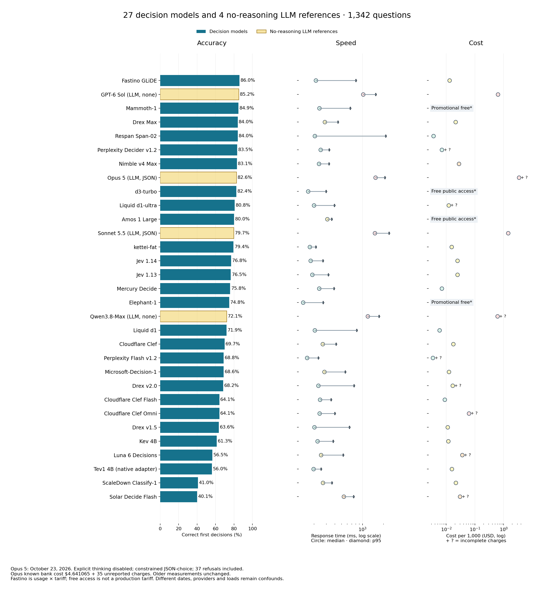
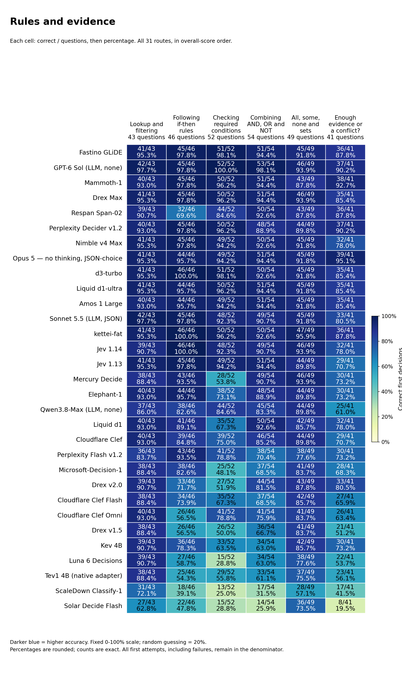
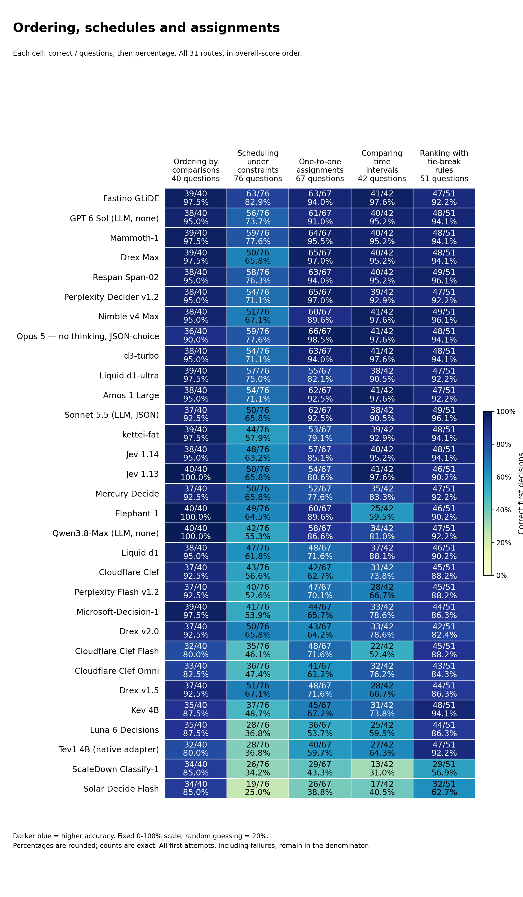
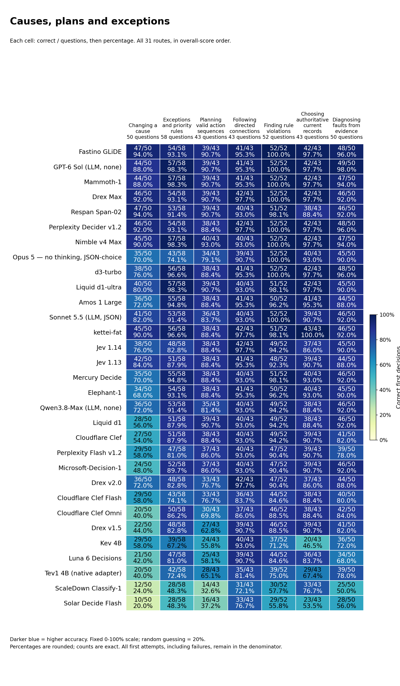
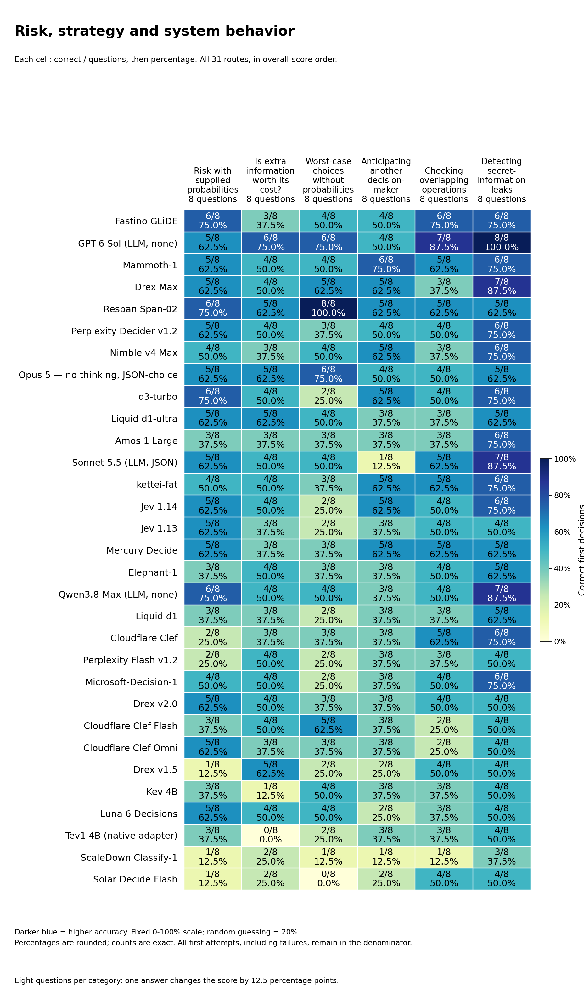

# System 1 Decision Benchmark

27 specialized decision models and 4 no-reasoning LLM references on the same **1,342 text questions across 31 categories**. Updated October 23, 2026.

**Fastino GLiDE remains highest at 1,154/1,342 (86.0%). Sol without reasoning scored1,143 (85.2%); the new Opus 5 no-thinking, JSON-choice reference scored1,109 (82.6%), above Sonnet’s 1,070 (79.7%).**

[Interactive report](https://etsabary.github.io/system-1-decision-benchmark/report.html) · [Opus findings](https://etsabary.github.io/system-1-decision-benchmark/report.html#new-additions) · [Named, color-coded categories](https://etsabary.github.io/system-1-decision-benchmark/report.html#functions).

## Results, speed and cost

Every row has 1,342 first attempts. Per-1,000 costs normalize actual bank totals. Pale-yellow bars are no-reasoning LLM references; blue bars are decision models. Opus and Sonnet use constrained JSON choice. + ? means missing charges; Opus has 35. ~ marks Fastino’s usage-based estimate, not monetary receipts.

| Model | Type | Correct / 1342 | Accuracy | Median | p95 | Cost / 1000 | Actual 1342 cost |
| --- | --- | --- | --- | --- | --- | --- | --- |
| Fastino GLiDE | Decision model | 1154/1342 | 86.0% | 213 ms 🟩 Fastest | 802 ms | ~$0.012960 | ~$0.017392 |
| GPT-6 Sol — no reasoning | LLM reference | 1143/1342 | 85.2% | 1023 ms 🟥 Slow | 1546 ms | $0.632112 | $0.848294 |
| Mammoth-1 | Decision model | 1139/1342 | 84.9% | 240 ms 🟩 Fastest | 666 ms | Promotional free access* | Promotional free access* |
| Drex Max | Decision model | 1127/1342 | 84.0% | 286 ms 🟨 Fast | 445 ms | $0.021180 | $0.028423 |
| Respan Span-02 | Decision model | 1127/1342 | 84.0% | 206 ms 🟩 Fastest | 2157 ms | $0.003537 | $0.004746 |
| Perplexity Decider v1.2 | Decision model | 1120/1342 | 83.5% | 249 ms 🟩 Fastest | 332 ms | $0.007000 + ? | $0.009394 + ? |
| Nimble v4 Max | Decision model | 1115/1342 | 83.1% | 235 ms 🟩 Fastest | 329 ms | $0.027633 | ~$0.037084 |
| Opus 5 — no thinking, JSON-choice | LLM reference | 1109/1342 | 82.6% | 1538 ms 🟥 Slow | 2109 ms | $3.458320 + ? | $4.641065 + ? |
| d3-turbo | Decision model | 1106/1342 | 82.4% | 165 ms 🟩 Fastest | 298 ms | Free public access* | Free public access* |
| Liquid d1-ultra | Decision model | 1084/1342 | 80.8% | 200 ms 🟩 Fastest | 393 ms | $0.012124 + ? | $0.016270 + ? |
| Amos 1 Large | Decision model | 1074/1342 | 80.0% | 311 ms 🟨 Fast | 360 ms | Free public access* | Free public access* |
| Sonnet 5.5 — no thinking, JSON-choice | LLM reference | 1070/1342 | 79.7% | 1506 ms 🟥 Slow | 2424 ms | $1.433613 | $1.923908 |
| kettei-fat | Decision model | 1066/1342 | 79.4% | 174 ms 🟩 Fastest | 214 ms | $0.015433 | $0.020711 |
| Jev 1.14 | Decision model | 1030/1342 | 76.8% | 179 ms 🟩 Fastest | 269 ms | $0.024571 | $0.032974 |
| Jev 1.13 | Decision model | 1026/1342 | 76.5% | 189 ms 🟩 Fastest | 323 ms | $0.024571 | $0.032974 |
| Mercury Decide | Decision model | 1017/1342 | 75.8% | 238 ms 🟩 Fastest | 388 ms | $0.006956 | $0.009334 |
| Elephant-1 | Decision model | 1004/1342 | 74.8% | 139 ms 🟩 Fastest | 272 ms | Promotional free access* | Promotional free access* |
| Qwen3.8-Max — none, Hyper Charm | LLM reference | 967/1342 | 72.1% | 1191 ms 🟥 Slow | 1731 ms | $0.614821 + ? | $0.825090 + ? quota |
| Liquid d1 | Decision model | 965/1342 | 71.9% | 206 ms 🟩 Fastest | 827 ms | $0.005773 | $0.007748 |
| Cloudflare Clef | Decision model | 936/1342 | 69.7% | 268 ms 🟨 Fast | 417 ms | $0.017594 | $0.023611 |
| Perplexity Decider Flash v1.2 | Decision model | 923/1342 | 68.8% | 159 ms 🟩 Fastest | 231 ms | $0.003406 + ? | $0.004570 + ? |
| Microsoft-Decision-1 | Decision model | 921/1342 | 68.6% | 283 ms 🟨 Fast | 566 ms | $0.012237 | $0.016422 |
| Drex v2.0 | Decision model | 915/1342 | 68.2% | 232 ms 🟩 Fastest | 755 ms | $0.016661 + ? | $0.022359 + ? |
| Cloudflare Clef Flash | Decision model | 860/1342 | 64.1% | 245 ms 🟩 Fastest | 353 ms | $0.008797 | $0.011806 |
| Cloudflare Clef Omni | Decision model | 860/1342 | 64.1% | 241 ms 🟩 Fastest | 400 ms | $0.061511 + ? | $0.082547 + ? |
| Drex v1.5 | Decision model | 853/1342 | 63.6% | 203 ms 🟩 Fastest | 649 ms | $0.011160 | $0.014976 |
| Kev 4B | Decision model | 822/1342 | 61.3% | 225 ms 🟩 Fastest | 377 ms | $0.011718 | $0.015725 |
| Luna 6 Decisions | Decision model | 758/1342 | 56.5% | 254 ms 🟨 Fast | 527 ms | $0.035840 + ? | $0.048097 + ? |
| Tev1 4B experimental (OpenRouter native adapter) | Decision model | 751/1342 | 56.0% | 198 ms 🟩 Fastest | 253 ms | $0.015657 | $0.021011 |
| ScaleDown Classify-1 | Decision model | 550/1342 | 41.0% | 268 ms 🟨 Fast | 362 ms | $0.021388 | $0.028703 |
| Solar Decide Flash | Decision model | 538/1342 | 40.1% | 540 ms 🟧 Moderate | 747 ms | $0.030203 + ? | $0.040532 + ? |

Free access is not a production tariff. Missing charges are unknown; Qwen is prepaid-quota valuation.

## Reading the speed and cost colors

The squares and labels use fixed descriptive bands, not relative ranks or statistical significance. Speed uses the full-bank first-attempt median. Cost uses known or accounted dollars per 1,000 questions, normalized from each actual 1,342-question run including permitted recoveries.

| Band | Median response time | Known/accounted cost per 1,000 |
|---|---|---|
| Green | 🟩 Fastest: ≤250 ms | 🟩 Lowest: ≤$0.010 |
| Yellow | 🟨 Fast: >250 to ≤500 ms | 🟨 Low: >$0.010 to ≤$0.025 |
| Orange | 🟧 Moderate: >500 to ≤1,000 ms | 🟧 Mid: >$0.025 to ≤$0.050 |
| Red | 🟥 Slow: >1,000 ms | 🟥 Highest: >$0.050 |
| Gray | ⬜ Unknown: unavailable | ⬜ Unknown: unavailable |

Bands use unrounded measurements; displayed numbers can round to a boundary. `+ ?` means additional charges were not reported. In those cells, the cost band describes only the known lower bound, not a complete cost or a guaranteed price advantage. The website also underlines these incomplete costs in amber. Text labels remain visible without color.

## Opus 5 without thinking scored 82.6%, below Sol and above Sonnet

Opus 5 answered1109/1342 correctly (82.6%), versus GPT-6 Sol without reasoning at 1143 (85.2%) and Sonnet 5.5 in constrained JSON-choice mode at 1070 (79.7%). Fastino GLiDE remains highest at 1154 (86.0%); Mammoth scored1139 (84.9%) and Span and Drex Max 1127 each (84.0%). These are observed results on the same developing bank, not a general intelligence ranking.

## Near-perfect unique assignments, with weaker exceptions and causal changes

Opus scored 66/67 on one-to-one assignments: giving every person or object exactly one partner while satisfying all clues. Sol scored 61/67, Fastino 63/67 and Drex Max 65/67. Opus scored 47/74 on truth-tellers and liars, versus Sol 38/74 and Fastino 59/74. It answered all 52 rule-violation questions correctly. On exceptions and priority rules, Opus scored 43/58 and Sol 57/58; on changing a cause while holding other inputs fixed, Opus scored35/50 and Sol 44/50. Ordered procedures remained18/48, the same as Sol and Fastino, versus Span 33/48.

## The larger LLM cost did not buy a higher overall System 1 score

Opus’s mean/median/p95 response was 1581/1538/2109 ms. Its API-reported bank cost was $4.641065 plus unreported charges for 35 responses, or at least $3.458320 per 1000 questions. Sol’s total was $0.84829450 and Sonnet’s $1.923908. The known Opus amount alone is 5.5 times Sol’s and 2.4 times Sonnet’s. Fastino’s separately labelled usage-based estimate was $0.01739196, with a 213 ms median. Different dates, providers and loads limit timing and price comparisons; missing charges are not zero.

## A constrained answer format, with 37 refusals retained as unsuccessful

The full Opus run used thinking.type=disabled, output_config.effort=high, no tools and a 16-token cap through OpenRouter’s pinned Anthropic standard route. All 1305 usable JSON choices explicitly reported zero thinking tokens and no thinking blocks. There were 37 refusals: two reported zero thinking tokens, while 35 omitted thinking/cost telemetry. All 37 remain unsuccessful first attempts in the 1342-question score. There were no retries or malformed JSON choices. A separate eight-question bare-ID trial produced five usable IDs, two malformed/explanatory outputs and one refusal; it is not pooled into this score. Constraining the answer grammar does not make this identical to unconstrained bare-ID delivery.

## The harder additions separate the references too

Opus scored1001/1136 (88.1%) on the original portion and108/206 (52.4%) on the additions. Across the six newest eight-question categories it scored 29/48, versus Sol 36/48, Span 34/48 and Fastino 29/48. The primary score remains one unweighted1342-question total. Existing questions, category weights and all 30 earlier model records are unchanged.

## Fastino has the highest observed text score, not the highest image score

Fastino GLiDE answered1154/1342 correctly (86.0%), ahead of GPT-6 Sol without reasoning at 1143 (85.2%), Mammoth-1 at 1139 (84.9%), and Span-02 and Drex Max at 1127 each (84.0%). The gaps are 11 and15 answers against Sol and Mammoth. These scores describe this developing bank and do not establish a reliable universal intelligence ordering. On the separate image bank, GLiDE scored158/200 (79.0%): second, one answer behind Amos at 159/200. Text and image percentages are not combined.

## A short response time and a metered price below the Sol reference

GLiDE’s mean / median / p95 text response was 343/213/802 ms. Sol’s median was 1023 ms: 4.8 times GLiDE’s measured median. GLiDE’s usage-based cost was $0.01739196 for the complete bank, or $0.01296 per 1000 questions; Sol’s API-reported total was $0.84829450, about 48.8 times as much. Span’s median was slightly shorter at 206 ms, and its recorded cost was lower at $0.00474628. GLiDE is not the cheapest or fastest entry. These are different dated routes, not controlled hardware measurements. Fastino cost is calculated from reported input tokens and the captured tariff, not a returned monetary receipt.

## Truth-tellers separate GLiDE from the nearby leaders

GLiDE scored 59/74 on truth-tellers and liars: deciding which assignments of truth and falsehood make all the supplied statements consistent. Span scored 55/74, Mammoth 48/74 and Sol 38/74. On exact truth counting—how many supplied claims are true—GLiDE scored 45/71, versus Span 46/71 and Sol 51/71. These are distinct operations: being better at assigning truth-tellers does not make GLiDE best at counting true claims.

## Strong rules and evidence, with a specific state-update weakness

GLiDE answered all 52 rule-counterexample questions correctly, 51/52 required-condition questions, 45/46 if-then questions and 41/42 interval comparisons. Required-condition questions ask whether every prerequisite holds; counterexamples ask which case breaks a stated rule. Its one-to-one assignments score was 63/67, versus Mammoth’s 64/67 and Drex Max’s 65/67. Ordered procedures remained18/48 (37.5%), the same as Mammoth and Sol and below Span’s 33/48. Those questions require applying each edit to the current state in order, not recognizing a plausible end state. Tracking swaps gave GLiDE 31/52.

## The new categories do not follow the overall ranking

Across the six eight-question categories covering risk, information value, worst-case choice, strategic response, concurrent operations and information leaks, GLiDE scored 29/48. Sol scored36/48, Span 34/48 and Mammoth 30/48. GLiDE scored3/8 on whether extra information is worth paying for, and 4/8 on worst-case choices without supplied probabilities; Span scored 8/8 on the latter. Each category has only eight questions, so one answer changes its score by 12.5 percentage points. The category profiles identify different useful routes rather than one uniformly best model.

## The harder additions remain harder for GLiDE

GLiDE scored1028/1136 (90.5%) on the original portion and126/206 (61.2%) on the additions. These are descriptive slices of the same unweighted1342-question score, not separate leaderboards. All existing questions, options, audits and category weights are unchanged. No older model was rerun or re-scored for this addition.

## The served version and image support were checked, not assumed

The request model is fastino/GLiDE. The authenticated live catalog described a one-pass GLiDE v2.2 deployment; every scored response identified glide_v2. This is a hosted alias, not an immutable-weight attestation, and it must not be labelled v1.2. The catalog image flag was false while the documentation described image parts; real single-image and three-image probes succeeded, followed by the full 200-image run. No OCR or captions replaced pixels. All 1542 scored calls returned usable typed decisions, with no retries, valid probability distributions, zero reported output tokens and not-stored retention headers. That telemetry does not independently reveal undisclosed internal computation.

## Earlier model profiles and price qualifications remain available

Mammoth remains the next-highest specialized text model at 1139/1342. Drex Max and Span tie at 1127, but Drex’s one-to-one assignments score is 65/67 and Span’s procedure score is 33/48. Elephant’s 1004/1342 remains below Jev 1.14’s 1030/1342. Baseten’s captured promotional free access and Amos/d3 public-free access are not API-reported metered prices of zero. The 29 earlier model records and their dated release seals are preserved exactly; their tests were not repeated to create this update.

## Category scores and explanations

The 31 categories are grouped below so the labels and values remain readable. These are reading groups, not new scored categories. All 31 routes remain in overall-score order. Every cell shows **correct / questions and percentage**. Darker blue means higher accuracy on a fixed 0-100% scale; uniform random guessing averages 20%. Different category sizes mean that percentages alone do not show how much evidence is available.

[Open the color-coded, selectable tables](https://etsabary.github.io/system-1-decision-benchmark/report.html#functions), with a pinned model-name column and individual category rankings.

### Rules and evidence

Which facts meet a rule, which conclusions follow, and when is the evidence insufficient?

| Category | Questions | What it tests and a simple example |
| --- | --- | --- |
| Lookup and filtering (F01) | 43 | Select records that meet stated conditions Example: Which listed request is both signed and marked urgent? |
| Following if-then rules (F02) | 46 | Apply an implication from its trigger Example: If an active badge grants entry and this badge is active, what follows? |
| Checking required conditions (F03) | 52 | Reason backward from a missing required condition Example: Every approved request needs a valid ticket; can one without a ticket be approved? |
| Combining AND, OR and NOT (F04) | 54 | Track combinations such as both, either and exactly one Example: Which choice satisfies exactly one of two stated conditions? |
| All, some, none and sets (F05) | 49 | Track all, some, none and overlapping groups Example: All teal tokens are marked; no marked token is blank; which relation follows? |
| Enough evidence or a conflict? (F11) | 41 | Determine whether facts force an answer or contradict one another Example: Is a proposed arrangement determined, impossible or still underdetermined? |

[Full-size SVG](results/releases/opus5_reference_2026-10-23/rules.svg) · [Color-coded table and category rankings](https://etsabary.github.io/system-1-decision-benchmark/report.html#group-rules)

### Ordering, schedules and assignments

Can the model combine comparisons, fit a schedule, assign unique partners and apply tie-break rules?

| Category | Questions | What it tests and a simple example |
| --- | --- | --- |
| Ordering by comparisons (F06) | 40 | Combine ordered comparisons Example: A is taller than B and B than C; how do A and C compare? |
| Scheduling under constraints (F07) | 76 | Fit events around order and exclusion rules Example: Which timetable puts one meeting before another without overlapping a break? |
| One-to-one assignments (F08) | 67 | Give each item a unique partner while satisfying clues Example: Assign three people different desks using location restrictions. |
| Comparing time intervals (F14) | 42 | Compare starts, ends and overlapping periods Example: Which interval overlaps a specified event without containing it? |
| Ranking with tie-break rules (F22) | 51 | Rank candidates using explicit tie-break rules Example: Rank by priority first, then age when priorities tie. |

[Full-size SVG](results/releases/opus5_reference_2026-10-23/ordering.svg) · [Color-coded table and category rankings](https://etsabary.github.io/system-1-decision-benchmark/report.html#group-ordering)

### Claims, changing state and perspectives

Can the model count true statements, update a changing situation and separate what different observers know?

| Category | Questions | What it tests and a simple example |
| --- | --- | --- |
| Counting exactly true claims (F09) | 71 | Count precisely how many statements hold Example: Under the supplied facts, how many of six claims are true? |
| Truth-tellers and liars (F10) | 74 | Find a consistent pattern of truthful and false statements Example: Which assignment of honest and dishonest speakers fits their claims? |
| Tracking swaps (F12) | 52 | Update locations after repeated exchanges Example: A red token starts in box A; several box contents are swapped; where does it end? |
| Following step-by-step procedures (F13) | 48 | Apply each ordered edit to the current state Example: Toggle one flag, swap two values, then conditionally reset another flag. |
| Tracking position and direction (F15) | 49 | Update position or direction from described movement Example: Follow successive turns and moves, then identify the final direction. |
| Resolving names and references (F16) | 50 | Resolve chains of names, roles and references Example: Identify the mentor of the colleague named in a nested description. |
| Tracking what others know (F17) | 50 | Distinguish what different observers witnessed Example: An object moves while one observer is absent; where will that observer look? |

[Full-size SVG](results/releases/opus5_reference_2026-10-23/state.svg) · [Color-coded table and category rankings](https://etsabary.github.io/system-1-decision-benchmark/report.html#group-state)

### Causes, plans and exceptions

Which actions work, which consequences change, and which rule or source controls when information conflicts?

| Category | Questions | What it tests and a simple example |
| --- | --- | --- |
| Changing a cause (F18) | 50 | Recompute consequences of changing a specified input Example: Force a switch off while holding other inputs fixed; which lamp now lights? |
| Exceptions and priority rules (F19) | 58 | Apply a rule, its exception and stated precedence Example: A badge permits entry unless a higher-priority suspension applies. |
| Planning valid action sequences (F20) | 43 | Choose an action sequence whose requirements are met Example: Obtain a key before opening a locked door, with limited moves available. |
| Following directed connections (F21) | 43 | Follow arrows in their permitted direction Example: Can node A reach node D through the listed directed links? |
| Finding rule violations (F23) | 52 | Find a case that violates a stated rule Example: Which listed record disproves the claim that every approved item is signed? |
| Choosing authoritative current records (F24) | 43 | Select the valid source rather than an outdated conflicting one Example: Two records disagree; which controls under the stated authority and date policy? |
| Diagnosing faults from evidence (F25) | 50 | Match observed symptoms to explicit fault rules Example: Which fault is consistent with the supplied test results? |

[Full-size SVG](results/releases/opus5_reference_2026-10-23/causes.svg) · [Color-coded table and category rankings](https://etsabary.github.io/system-1-decision-benchmark/report.html#group-causes)

### Risk, strategy and system behavior

These decisions involve uncertain outcomes, another actor, overlapping operations or possible information leaks.

**Worst-case choices without probabilities** means choosing under a specified worst-case loss or regret rule when the likelihoods of possible situations are not supplied. There is no probability distribution to average over. Each of these six categories has eight questions, so one answer changes its score by 12.5 percentage points.

| Category | Questions | What it tests and a simple example |
| --- | --- | --- |
| Risk with supplied probabilities (F26) | 8 | Choose the action with the lowest probability-weighted cost, using the supplied likelihoods and costs. Example: Which action minimizes the expected cost of a possible delay? |
| Is extra information worth its cost? (F27) | 8 | Decide whether paying for a test before choosing an action reduces the probability-weighted cost enough to cover the test price. Example: Should you buy a sensor reading before choosing an action, or is acting without the extra information cheaper overall? |
| Worst-case choices without probabilities (F28) | 8 | Follow the stated worst-case rule when likelihoods are not supplied. Minimize either the largest possible loss or the largest regret (extra loss compared with the best action for each situation), as the question specifies. Do not invent probabilities. Example: A route costs 4 in either situation; another costs 1 or 9. With no probabilities and a smallest-worst-case-cost rule, which route should be chosen? |
| Anticipating another decision-maker (F29) | 8 | Choose an action while accounting for the specified choices or payoff-maximizing response of another decision-maker. Example: Which first move gives the best result after the other player chooses their own best reply? |
| Checking overlapping operations (F30) | 8 | Decide whether overlapping operations and their reported results can fit a permitted one-at-a-time order that respects the specified timing and object rules. Example: Two processes read and change the same stored value. Could their reported results fit an allowed one-at-a-time order? |
| Detecting secret-information leaks (F31) | 8 | Check whether changing a protected secret can change an observable result in a way the stated policy forbids. Example: If public inputs stay the same, could public output distinguish two secret values that the policy says must remain indistinguishable? |

[Full-size SVG](results/releases/opus5_reference_2026-10-23/uncertainty.svg) · [Color-coded table and category rankings](https://etsabary.github.io/system-1-decision-benchmark/report.html#group-uncertainty)

Counts are exact; displayed percentages are rounded. A perfect result on a small sample is not a reliability guarantee. [Download the full category matrix](results/releases/opus5_reference_2026-10-23/category_scores.csv).

## Questions, exports and verification

Unchanged answer-free bank: [CSV](results/releases/consolidated_2026-10-19/questions_1342.csv), [native JSONL](results/releases/consolidated_2026-10-19/questions_1342.jsonl), [readable text](results/releases/consolidated_2026-10-19/questions_1342.txt).

Current exports: [aggregate JSON](results/releases/opus5_reference_2026-10-23/statistics.json), [model CSV](results/releases/opus5_reference_2026-10-23/model_statistics.csv), [category CSV](results/releases/opus5_reference_2026-10-23/category_scores.csv), [audit](results/releases/opus5_reference_2026-10-23/audit_receipt.json).

31 full-bank routes: 27 specialized decision models and four selected no-reasoning LLM references. Each covers 1342 questions across 31 categories: 41,602 first attempts. Opus was measured October 23, 2026 (America/Toronto); all 30 earlier model records retain their original measurements and dates.

Opus used two requests per barrier wave, a 16-token output cap, explicit disabled thinking at high effort, no tools, the same frozen question/option order and numeric-only suffix, and an additional JSON-choice output grammar. The dated Anthropic standard endpoint was pinned with no provider fallback. All first attempts, including 37 refusals, stay in accuracy and latency denominators. No retries occurred. The mean, median and p95 pool all 1342 original response times, not category medians.

Opus API-reported cost totals $4.641065 for 1307 receipts; 35 refusal charges are unreported. Its separate successful synthetic probes total $0.002610; the disabled-thinking+xhigh negative control was rejected with HTTP400 and omitted cost telemetry. The separate eight-case bare-ID trial cost $0.019325 reported plus one unreported charge. These probes and the stopped trial are not pooled into the ranked bank. The positive high-effort probe returned zero thinking tokens; the negative control confirmed that xhigh is incompatible with disabled thinking on the tested route.

All 1305 usable Opus choices reported zero thinking tokens and no thinking blocks; 35 refusals omitted telemetry and are unverified, not verified zeros. Sonnet and Opus use separately labelled constrained JSON choice; Sol uses the bare-ID contract. These are selected references, not an exhaustive ranking of the strongest LLMs or a comparison with reasoning enabled.

Same frozen answer-free question bank, original options, native input and seed 2026101906. Every first attempt remains in the accuracy and latency denominator. One recovery is permitted only for transport failures or HTTP 408/429/5xx; Fastino additionally prespecified the documented HTTP 425 warming condition. No recovery was needed. No answer-dependent retries, batching of independent cases or provider fallback.

Fastino used two text requests per barrier wave and serial image requests. The text and image streams overlapped, with up to three Fastino calls globally. Timing starts before a fresh HTTPS connection and ends after the complete response body; encoding, queue, pacing and retry waits are excluded. The predeclared cumulative median cutoff is above 2000 ms after at least 20 questions. Provider hardware, load, dates and account limits remain confounds; these are observed route response times, not isolated inference throughput.

Fastino returned no monetary receipts. Its $0.04 per million input-token and $0 output tariff was captured from the authenticated catalog and documentation. Core text cost is $0.01739196; its separate text admission probe cost $0.00000364. Image core cost is $0.00767264 and two image probes cost $0.00010484. The combined usage-based cost including all probes was $0.02517308. Per-1000 values normalize actual bank totals; no extra 1000-question runs were made. Earlier missing charges remain unknown, not zero.

Native Fastino requests used store:false; all scored receipts reported not-stored retention. The response identity glide_v2 and catalog v2.2 description are recorded. Internal execution and immutable weights are not independently attested. LLM references retain their original protocol labels: Sol explicit reasoning off, Sonnet constrained JSON choice after a separate failed bare-ID trial, and Qwen none with missing reasoning-token telemetry not called zero.

This is a developing benchmark with uneven category sizes and dependent variants, not 1342 independent observations or a pristine held-out evaluation. The 37 permanent author-development exclusions retain their separate 1305-case diagnostic. Two audited ambiguous originals were replaced before these runs. The additions retain their verification evidence; the original bank received a targeted difficult-item audit rather than independent external verification of every original answer.

Answer keys, per-item correctness, raw account state and credentials stay outside public exports. Private frozen-key scoring, input reconstruction, full-ledger reconciliation, quantiles and exact-decimal cost sums were checked before publication. Public aggregate checks cannot independently reproduce answer correctness without the external reference key. Text and image banks remain separate.

Implementation: [scripts/](scripts/README.md). Current checks: `python3 scripts/validate_opus5_release.py`; prior checks: `python3 scripts/validate_fastino_2026_10_23.py` and `python3 scripts/validate_october21_release.py`. Older dated evidence and seals remain unchanged.
