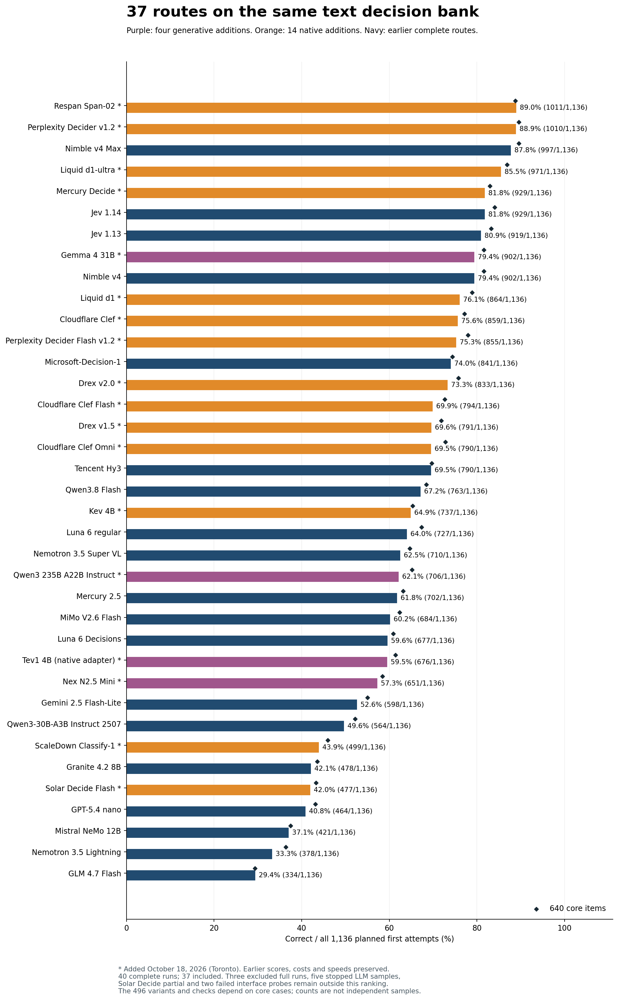
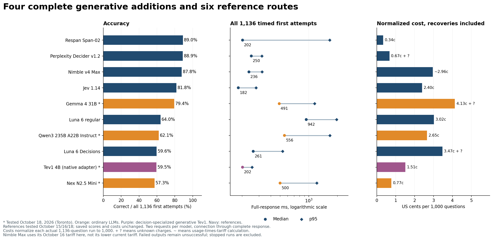
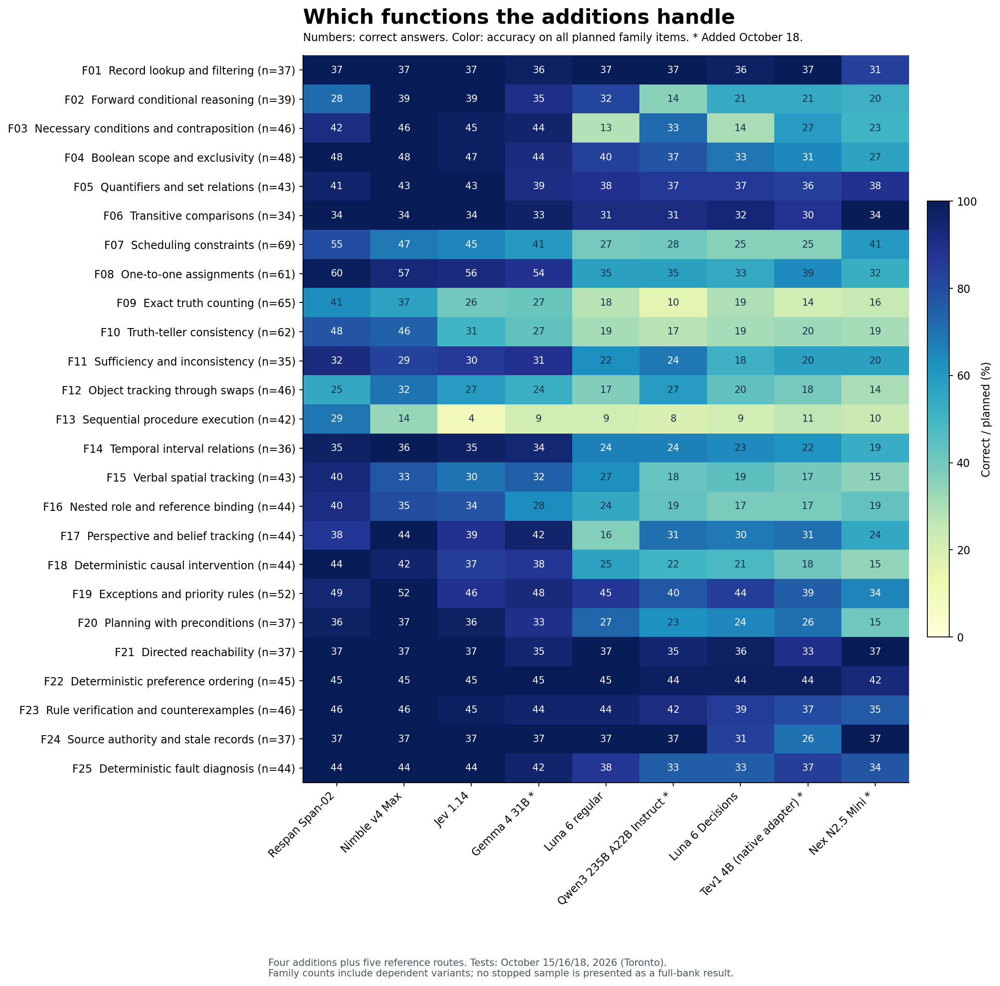

# 37 models on the same 1136 text decisions

I started this benchmark because Jev interested me, but I could not place its intelligence relative to the LLMs I use. Could a service that returns a typed decision rather than a paragraph make better quick decisions than Luna? On this bank, Jev was substantially stronger. Expanding the comparison has since found models that exceed Jev, and a regular LLM that comes close.

**Respan Span-02 scored 1,011/1,136 (89.0%), Perplexity Decider v1.2 scored 1,010 (88.9%), and Nimble Max scored 997 (87.8%).** Jev 1.14 scored 929 (81.8%), Jev 1.13 scored 919 (80.9%), regular Luna scored 727 (64.0%) and Luna Decisions scored 677 (59.6%). The strongest regular LLM under the same short-output contract is now **Gemma 4 31B: 902/1,136 (79.4%)**.

These are **System 1-style decisions**: one answer from supplied information, without an explicit thinking budget, tools or an agentic feedback loop. They matter for systems routing many requests under time and cost constraints. This does not compare unrestricted reasoning, writing or agentic ability.

**Updated October 18, 2026.** The main comparison contains **37 complete routes × 1,136 questions = 42,032 model-question cases**. There are 40 complete runs in the saved record, or 45,440 cases; three output-noncompliant runs remain outside the ranking. The October 18 release adds 14 complete native-decision routes, three regular LLMs and the decision-specialized generative Tev1. Five stopped LLM samples, the stopped Solar Decide sample and two failed interface probes are separate diagnostics, not additional full-bank results. The previous release ranked 19 models from 22 complete runs (24,992 model-question cases); those saved results, costs and response times are unchanged.

The bank has **640 core questions plus 496 related variants, contrasts and candidate checks across 25 families**. Related items are not independent observations. The [function tables and examples](FUNCTIONS.md) explain the abilities. The [image benchmark](https://github.com/etsabary/visual-decision-benchmark) remains separate. A harder future bank is also a separate project; no new questions enter this release.



## Full bank results with cost and speed scales

Every score uses the first attempt on all 1,136 questions. Failed requests, refusals, invalid output and truncations remain unsuccessful. Median and p95 include **all 1,136 timed first attempts**, including failures. p95 is the response time at or below which roughly 95% of requests completed. A lower median can coexist with a long slow tail.

The labels use fixed descriptive bands for this workload, not universal definitions. Speed: 🟩 Fastest ≤250 ms; 🟨 Fast >250 to 500 ms; 🟧 Moderate >500 to 1,000 ms; 🟥 Slow >1,000 ms. Cost per 1,000: 🟩 Lowest ≤$0.01; 🟨 Low >$0.01 to $0.025; 🟧 Mid >$0.025 to $0.05; 🟥 Highest >$0.05. Both the label and the numerical value remain visible, so color is not required to read the comparison.

Costs per 1,000 normalize the actual 1,136-question run, including eligible recoveries: run cost ÷ 1,136 × 1,000. **`+ ?` means some charges are unknown**, so that color band describes the known lower bound and may understate the final cost. `~` marks token usage multiplied by a captured published tariff instead of a returned dollar charge. Dates are Toronto dates. * marks an October 18 addition.

| Model | Correct / 1,136 | Accuracy | Core correct | Median | p95 | Cost per 1,000 | Test date |
| --- | --- | --- | --- | --- | --- | --- | --- |
| Respan Span-02 * | 1011 | 89.0% | 568/640 | 202 ms 🟩 Fastest | 1661 ms | $0.00338 🟩 Lowest | 2026-10-18 |
| Perplexity Decider v1.2 * | 1010 | 88.9% | 573/640 | 250 ms 🟩 Fastest | 323 ms | $0.00672 🟩 Lowest + ? | 2026-10-18 |
| Nimble v4 Max | 997 | 87.8% | 573/640 | 236 ms 🟩 Fastest | 324 ms | ~$0.02963 🟧 Mid | 2026-10-16 |
| Liquid d1-ultra * | 971 | 85.5% | 556/640 | 196 ms 🟩 Fastest | 261 ms | $0.01157 🟨 Low + ? | 2026-10-18 |
| Jev 1.14 | 929 | 81.8% | 538/640 | 182 ms 🟩 Fastest | 280 ms | $0.02397 🟨 Low | 2026-10-15 |
| Mercury Decide * | 929 | 81.8% | 531/640 | 240 ms 🟩 Fastest | 387 ms | $0.00670 🟩 Lowest | 2026-10-18 |
| Jev 1.13 | 919 | 80.9% | 533/640 | 197 ms 🟩 Fastest | 340 ms | $0.02397 🟨 Low | 2026-10-15 |
| Nimble v4 | 902 | 79.4% | 522/640 | 214 ms 🟩 Fastest | 260 ms | ~$0.01317 🟨 Low | 2026-10-16 |
| Gemma 4 31B * | 902 | 79.4% | 522/640 | 491 ms 🟨 Fast | 1154 ms | $0.04131 🟧 Mid + ? | 2026-10-18 |
| Liquid d1 * | 864 | 76.1% | 505/640 | 215 ms 🟩 Fastest | 894 ms | $0.00551 🟩 Lowest | 2026-10-18 |
| Cloudflare Clef * | 859 | 75.6% | 494/640 | 283 ms 🟨 Fast | 415 ms | $0.01704 🟨 Low | 2026-10-18 |
| Perplexity Decider Flash v1.2 * | 855 | 75.3% | 499/640 | 161 ms 🟩 Fastest | 236 ms | $0.00327 🟩 Lowest + ? | 2026-10-18 |
| Microsoft-Decision-1 | 841 | 74.0% | 476/640 | 288 ms 🟨 Fast | 574 ms | $0.01169 🟨 Low | 2026-10-16 |
| Drex v2.0 * | 833 | 73.3% | 485/640 | 232 ms 🟩 Fastest | 724 ms | $0.01588 🟨 Low + ? | 2026-10-18 |
| Cloudflare Clef Flash * | 794 | 69.9% | 465/640 | 262 ms 🟨 Fast | 353 ms | $0.00852 🟩 Lowest | 2026-10-18 |
| Drex v1.5 * | 791 | 69.6% | 460/640 | 197 ms 🟩 Fastest | 601 ms | $0.01061 🟨 Low | 2026-10-18 |
| Tencent Hy3 | 790 | 69.5% | 446/640 | 1423 ms 🟥 Slow | 1926 ms | $0.02442 🟨 Low + ? | 2026-10-16 |
| Cloudflare Clef Omni * | 790 | 69.5% | 466/640 | 248 ms 🟩 Fastest | 415 ms | $0.05945 🟥 Highest + ? | 2026-10-18 |
| Qwen3.8 Flash | 763 | 67.2% | 438/640 | 862 ms 🟧 Moderate | 5717 ms | $0.04404 🟧 Mid + ? | 2026-10-16 |
| Kev 4B * | 737 | 64.9% | 418/640 | 228 ms 🟩 Fastest | 371 ms | $0.01114 🟨 Low | 2026-10-18 |
| Luna 6 regular | 727 | 64.0% | 431/640 | 942 ms 🟧 Moderate | 1961 ms | $0.03021 🟧 Mid | 2026-10-15 |
| Nemotron 3.5 Super VL | 710 | 62.5% | 414/640 | 465 ms 🟨 Fast | 835 ms | $0.02977 🟧 Mid + ? | 2026-10-16 |
| Qwen3 235B A22B Instruct 2507 * | 706 | 62.1% | 417/640 | 556 ms 🟧 Moderate | 1667 ms | $0.02653 🟧 Mid | 2026-10-18 |
| Mercury 2.5 | 702 | 61.8% | 404/640 | 534 ms 🟧 Moderate | 1077 ms | $0.01163 🟨 Low | 2026-10-15 |
| MiMo V2.6 Flash | 684 | 60.2% | 399/640 | 1429 ms 🟥 Slow | 6032 ms | $0.03796 🟧 Mid + ? | 2026-10-16 |
| Luna 6 Decisions | 677 | 59.6% | 390/640 | 261 ms 🟨 Fast | 533 ms | $0.03470 🟧 Mid + ? | 2026-10-15 |
| Tev1 4B experimental (OpenRouter native adapter) * | 676 | 59.5% | 393/640 | 202 ms 🟩 Fastest | 254 ms | $0.01510 🟨 Low | 2026-10-18 |
| Nex N2.5 Mini * | 651 | 57.3% | 374/640 | 500 ms 🟧 Moderate | 1215 ms | $0.00770 🟩 Lowest | 2026-10-18 |
| Gemini 2.5 Flash-Lite | 598 | 52.6% | 352/640 | 341 ms 🟨 Fast | 523 ms | $0.02834 🟧 Mid | 2026-10-15 |
| Qwen3-30B-A3B Instruct 2507 | 564 | 49.6% | 334/640 | 1034 ms 🟥 Slow | 1823 ms | $0.02573 🟧 Mid | 2026-10-15 |
| ScaleDown Classify-1 * | 499 | 43.9% | 294/640 | 268 ms 🟨 Fast | 354 ms | $0.02066 🟨 Low | 2026-10-18 |
| Granite 4.2 8B | 478 | 42.1% | 279/640 | 324 ms 🟨 Fast | 866 ms | $0.01369 🟨 Low + ? | 2026-10-15 |
| Solar Decide Flash * | 477 | 42.0% | 277/640 | 542 ms 🟧 Moderate | 738 ms | $0.02952 🟧 Mid + ? | 2026-10-18 |
| GPT-5.4 nano | 464 | 40.8% | 276/640 | 683 ms 🟧 Moderate | 1136 ms | $0.06166 🟥 Highest | 2026-10-15 |
| Mistral NeMo 12B | 421 | 37.1% | 240/640 | 490 ms 🟨 Fast | 1523 ms | $0.00813 🟩 Lowest + ? | 2026-10-15 |
| Nemotron 3.5 Lightning | 378 | 33.3% | 233/640 | 280 ms 🟨 Fast | 533 ms | $0.02046 🟨 Low + ? | 2026-10-16 |
| GLM 4.7 Flash | 334 | 29.4% | 188/640 | 560 ms 🟧 Moderate | 17056 ms | $0.01766 🟨 Low + ? | 2026-10-16 |

The 37 included runs account for **$0.89907359** in known charges or tariff calculations, with **352 attempt charges unreported**. These are not independently reconciled invoices. Compatibility calls and stopped samples are excluded from ranked-run totals. Promotions and later tariff changes are not applied retroactively.

Within that ranked-run total, the 14 complete October 18 native-decision additions reported **$0.238535627**, with **118 attempt charges unknown**. The **15 native-route compatibility calls**, including the stopped route's probe, reported **$0.00018676** separately, with **0 unknown charges**. The stopped native Solar sample is accounted for separately below; it is not part of the 14 full runs.

Nimble Max's saved cost uses its October 16 tariff of $0.09 per million input tokens. Its [documented tariff checked October 18](https://docs.bespokelabs.ai/nimble/pricing.md) is $0.04. At that price, the saved 373,997 input tokens would cost $0.01495988 for 1,136 questions, or $0.013169 per 1,000. This is a price-only calculation, not a new run. The deprecated `nimble-v4` name now redirects to Max: its dated row does not imply a separate current checkpoint.

## Span-02 and Perplexity Decider exceed the previous full-bank leader

Respan Span-02 scored **1,011/1,136 (89.0%)**, and Perplexity Decider v1.2 scored **1,010/1,136 (88.9%)**. Nimble Max's previous result was 997/1,136 (87.8%). These are gains of 14 and 13 correct answers. The new results improve the full-bank total, but the core-only comparison is different: Perplexity and Nimble Max both scored 573/640 (89.5%); Span-02 scored 568/640 (88.8%). Span's higher total comes from the related variants and checks, rather than a higher score on the underlying core questions.

The one-answer difference between Span and Perplexity is not a useful basis for declaring one generally smarter. Span was correct on 71 questions that Perplexity missed, while Perplexity was correct on 70 that Span missed. One Perplexity first attempt failed at the transport level; its permitted recovery was correct and brought its eventual score to 1,011. The primary ranking retains 1,010. The family profiles, cost and response-time tails explain more than the one-answer ordering.

Span's median was **202 ms**, with **$0.00384482** reported for the full bank, or **$0.00338 per 1,000 questions**. Every first answer was usable. Perplexity's median was **250 ms**, with **$0.00763898** reported for its run and one unreported transport charge. Perplexity had the more predictable slow tail: **323 ms p95**, compared with Span's **1,661 ms**. A fast median does not mean every request is fast.

## Span improves procedures but loses some simpler rules

Span scored **29/42 on sequential procedures**, compared with Nimble Max's 14/42, Perplexity's 11/42 and Jev 1.14's 4/42. These questions require updating a state after each operation, such as swapping two registers, testing the updated value and then overwriting another register. Span also improved scheduling to 55/69, one-to-one assignments to 60/61, and verbal spatial tracking to 40/43. One-to-one assignments require giving every person or item a unique partner while respecting interacting clues. Spatial tracking requires maintaining position and heading through described turns and moves.

The procedure gain is substantial on this bank, but 29/42 still leaves 13 wrong answers. Exact truth counting was only 41/65, and repeated swaps were 25/46. Span also scored **28/39 on forward conditional rules**, where both Perplexity and Nimble Max scored 39/39. Belief tracking was 38/44, versus their 44/44. These are concrete reasons to test the caller's own rule types rather than choose a route solely by its overall score.

Perplexity was stronger on those direct implications, necessary conditions, temporal intervals and belief tracking. It also reached 60/61 on one-to-one assignments, 53/69 on scheduling and 33/35 on sufficiency and inconsistency. Its **11/42 procedure score** and **39/65 truth-counting score** leave those functions unreliable. The overall result does not support unattended execution of multi-step instructions.

## Liquid d1-ultra improves on Jev with a similar median

Liquid d1-ultra scored **971/1,136 (85.5%)**, 42 more correct answers than Jev 1.14. Its core score was 556/640 (86.9%), versus Jev's 538/640 (84.1%). Its **196 ms median** was close to Jev's 182 ms, and its **261 ms p95** was slightly below Jev's 280 ms. It reported **$0.01314377** for the full run, with one unknown transport charge, compared with Jev's $0.02723011.

d1-ultra was perfect on the sampled necessary conditions, Boolean scope, exceptions, planning, reachability, preference ordering, rule verification, source authority and fault diagnosis. Its weak areas included procedures (8/42), repeated swaps (25/46) and truth-teller consistency (38/62). The smaller d1 scored 864/1,136 (76.1%), with a 215 ms median and $0.00625894 reported cost. Both versions offer useful price and quality comparisons, but neither matched the leading full-bank scores.

## Mercury Decide matches Jev's total with a different pattern

Mercury Decide scored **929/1,136 (81.8%)**, exactly Jev 1.14's total. Its core score was slightly lower, at 531/640 versus Jev's 538/640. Its **240 ms median** was slower than Jev's 182 ms, while its **$0.00760874 reported run cost** was about 28% of Jev's captured run cost. All 1,136 first answers were usable. The captured Mercury Decide price was promotional.

The tied total conceals different strengths. Mercury scored 33/46 on repeated swaps, 42/44 on belief tracking and 51/52 on priority rules, versus Jev's 27/46, 39/44 and 46/52. Necessary conditions were much weaker at 26/46 versus Jev's 45/46. Procedures were only 10/42. It is a plausible lower-cost route for some of the tested functions, not an interchangeable copy of Jev.

Mercury Decide is also distinct from the previously tested regular Mercury 2.5, which scored 702/1,136 (61.8%) with a 534 ms median and $0.01321493 reported cost. The native decision route performed substantially better on this contract. These are different hosted configurations tested on different dates, rather than an experiment isolating the effect of a decision head.

## Native decision output does not by itself establish high accuracy

Clef scored 859/1,136 (75.6%), Clef Flash 794 (69.9%) and Clef Omni 790 (69.5%). Their medians were all below 300 ms. Omni's $0.06753705 reported text-run cost was the highest among the completed new native routes, without a text-accuracy gain over the cheaper Clef routes. Its listed non-text capabilities were not tested here.

Drex v2.0 scored 833/1,136 (73.3%), with a 232 ms median. It encountered 31 first-attempt HTTP 429 provider failures. The earlier v1.5 scored 791 (69.6%), with a 197 ms median and no failed first response. Kev 4B scored 737 (64.9%), near regular Luna's 727, but with a much shorter median: 228 ms versus 942 ms. Kev's core result was lower than Luna's, at 418/640 versus 431/640. These are hosted-route measurements, not local-hardware speed estimates.

Classify-1 scored **499/1,136 (43.9%)**, and Solar Decide Flash scored **477 (42.0%)**. Their low scores mostly reflect wrong valid choices, not explanatory output. The stopped, slower Solar Decide route is a separate configuration and has only a partial diagnostic below. These results show why direct decision output, model size and a low per-token tariff are insufficient selection criteria.

Perplexity Flash scored 855/1,136 (75.3%), including 50 first-attempt token-rate-limit failures. Among its 1,086 usable first answers, 855 were correct (78.7%). Its 161 ms median includes the failed requests. The higher conditional percentage is diagnostic only; it does not replace the full-denominator score.

## Gemma is the strongest regular LLM tested under this contract

Gemma 4 31B scored **902/1,136 (79.4%)**, 175 more correct answers than regular Luna and 225 more than Luna Decisions. It finished 27 questions behind Jev 1.14. Its core-only result was 522/640 (81.6%), compared with Jev's 538/640 and regular Luna's 431/640. The same 902 total as the saved Nimble v4 result does not imply that they answer the same questions correctly.

Its **491 ms median** was shorter than regular Luna's 942 ms, but longer than Jev's 182 ms or Nimble Max's 236 ms. Known full-run cost was **$0.04693176**, above regular Luna's $0.03431990. Forty attempt charges were unreported. Gemma had 47 model-output failures (4.1%) and 28 first-attempt provider failures. It stays below the agreed 5% output-failure cutoff, but all 75 unsuccessful first attempts remain in the score. Recovery improved its eventual result to 915; the ranking retains 902.

Gemma was strong on necessary conditions and contraposition (44/46), one-to-one assignments (54/61), belief tracking (42/44), priority rules (48/52) and causal intervention (38/44). Belief tracking asks whose knowledge changes after an event, given what each person witnessed. Causal intervention changes a variable by instruction and asks which downstream effects follow; it is not merely observing that variable. Gemma exceeded Jev on these sampled belief, priority and causal questions, despite scoring lower overall.

Its weaknesses remained substantial: scheduling 41/69, exact truth counting 27/65, truth-teller consistency 27/62, swaps 24/46 and procedures 9/42. A model that can handle many implications can still fail when it must maintain an updated state or make several constraints hold simultaneously.

## Qwen is near regular Mercury and Nex is a cheaper lower scoring option

Qwen3 235B A22B Instruct 2507 scored **706/1,136 (62.1%)**, with all first answers usable, a **556 ms median**, a 1,667 ms p95 and **$0.03013258** reported cost. It scored 142 questions above the smaller Qwen3-30B-A3B Instruct 2507 configuration, but only four above regular Mercury 2.5. Mercury's saved median was 534 ms and its cost $0.01321493 at the captured promotional price. A larger hosted model did not produce a substantial aggregate gain over that cheaper alternative.

Qwen scored 37/37 on lookup and source authority, 44/45 on preference ordering and 42/46 on counterexamples. It was much weaker on forward conditionals (14/39), exact truth counting (10/65), procedures (8/42) and causal intervention (22/44). Its swap score of 27/46 matched Jev 1.14 and exceeded Span's 25/46, without making either result dependable.

Nex N2.5 Mini scored **651/1,136 (57.3%)**, with all first answers usable, a **500 ms median**, a 1,215 ms p95 and **$0.008746245** reported cost. It was the cheapest completed new regular LLM, but did not improve on regular Luna, Luna Decisions or the leading native routes. Its better families included transitive comparisons (34/34), reachability (37/37), source authority (37/37) and set relations (38/43). Belief tracking was 24/44, causal intervention 15/44, swaps 14/46 and procedures 10/42. Span's native route was cheaper and more accurate overall in these captured runs.

## Tev is a small generative decision model with a different interface

Tev1 4B experimental scored **676/1,136 (59.5%)**, one fewer correct answer than Luna Decisions, with all first answers usable. Its **202 ms median**, **254 ms p95** and **$0.01714902** reported full-run cost offer a useful speed and cost comparison with Luna Decisions' 261 ms, 533 ms and $0.03941610, respectively. Luna's total also has 61 unreported attempt charges. These close accuracy counts are descriptive results, not proof of statistical equivalence.

Tev scored 37/37 on lookup, 44/45 on preference ordering and 37/44 on fault diagnosis. Necessary conditions were 27/46, scheduling 25/69, swaps 18/46 and procedures 11/42. It did not approach the leading overall accuracy scores.

Tev's [documented architecture](https://huggingface.co/togethercomputer/Tev1-4B-experimental) generates an option through a language-model head. OpenRouter rejected its chat/completions call with HTTP 400 and required the native decisions endpoint. The complete run therefore uses a **decision-specialized generative model through OpenRouter's native adapter**, not a claimed non-generative architecture. The failed chat probe is preserved separately; it is not scored as an incorrect decision.



## Output compliance and the stopped LLM samples

The existing main-table rule excludes complete runs with at least 5% model-output failures. That author-requested, post-hoc rule still excludes the earlier Haiku, DeepSeek and Phi-4 runs; their [complete diagnostics](OUTPUT_COMPLIANCE.md) are preserved. Provider failures are counted separately and do not count toward the format cutoff.

For the new LLMs, the agreed operational screen stops a route after the first 100 questions, or at a subsequent cumulative 100-question check, if accuracy falls below 50%, model-output failures reach 5%, or the median exceeds two seconds. A final check covers all 1,136. This is practical outcome-based selection of useful additions, not a representative survey or a pre-registered superiority study. The first 100 questions cover all families unevenly and include related variants. Partial accuracy is not extrapolated to the full bank, and this new stopping policy is not retroactively used to remove older completed low-scoring rows.

| Added model | First correct | Eventual correct | Usable first | Output failures | Provider failures | Actual 1,136 cost | Unknown charges |
| --- | --- | --- | --- | --- | --- | --- | --- |
| Gemma 4 31B | 902 | 915 | 1061 | 47 | 28 | $0.04693176 | 40 |
| Qwen3 235B A22B Instruct 2507 | 706 | 706 | 1136 | 0 | 0 | $0.03013258 | 0 |
| Tev1 4B experimental (OpenRouter native adapter) | 676 | 676 | 1136 | 0 | 0 | $0.01714902 | 0 |
| Nex N2.5 Mini | 651 | 651 | 1136 | 0 | 0 | $0.00874624 | 0 |

The four complete additions reported **$0.102959605**, with 40 unknown charges. Stopped samples reported **$0.03269781064**, with 147 unknown charges. Eleven compatibility probes reported **$0.000176189**, with two charges unknown. The entire new generative-route experiment therefore reported **$0.13583360464**, with 189 unknown attempt charges. None of the partial or probe costs is silently assigned to a completed model's normalized score.

The five stopped LLM samples are listed with their actual denominators in the [separate diagnostics](OUTPUT_COMPLIANCE.md#october-18-stopped-samples), outside the main ranking, cost scale and function charts. Their small, selected prefixes cannot establish a full-bank model ranking.

Mistral Small 4's 18/100 reflects 68 first-attempt provider failures; among its 32 usable first decisions, 18 were correct. That is a route-availability problem as well as a low delivered score, not evidence that an available Mistral model would score 18% overall. Solar Pro4 passed earlier screens and reached exactly 40 output failures in 800 questions, the 5% stopping threshold. DeepSeek's October 17 checkpoint returned 62 correct answers in 100 but seven unusable model outputs. Ling failed all three screens. Laguna failed the accuracy and format screens.

Xing4's free route returned HTTP 429 in its unscored compatibility probe. It has no measured benchmark accuracy. Tev's rejected chat route was replaced only by a separately bound native-adapter run; its full result is reported above.

The other stopped configuration, **Solar Decide**, returned 311/347 correct completed decisions (89.6%) but had a **4.58-second median and 12.95-second p95**. It was stopped at the author's request. On exactly those same 347 items, Span scored 316, Perplexity 310 and Nimble Max 309. One of 348 dispatches has no recorded response, so its result and charge remain unknown. It is not replayed and it receives no full-bank score. Its 347 recorded responses reported $0.01015205, separate from the generative experiment totals above.

## What the scores support

The top full-bank routes have different profiles. Span improves sequential execution and scheduling, while Perplexity and Nimble are stronger on some direct rule and belief questions. Jev remains substantially above both Luna configurations, and its 182 ms median remains among the shortest tested. Gemma narrows the regular-LLM accuracy gap, at a higher known cost and with some unusable outputs. Very cheap regular LLMs can be useful for simple families without matching the best specialized routes overall.

Regular Luna still outscored Luna Decisions, 727 versus 677, while taking a longer median, 942 versus 261 ms. Jev 1.14's ten-answer total improvement over 1.13 is modest, not a general intelligence jump. One-to-one assignments improved from 50/61 to 56/61, while other families changed little or moved in the other direction. Feature claims such as languages or image support are not established by these English text scores; the separate visual benchmark measures actual image decisions.



The [37-model family CSV](overall_llm_expanded_2026-10-18/family_comparison.csv) and [function tables](FUNCTIONS.md) show the complete profile. A perfect sampled family is not a reliability guarantee. The dependent variants help expose option-position sensitivity and inconsistency, but do not create extra independent scenarios. The overall score alone does not establish safe deployment on an unfamiliar workload.

## Measurement conditions and reproducible evidence

All additions receive the unchanged question facts, instructions and five options in the original order. Ordinary LLMs use the original numeric-only suffix, a 16-token output cap and reasoning disabled, or a natively nonthinking checkpoint. Native APIs serialize the same content as state and five criteria; Tev uses that native wire format. Providers are pinned and fallback is disabled. Captured [model and endpoint snapshots](llm_additions_2026-10-18) retain the requested model, returned identities, tariff, promotion and settings. Aliases alone do not independently attest fixed model weights.

There are two concurrent requests per model, with a barrier after each pair. Each attempt opens a fresh HTTPS connection; the monotonic timer starts before connecting and stops after reading the complete body. Local queueing and retry waits are outside that response timer. Up to five native models or four regular LLMs were active in their respective batches, with Tev controlled separately. Dates, providers and aggregate load differ, so these are end-to-end hosted-route measurements, not isolated architecture or local-hardware comparisons.

Only transport failures and actual HTTP 408, 429 or 5xx allow one recovery. Wrong valid answers, malformed model outputs and HTTP-200 provider-error envelopes are not retried. The ranking never substitutes a recovered answer for the first attempt. Reported absence of a reasoning trace is not an independent audit of hidden internal computation.

The [40-model aggregate](overall_llm_expanded_2026-10-18/summary.json), [new generative ledgers](llm_additions_2026-10-18), [native addition ledgers](native_additions_2026-10-18), [prior 22-model snapshot](overall_expanded_2026-10-16/summary.json) and [unchanged question bank](data/questions_1136.csv) preserve the evidence. The answer key, credentials, account metadata and individual correctness records are not published. The inference executors never read the key. A separate offline controller reads it only to release or stop subsequent unchanged batches; no correct answer or item-level feedback is sent to the models.

Offline integrity checks send no requests. Use Python 3.10, matching the capture runtime, to reproduce the frozen probability-validity checks:

```sh
python3 native_expansion_analysis.py
python3 llm_expansion_analysis_2026_10_18.py
```

With the frozen private key supplied externally, all complete scores, stopped-sample scores, family scores and screening decisions can be independently reproduced offline:

```sh
python3 llm_expansion_analysis_2026_10_18.py --answer-key /path/to/answer_key_PRIVATE.csv
```

The [original three-model reference](THREE_MODEL_REFERENCE.md) remains available, with its saved inputs and measurements intact.

## Reading the speed and cost colors

The squares and labels use fixed descriptive bands, not relative ranks or statistical significance. Speed uses the full-bank first-attempt median. Cost uses known or accounted dollars per 1,000 questions, normalized from each actual 1,136-question run including permitted recoveries.

| Band | Median response time | Known/accounted cost per 1,000 |
|---|---|---|
| Green | 🟩 Fastest: ≤250 ms | 🟩 Lowest: ≤$0.010 |
| Yellow | 🟨 Fast: >250 to ≤500 ms | 🟨 Low: >$0.010 to ≤$0.025 |
| Orange | 🟧 Moderate: >500 to ≤1,000 ms | 🟧 Mid: >$0.025 to ≤$0.050 |
| Red | 🟥 Slow: >1,000 ms | 🟥 Highest: >$0.050 |
| Gray | ⬜ Unknown: unavailable | ⬜ Unknown: unavailable |

Bands use unrounded measurements; displayed numbers can round to a boundary. `+ ?` means additional charges were not reported. In those cells, the cost band describes only the known lower bound, not a complete cost or a guaranteed price advantage. The website also underlines these incomplete costs in amber. Text labels remain visible without color.
