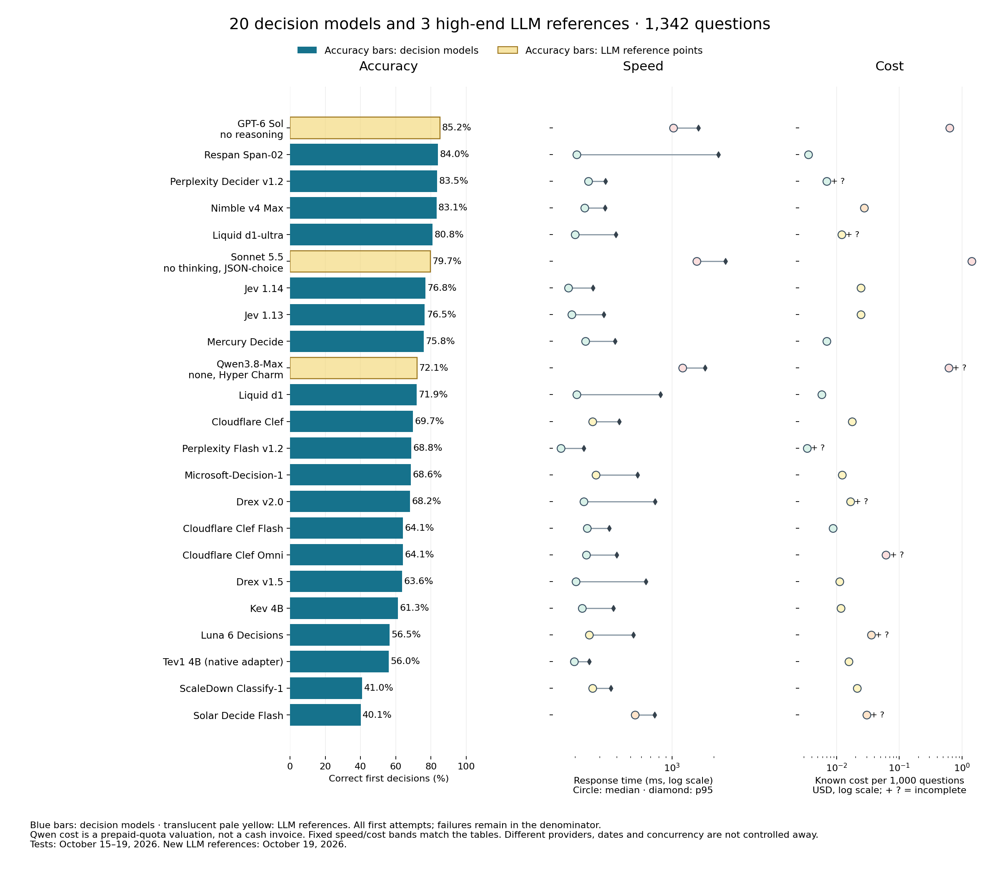
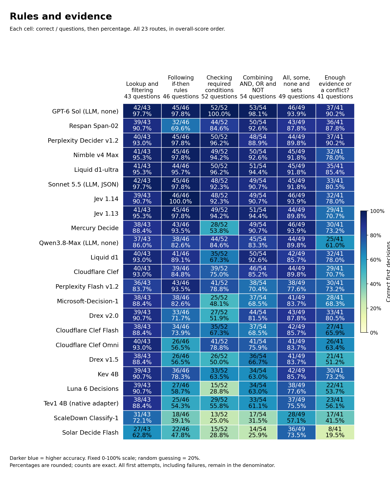
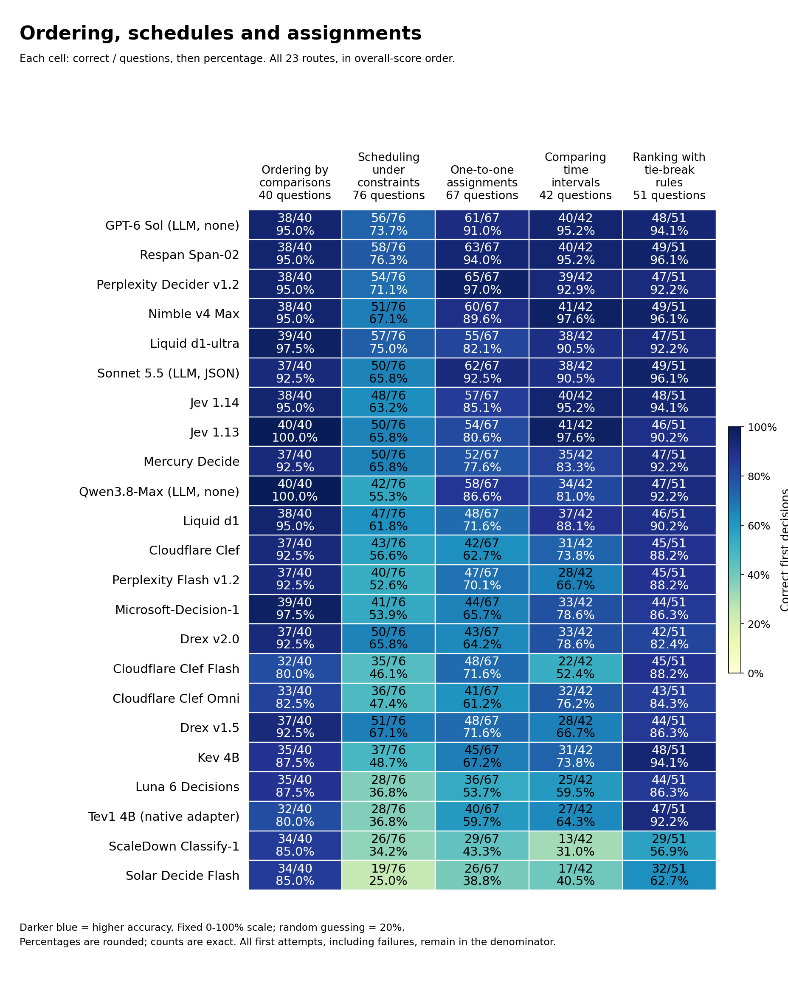
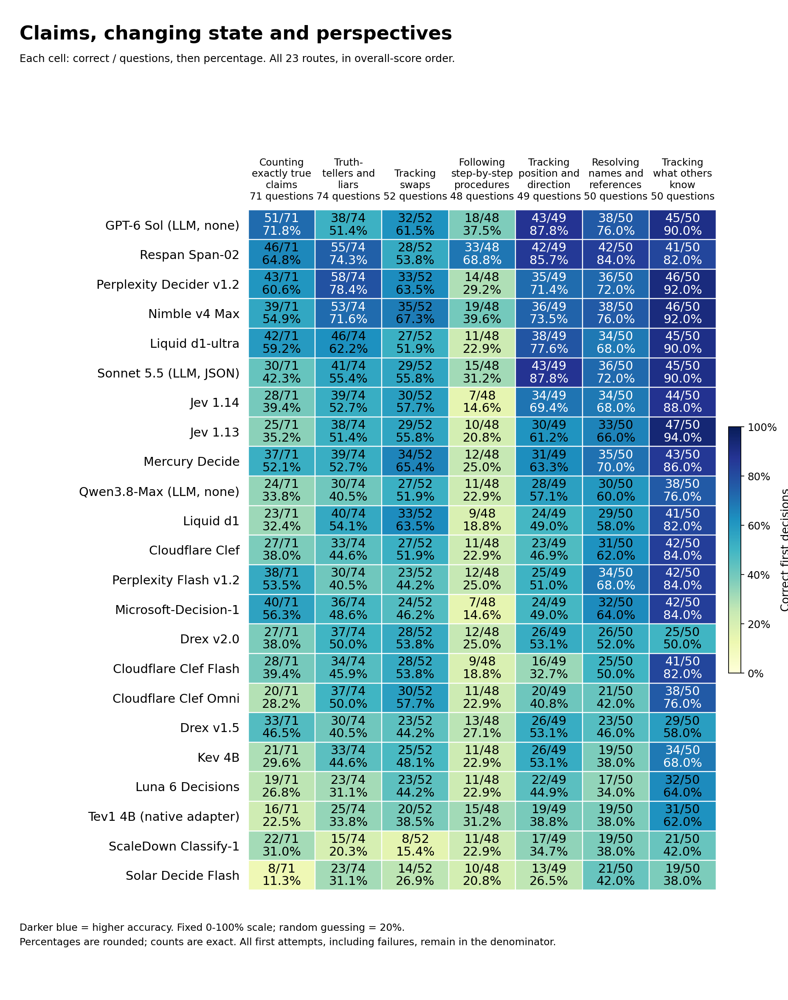
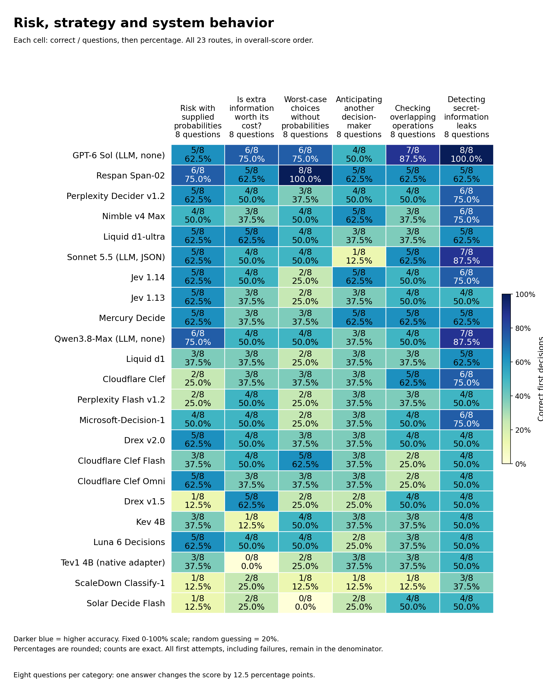

# System 1 Decision Benchmark

20 specialized decision models and 3 high-end LLM references on 1,342 text questions.

Updated October 19, 2026. Three LLM configurations were tested October 19; decision-model measurements are unchanged.

**Respan Span-02 leads the specialized decision models with 1127/1342 (84.0%). The LLM reference scores, speed and cost below use the same complete bank with reasoning disabled.**

[Interactive report](https://etsabary.github.io/system-1-decision-benchmark/report.html) · [LLM reference findings](https://etsabary.github.io/system-1-decision-benchmark/report.html#llm-references) · [Named, color-coded categories](https://etsabary.github.io/system-1-decision-benchmark/report.html#functions).

## Results, speed and cost

Every row covers 1342 first attempts. Costs per 1000 are normalized; actual full-bank totals appear separately. Qwen’s cost is a Hyper Charm quota valuation, not a cash invoice. + ? means additional unreported charges.

| Model | Type | Correct /1342 | Accuracy | Median | p95 | Cost per 1000 | Actual1342-question cost |
| --- | --- | --- | --- | --- | --- | --- | --- |
| GPT-6 Sol — no reasoning | LLM reference | 1143/1342 | 85.2% | 1023 ms 🟥 Slow | 1546 ms | $0.63211 🟥 Highest | $0.848294 |
| Respan Span-02 | Decision model | 1127/1342 | 84.0% | 206 ms 🟩 Fastest | 2157 ms | $0.00354 🟩 Lowest | $0.004746 |
| Perplexity Decider v1.2 | Decision model | 1120/1342 | 83.5% | 249 ms 🟩 Fastest | 332 ms | $0.00700 🟩 Lowest + ? | $0.009394 + ? |
| Nimble v4 Max | Decision model | 1115/1342 | 83.1% | 235 ms 🟩 Fastest | 329 ms | ~$0.02763 🟧 Mid | $0.037084 |
| Liquid d1-ultra | Decision model | 1084/1342 | 80.8% | 200 ms 🟩 Fastest | 393 ms | $0.01212 🟨 Low + ? | $0.016270 + ? |
| Sonnet 5.5 — no thinking, JSON-choice | LLM reference | 1070/1342 | 79.7% | 1506 ms 🟥 Slow | 2424 ms | $1.43361 🟥 Highest | $1.923908 |
| Jev 1.14 | Decision model | 1030/1342 | 76.8% | 179 ms 🟩 Fastest | 269 ms | $0.02457 🟨 Low | $0.032974 |
| Jev 1.13 | Decision model | 1026/1342 | 76.5% | 189 ms 🟩 Fastest | 323 ms | $0.02457 🟨 Low | $0.032974 |
| Mercury Decide | Decision model | 1017/1342 | 75.8% | 238 ms 🟩 Fastest | 388 ms | $0.00696 🟩 Lowest | $0.009334 |
| Qwen3.8-Max — none, Hyper Charm | LLM reference | 967/1342 | 72.1% | 1191 ms 🟥 Slow | 1731 ms | $0.61482 🟥 Highest + ? | $0.825090 + ? quota |
| Liquid d1 | Decision model | 965/1342 | 71.9% | 206 ms 🟩 Fastest | 827 ms | $0.00577 🟩 Lowest | $0.007748 |
| Cloudflare Clef | Decision model | 936/1342 | 69.7% | 268 ms 🟨 Fast | 417 ms | $0.01759 🟨 Low | $0.023611 |
| Perplexity Decider Flash v1.2 | Decision model | 923/1342 | 68.8% | 159 ms 🟩 Fastest | 231 ms | $0.00341 🟩 Lowest + ? | $0.004570 + ? |
| Microsoft-Decision-1 | Decision model | 921/1342 | 68.6% | 283 ms 🟨 Fast | 566 ms | $0.01224 🟨 Low | $0.016422 |
| Drex v2.0 | Decision model | 915/1342 | 68.2% | 232 ms 🟩 Fastest | 755 ms | $0.01666 🟨 Low + ? | $0.022359 + ? |
| Cloudflare Clef Flash | Decision model | 860/1342 | 64.1% | 245 ms 🟩 Fastest | 353 ms | $0.00880 🟩 Lowest | $0.011806 |
| Cloudflare Clef Omni | Decision model | 860/1342 | 64.1% | 241 ms 🟩 Fastest | 400 ms | $0.06151 🟥 Highest + ? | $0.082547 + ? |
| Drex v1.5 | Decision model | 853/1342 | 63.6% | 203 ms 🟩 Fastest | 649 ms | $0.01116 🟨 Low | $0.014976 |
| Kev 4B | Decision model | 822/1342 | 61.3% | 225 ms 🟩 Fastest | 377 ms | $0.01172 🟨 Low | $0.015725 |
| Luna 6 Decisions | Decision model | 758/1342 | 56.5% | 254 ms 🟨 Fast | 527 ms | $0.03584 🟧 Mid + ? | $0.048097 + ? |
| Tev1 4B experimental (OpenRouter native adapter) | Decision model | 751/1342 | 56.0% | 198 ms 🟩 Fastest | 253 ms | $0.01566 🟨 Low | $0.021011 |
| ScaleDown Classify-1 | Decision model | 550/1342 | 41.0% | 268 ms 🟨 Fast | 362 ms | $0.02139 🟨 Low | $0.028703 |
| Solar Decide Flash | Decision model | 538/1342 | 40.1% | 540 ms 🟧 Moderate | 747 ms | $0.03020 🟧 Mid + ? | $0.040532 + ? |

## Reading the speed and cost colors

The squares and labels use fixed descriptive bands, not relative ranks or statistical significance. Speed uses the full-bank first-attempt median. Cost uses known or accounted dollars per 1,000 questions, normalized from each actual 1,342-question run including permitted recoveries.

| Band | Median response time | Known/accounted cost per 1,000 |
|---|---|---|
| Green | 🟩 Fastest: ≤250 ms | 🟩 Lowest: ≤$0.010 |
| Yellow | 🟨 Fast: >250 to ≤500 ms | 🟨 Low: >$0.010 to ≤$0.025 |
| Orange | 🟧 Moderate: >500 to ≤1,000 ms | 🟧 Mid: >$0.025 to ≤$0.050 |
| Red | 🟥 Slow: >1,000 ms | 🟥 Highest: >$0.050 |
| Gray | ⬜ Unknown: unavailable | ⬜ Unknown: unavailable |

Bands use unrounded measurements; displayed numbers can round to a boundary. `+ ?` means additional charges were not reported. In those cells, the cost band describes only the known lower bound, not a complete cost or a guaranteed price advantage. The website also underlines these incomplete costs in amber. Text labels remain visible without color.

## Decision models alongside high-end LLMs

Respan Span-02 scored 1127/1342 (84.0%). The highest-scoring LLM reference was GPT-6 Sol — no reasoning: 1143/1342 (85.2%), a gap of 16 decisions. These are the same questions, facts and option order, with no tools or iterative repair. This measures System 1-style decision performance, not unrestricted reasoning or general intelligence.

## Sol and Span are close overall, with different strengths

Sol scored 1143/1342 (85.2%), versus Span’s 1127 (84.0%). On the original 1136 questions, Sol scored 1014 and Span 1011; on the added 206, Sol scored 129 and Span 116. Sol answered 45/46 forward conditionals and 52/52 necessary-condition questions; Span answered 32/46 and 44/52. Span answered 33/48 sequential procedures and 55/74 truth-teller questions, versus Sol 18/48 and 38/74.

## Speed and cost separate otherwise nearby scores

Sol’s median was 1023 ms, versus Span’s 206 ms: 5.0 times longer. Their recorded full-bank costs were $0.848294 and $0.00474628, a 179-fold difference. Span’s p95 was 2157 ms, versus Sol’s 1546 ms; the median advantage did not extend to that tail measure. These are route measurements, not controlled hardware comparisons.

## Sonnet needs a constrained decision format

Sonnet’s JSON-choice run scored 1070/1342 (79.7%), at a 1506 ms median and $1.923908 for the bank. All 1342 outputs were valid and reported zero thinking tokens. In the separate bare-ID trial, 84 of 110 outputs were unusable explanations or truncated text. That trial is not pooled into this score. Sonnet scored 45/46 forward conditionals, 15/48 sequential procedures and 30/71 exact truth-counting questions.

## Qwen: decision accuracy and account limits

Qwen3.8-Max delivered 967/1342 (72.1%); 1317 first attempts returned usable decisions, with 73.4% accuracy among those responses. There were 25 first-attempt provider/transport failures, retained in the primary score. It scored 38/46 on following if-then rules, 11/48 on step-by-step procedures and 30/74 on truth-teller consistency. Its median was 1191 ms and p95 1731 ms. Hyper Charm’s hourly limit produced some rejected requests; those are not labelled wrong model choices. Its cost is a prepaid-quota valuation, not additional cash billing. The requested none setting is documented in Hyper’s catalog, but the route does not report reasoning-token counts.

## What the comparison supports

Span’s 84.0% sits between Sol’s 85.2% and Sonnet’s 79.7% on these immediate decisions, with much lower recorded cost and a shorter median response. The Qwen row adds a further reference point. Scores and error profiles differ by category. This is a selected reference group, not an exhaustive ranking of every LLM that can disable reasoning. Models that require thinking are outside this comparison. New eight-question categories remain coarse diagnostic samples, not reliability guarantees.

## What this measures

One decision from supplied information, with five choices. No requested thinking budget, tools, explanation or iterative repair. This is System 1-style decision performance, not a comparison of unrestricted reasoning, writing or agentic work. The ranking uses every first attempt; provider failures count as unsuccessful delivered decisions and are not called wrong reasoning answers.

## Span leads the decision models

Span scored 1,127/1,342 (84.0%), Perplexity 1,120 (83.5%) and Nimble Max 1,115 (83.1%). The gaps are 7 and 12 answers. They are too small to establish a general intelligence ordering. Equal weighting of the 31 category percentages also puts Span first: 82.4%, versus Perplexity’s 79.4% and Nimble’s 79.0%. The main score remains question-weighted, so large categories contribute more questions.

## Typical speed and tail speed tell different stories

Span’s median was 206 ms, with a 2.16-second p95. Perplexity’s median was 249 ms and p95 332 ms; Nimble’s were 235 and 329 ms. Span combines a short typical response with a much longer response-time tail. Its recorded cost is $0.00354 per 1,000 questions, versus $0.00700 plus one unreported attempt cost for Perplexity and approximately $0.02763 for Nimble. Span has the lowest cost among routes with complete cost reporting. All pooled medians are below two seconds. The exclusion policy uses median, not p95.

## Sequential state updates and truth counting remain discriminating

Sequential procedures require applying ordered edits to the current state, such as reversing a row, swapping positions and moving an item. Span scored 33/48, Nimble 19/48, Perplexity 14/48 and Jev 1.14 7/48. For exact truth counting, which asks how many claims are true under the supplied facts, the same routes scored 46/71, 39/71, 43/71 and 28/71. Strong performance here still includes many wrong answers.

## The decision-model leader is not strongest in every function

Forward conditionals ask what follows when facts activate chains of rules. Jev 1.14 scored 46/46, Perplexity and Nimble each 45/46, and Span 32/46. On truth-teller consistency, where whole statements must match each speaker’s type, Perplexity scored 58/74, Span 55/74 and Nimble 53/74. On one-to-one assignments, Perplexity scored 65/67 and Span 63/67; on belief tracking, Jev 1.13 scored 47/50 and Span 41/50. Belief tracking distinguishes what observers know from what actually happened.

## Uncertainty and system constraints change the functional picture

Across the six uncertainty, strategy and system categories, Span scored 34/48, Perplexity 26/48, Nimble 25/48 and Jev 1.14 26/48. Span’s largest visible advantage is worst-case choices without supplied probabilities: 8/8, versus Perplexity 3/8, Nimble 4/8 and Jev 1.14 2/8. These require a worst-case action or policy, not an invented average. In information-flow security, Perplexity, Nimble and Jev 1.14 each scored 6/8, versus Span’s 5/8. Each category has eight questions. One answer changes its score by 12.5 percentage points; these are diagnostic profiles, not reliability guarantees.

## Jev, Luna and a lower-cost native alternative

Jev 1.14 scored 1,030/1,342 (76.8%), Jev 1.13 1,026 (76.5%), and Luna Decisions 758 (56.5%). The Jev versions differ by 4 correct decisions overall. Assignments favor 1.14, 57/67 versus 54/67; causal intervention favors 1.13, 42/50 versus 38/50. The update is not a uniform improvement across functions. Mercury Decide scored 1,017 (75.8%), with a 238 ms median and $0.00696 per 1,000 at the captured prices. It scored 34/52 on swaps and 55/58 on priority rules, but 28/52 on necessary conditions, versus Jev 1.14’s 48/52. This is the native Mercury Decide route, not regular Mercury 2.5. The earlier LLM cohort lacks expanded coverage; the new reference group has complete matched coverage.

## Category scores and explanations

The 31 categories are grouped below so the labels and values remain readable. These are reading groups, not new scored categories. All 23 routes remain in overall-score order. Every cell shows **correct / questions and percentage**. Darker blue means higher accuracy on a fixed 0-100% scale; uniform random guessing averages 20%. Different category sizes mean that percentages alone do not show how much evidence is available.

[Open the color-coded, selectable tables](https://etsabary.github.io/system-1-decision-benchmark/report.html#functions), with a pinned model-name column and individual category rankings.

### Rules and evidence

Which facts meet a rule, which conclusions follow, and when is the evidence insufficient?

| Category | Questions | What it tests and a simple example |
| --- | --- | --- |
| Lookup and filtering (F01) | 43 | Select records that meet stated conditions Example: Which listed request is both signed and marked urgent? |
| Following if-then rules (F02) | 46 | Apply an implication from its trigger Example: If an active badge grants entry and this badge is active, what follows? |
| Checking required conditions (F03) | 52 | Reason backward from a missing required condition Example: Every approved request needs a valid ticket; can one without a ticket be approved? |
| Combining AND, OR and NOT (F04) | 54 | Track combinations such as both, either and exactly one Example: Which choice satisfies exactly one of two stated conditions? |
| All, some, none and sets (F05) | 49 | Track all, some, none and overlapping groups Example: All teal tokens are marked; no marked token is blank; which relation follows? |
| Enough evidence or a conflict? (F11) | 41 | Determine whether facts force an answer or contradict one another Example: Is a proposed arrangement determined, impossible or still underdetermined? |

[Full-size SVG](llm_references_2026-10-19/rules.svg) · [Color-coded table and category rankings](https://etsabary.github.io/system-1-decision-benchmark/report.html#group-rules)

### Ordering, schedules and assignments

Can the model combine comparisons, fit a schedule, assign unique partners and apply tie-break rules?

| Category | Questions | What it tests and a simple example |
| --- | --- | --- |
| Ordering by comparisons (F06) | 40 | Combine ordered comparisons Example: A is taller than B and B than C; how do A and C compare? |
| Scheduling under constraints (F07) | 76 | Fit events around order and exclusion rules Example: Which timetable puts one meeting before another without overlapping a break? |
| One-to-one assignments (F08) | 67 | Give each item a unique partner while satisfying clues Example: Assign three people different desks using location restrictions. |
| Comparing time intervals (F14) | 42 | Compare starts, ends and overlapping periods Example: Which interval overlaps a specified event without containing it? |
| Ranking with tie-break rules (F22) | 51 | Rank candidates using explicit tie-break rules Example: Rank by priority first, then age when priorities tie. |

[Full-size SVG](llm_references_2026-10-19/ordering.svg) · [Color-coded table and category rankings](https://etsabary.github.io/system-1-decision-benchmark/report.html#group-ordering)

### Claims, changing state and perspectives

Can the model count true statements, update a changing situation and separate what different observers know?

| Category | Questions | What it tests and a simple example |
| --- | --- | --- |
| Counting exactly true claims (F09) | 71 | Count precisely how many statements hold Example: Under the supplied facts, how many of six claims are true? |
| Truth-tellers and liars (F10) | 74 | Find a consistent pattern of truthful and false statements Example: Which assignment of honest and dishonest speakers fits their claims? |
| Tracking swaps (F12) | 52 | Update locations after repeated exchanges Example: A red token starts in box A; several box contents are swapped; where does it end? |
| Following step-by-step procedures (F13) | 48 | Apply each ordered edit to the current state Example: Toggle one flag, swap two values, then conditionally reset another flag. |
| Tracking position and direction (F15) | 49 | Update position or direction from described movement Example: Follow successive turns and moves, then identify the final direction. |
| Resolving names and references (F16) | 50 | Resolve chains of names, roles and references Example: Identify the mentor of the colleague named in a nested description. |
| Tracking what others know (F17) | 50 | Distinguish what different observers witnessed Example: An object moves while one observer is absent; where will that observer look? |

[Full-size SVG](llm_references_2026-10-19/state.svg) · [Color-coded table and category rankings](https://etsabary.github.io/system-1-decision-benchmark/report.html#group-state)

### Causes, plans and exceptions

Which actions work, which consequences change, and which rule or source controls when information conflicts?

| Category | Questions | What it tests and a simple example |
| --- | --- | --- |
| Changing a cause (F18) | 50 | Recompute consequences of changing a specified input Example: Force a switch off while holding other inputs fixed; which lamp now lights? |
| Exceptions and priority rules (F19) | 58 | Apply a rule, its exception and stated precedence Example: A badge permits entry unless a higher-priority suspension applies. |
| Planning valid action sequences (F20) | 43 | Choose an action sequence whose requirements are met Example: Obtain a key before opening a locked door, with limited moves available. |
| Following directed connections (F21) | 43 | Follow arrows in their permitted direction Example: Can node A reach node D through the listed directed links? |
| Finding rule violations (F23) | 52 | Find a case that violates a stated rule Example: Which listed record disproves the claim that every approved item is signed? |
| Choosing authoritative current records (F24) | 43 | Select the valid source rather than an outdated conflicting one Example: Two records disagree; which controls under the stated authority and date policy? |
| Diagnosing faults from evidence (F25) | 50 | Match observed symptoms to explicit fault rules Example: Which fault is consistent with the supplied test results? |

[Full-size SVG](llm_references_2026-10-19/causes.svg) · [Color-coded table and category rankings](https://etsabary.github.io/system-1-decision-benchmark/report.html#group-causes)

### Risk, strategy and system behavior

These decisions involve uncertain outcomes, another actor, overlapping operations or possible information leaks.

**Worst-case choices without probabilities** means choosing under a specified worst-case loss or regret rule when the likelihoods of possible situations are not supplied. There is no probability distribution to average over. Each of these six categories has eight questions, so one answer changes its score by 12.5 percentage points.

| Category | Questions | What it tests and a simple example |
| --- | --- | --- |
| Risk with supplied probabilities (F26) | 8 | Choose the action with the lowest probability-weighted cost, using the supplied likelihoods and costs. Example: Which action minimizes the expected cost of a possible delay? |
| Is extra information worth its cost? (F27) | 8 | Decide whether paying for a test before choosing an action reduces the probability-weighted cost enough to cover the test price. Example: Should you buy a sensor reading before choosing an action, or is acting without the extra information cheaper overall? |
| Worst-case choices without probabilities (F28) | 8 | Follow the stated worst-case rule when likelihoods are not supplied. Minimize either the largest possible loss or the largest regret (extra loss compared with the best action for each situation), as the question specifies. Do not invent probabilities. Example: A route costs 4 in either situation; another costs 1 or 9. With no probabilities and a smallest-worst-case-cost rule, which route should be chosen? |
| Anticipating another decision-maker (F29) | 8 | Choose an action while accounting for the specified choices or payoff-maximizing response of another decision-maker. Example: Which first move gives the best result after the other player chooses their own best reply? |
| Checking overlapping operations (F30) | 8 | Decide whether overlapping operations and their reported results can fit a permitted one-at-a-time order that respects the specified timing and object rules. Example: Two processes read and change the same stored value. Could their reported results fit an allowed one-at-a-time order? |
| Detecting secret-information leaks (F31) | 8 | Check whether changing a protected secret can change an observable result in a way the stated policy forbids. Example: If public inputs stay the same, could public output distinguish two secret values that the policy says must remain indistinguishable? |

[Full-size SVG](llm_references_2026-10-19/uncertainty.svg) · [Color-coded table and category rankings](https://etsabary.github.io/system-1-decision-benchmark/report.html#group-uncertainty)

Counts are exact; displayed percentages are rounded. A perfect result on a small sample is not a reliability guarantee. [Download the full category matrix](llm_references_2026-10-19/category_scores.csv).

## Questions and statistics

All **1,342 questions**, facts and five choices retain their tested order. The JSONL also preserves exact model-independent native input packets and hashes. No answer keys, item-level correctness, certificates, verifier responses or private author metadata are published.

- Questions: [CSV](consolidated_2026-10-19/questions_1342.csv), [JSONL](consolidated_2026-10-19/questions_1342.jsonl), [readable text](consolidated_2026-10-19/questions_1342.txt).
- Statistics: [model CSV](llm_references_2026-10-19/model_statistics.csv), [function CSV](llm_references_2026-10-19/category_scores.csv), [aggregate JSON](llm_references_2026-10-19/statistics.json), [earlier decision-model plot data](consolidated_2026-10-19/plot_data.json).
- [Request failures and output compliance](OUTPUT_COMPLIANCE.md), [original decision-model release manifest](consolidated_2026-10-19/manifest.json), [original decision-model audit receipt](consolidated_2026-10-19/audit_receipt.json).

## Method and construction note

There are 1,342 questions and five choices per question. The uniform random-guess baseline is 20%. The questions include dependent variants and uneven category sizes; they are not 1,342 independent observations.

The full comparison is 23 routes × 1,342 questions = 30,866 first attempts. Within the unchanged 20-decision-model cohort, there are 26,840 first attempts. That original cohort has 26,983 selected HTTP attempts, including 143 permitted recoveries. New LLM attempt and recovery totals appear in the aggregate statistics and quality table. Only transport failures or actual HTTP 408/429/5xx permit one recovery. Recovered responses do not replace first attempts in the ranking or timing distribution.

Median and p95 are recomputed from all 1,342 individual first-attempt durations per route. Each attempt uses a fresh HTTPS connection and a monotonic timer from connection through the complete body. Queue time, retry waiting and recovery durations are excluded from these quantiles. p95 is the interpolated 95th percentile, not the mean of the slowest 5%.

The tests retain their captured dates, routes and loads; combining their raw measurements is not a synchronized rerun. The 20 decision-model measurements are unchanged; the three complete LLM reference runs were added on October 19. Returned dated identities and pins match across the selected banks; missing identities on failed calls are not silently inferred.

Among the 20 decision-model routes, Nimble uses Bespoke directly; the others use OpenRouter with pinned providers and no fallback. The new Qwen reference uses Hyper Charm directly. Tev1 is a decision-specialized generative model using a native adapter, not a claimed nongenerative architecture.

Costs include selected primary and permitted recovery attempts, normalized as cost ÷ 1,342 × 1,000. They are recorded charges or input usage times captured tariffs, not current-price quotes or independently reconciled invoices. Nimble retains 1,134 older $0.09/million-input records and 208 records at the captured $0.04 tariff. Missing costs remain unknown; no zero is substituted.

Known cost across the original 20-decision-model cohort is $0.480883745, with 218 attempt costs unreported. Verification subscription usage is outside this native-inference accounting.

The two retired ambiguous procedure prompts are absent. Their verified replacements are included exactly once. Provider failures and invalid outputs are unsuccessful delivered decisions, but only valid wrong choices are called wrong answers. Latency on a failed request may measure time to rejection.

This remains a developing benchmark. Thirty-seven author-development cases are included in this exploratory overview and retain their permanent exclusion from a future held-out scored release. The JSON preserves that policy; no new release acceptance is implied.

All 206 expansion questions have current-revision blind Sol xhigh and different-model Opus or Argon checks. Exact computational evidence supplements model review. The original bank received a targeted difficult-item audit, not independent external verification of every original question.

Construction history: the corrected 1,136-question bank, 200 verified expansion questions and six additional truth-teller questions are now pooled into one view. The six domains each contain two foundation questions and six more demanding candidates. The charts do not split scores by construction stage.

Sixteen earlier regular-LLM configurations have only 1,136-question coverage and are not extrapolated here. The three separately labelled LLM references above each cover all 1,342 questions. Solar Decide remains excluded for latency; the distinct Solar Decide Flash route remains included. No existing published row was removed.

The full question bank is downloadable without answers, grouped by category in CSV, JSONL and plain text. JSONL preserves the exact model-independent native input packets and hashes. Corrected prompts appear once; retired ambiguous prompts are absent. No answer keys, certificates, verifier responses, private author metadata or credentials are included.

The public bundle contains the consolidated graphics, aggregate statistics and all answer-free question inputs. The separate image benchmark is unchanged. The decision-model evidence was not rerun; the three new LLM references use fresh inference on the same complete bank.

The 37 author-development cases remain permanently excluded from a future held-out scored release. This public developmental overview does not claim a held-out score. Publication checks validate exported consistency and privacy; the sanitized audit receipt records a separate private raw-evidence check. The public aggregates alone cannot reproduce answer-key scoring or raw-latency quantiles.

## Earlier LLM comparison and image benchmark

The [36-model, 1,136-question reference](REFERENCE_1136.md) remains available with its measurements, analysis, raw evidence and unchanged release seals. Sixteen earlier regular LLM configurations lack complete expanded coverage and are not extrapolated. The 3 new, separately labelled qualified references above cover all 1,342 questions. The [image benchmark](https://github.com/etsabary/visual-decision-benchmark) is unchanged.

## Offline publication checks

Run `python3 validate_frontier_release.py` and `python3 validate_readable_report.py` and `python3 -m unittest test_consolidated_publication test_corrected_release`. These make no model calls. `publish_frontier_references.py` builds the current presentation from sealed summaries, preserving the earlier decision-model evidence and report seals. Sealed presentation artifacts are not overwritten. Earlier report builders describe superseded releases and must not overwrite the current presentation.

[Current 23-route model statistics CSV](llm_references_2026-10-19/model_statistics.csv) · [Current named-category scores CSV](llm_references_2026-10-19/category_scores.csv).
