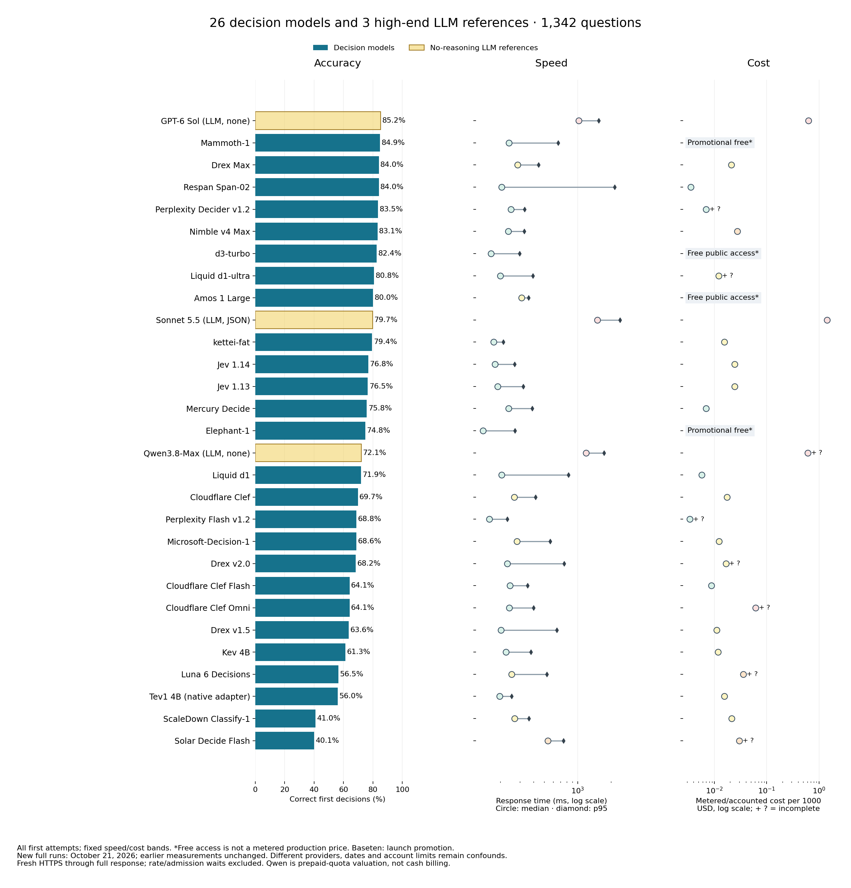
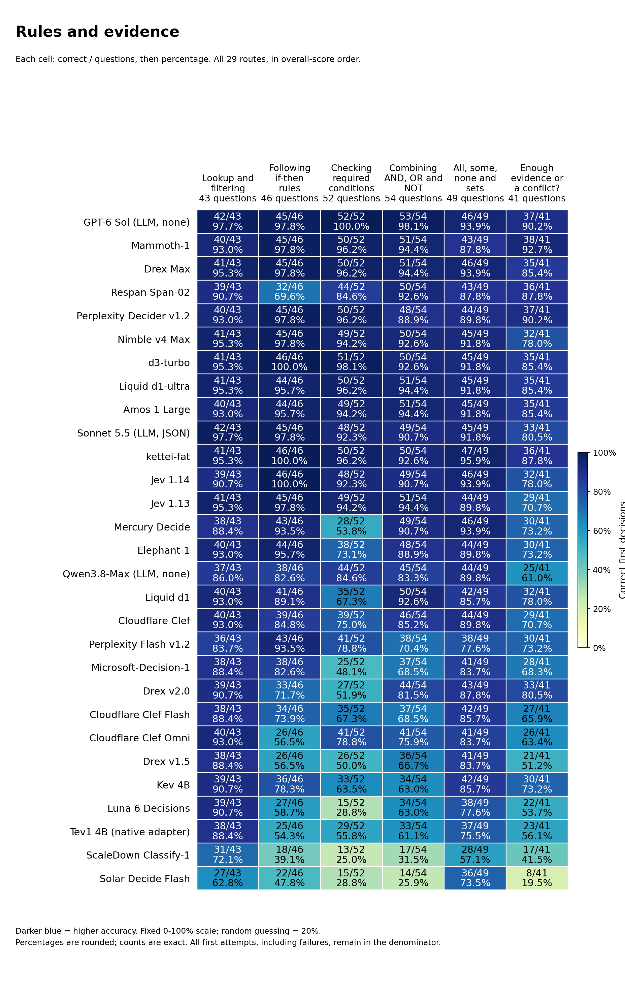
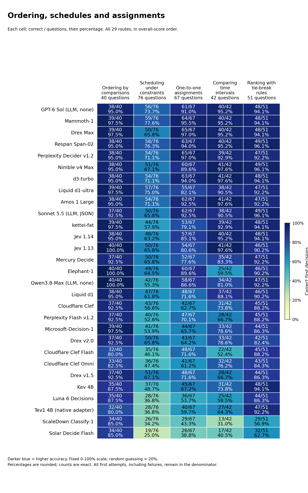
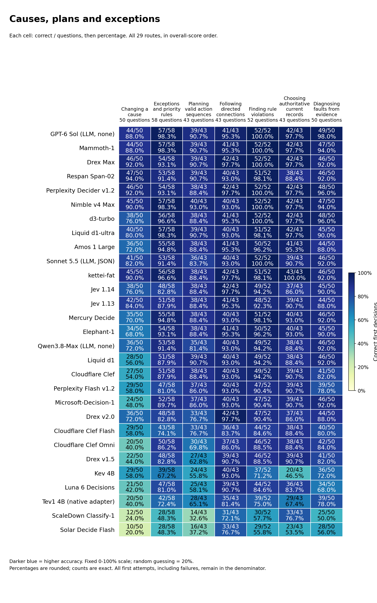
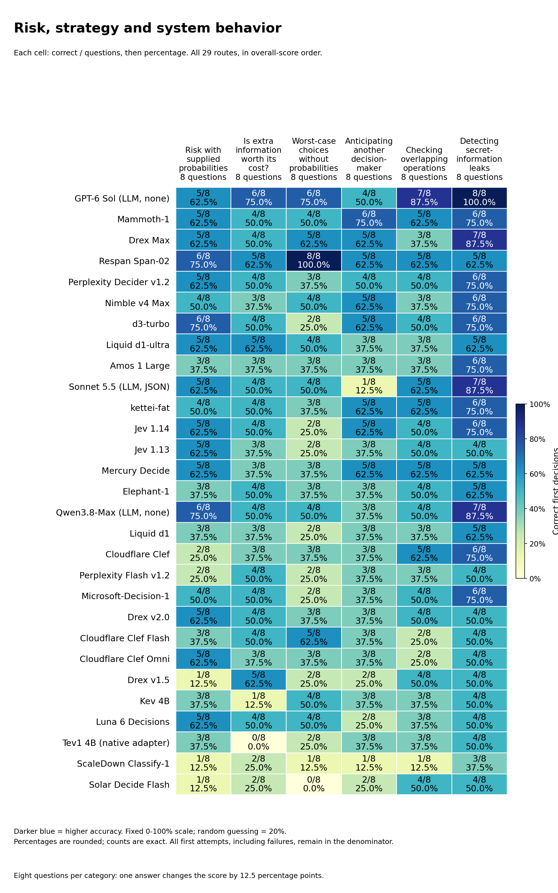

# System 1 Decision Benchmark

26 specialized decision models and 3 high-end LLM references on the same 1,342 text questions across 31 categories. Updated October 21, 2026.

**Mammoth-1 leads the tested decision models at 1139/1342 (84.9%). GPT-6 Sol without reasoning scored 1143/1342 (85.2%); their median responses were 240 ms and 1023 ms. Drex Max and Span-02 tie at 1127/1342 (84.0%).**

[Interactive report](https://etsabary.github.io/system-1-decision-benchmark/report.html) ·[October 21 findings](https://etsabary.github.io/system-1-decision-benchmark/report.html#new-additions) ·[Named, color-coded categories](https://etsabary.github.io/system-1-decision-benchmark/report.html#functions).

Benchmark runners, report builders and offline checks are grouped in [scripts/](scripts/README.md).

## Results, speed and cost

Every row contains 1342 first attempts. Costs per 1000 are normalized; actual run totals appear separately. Free access is not a metered production price. Pale-yellow graph bars distinguish no-reasoning LLM references; blue bars are decision models.

| Model | Type | Correct /1342 | Accuracy | Median | p95 | Cost per 1000 | Actual 1342-question cost |
| --- | --- | --- | --- | --- | --- | --- | --- |
| GPT-6 Sol — no reasoning | LLM reference | 1143/1342 | 85.2% | 1023 ms 🟥 Slow | 1546 ms | $0.632112 | $0.848294 |
| Mammoth-1 | Decision model | 1139/1342 | 84.9% | 240 ms 🟩 Fastest | 666 ms | Promotional free access* | Promotional free access* |
| Drex Max | Decision model | 1127/1342 | 84.0% | 286 ms 🟨 Fast | 445 ms | $0.021180 | $0.028423 |
| Respan Span-02 | Decision model | 1127/1342 | 84.0% | 206 ms 🟩 Fastest | 2157 ms | $0.003537 | $0.004746 |
| Perplexity Decider v1.2 | Decision model | 1120/1342 | 83.5% | 249 ms 🟩 Fastest | 332 ms | $0.007000 + ? | $0.009394 + ? |
| Nimble v4 Max | Decision model | 1115/1342 | 83.1% | 235 ms 🟩 Fastest | 329 ms | $0.027633 | ~$0.037084 |
| d3-turbo | Decision model | 1106/1342 | 82.4% | 165 ms 🟩 Fastest | 298 ms | Free public access* | Free public access* |
| Liquid d1-ultra | Decision model | 1084/1342 | 80.8% | 200 ms 🟩 Fastest | 393 ms | $0.012124 + ? | $0.016270 + ? |
| Amos 1 Large | Decision model | 1074/1342 | 80.0% | 311 ms 🟨 Fast | 360 ms | Free public access* | Free public access* |
| Sonnet 5.5 — no thinking, JSON-choice | LLM reference | 1070/1342 | 79.7% | 1506 ms 🟥 Slow | 2424 ms | $1.433613 | $1.923908 |
| kettei-fat | Decision model | 1066/1342 | 79.4% | 174 ms 🟩 Fastest | 214 ms | $0.015433 | $0.020711 |
| Jev 1.14 | Decision model | 1030/1342 | 76.8% | 179 ms 🟩 Fastest | 269 ms | $0.024571 | $0.032974 |
| Jev 1.13 | Decision model | 1026/1342 | 76.5% | 189 ms 🟩 Fastest | 323 ms | $0.024571 | $0.032974 |
| Mercury Decide | Decision model | 1017/1342 | 75.8% | 238 ms 🟩 Fastest | 388 ms | $0.006956 | $0.009334 |
| Elephant-1 | Decision model | 1004/1342 | 74.8% | 139 ms 🟩 Fastest | 272 ms | Promotional free access* | Promotional free access* |
| Qwen3.8-Max — none, Hyper Charm | LLM reference | 967/1342 | 72.1% | 1191 ms 🟥 Slow | 1731 ms | $0.614821 + ? | $0.825090 + ? quota |
| Liquid d1 | Decision model | 965/1342 | 71.9% | 206 ms 🟩 Fastest | 827 ms | $0.005773 | $0.007748 |
| Cloudflare Clef | Decision model | 936/1342 | 69.7% | 268 ms 🟨 Fast | 417 ms | $0.017594 | $0.023611 |
| Perplexity Decider Flash v1.2 | Decision model | 923/1342 | 68.8% | 159 ms 🟩 Fastest | 231 ms | $0.003406 + ? | $0.004570 + ? |
| Microsoft-Decision-1 | Decision model | 921/1342 | 68.6% | 283 ms 🟨 Fast | 566 ms | $0.012237 | $0.016422 |
| Drex v2.0 | Decision model | 915/1342 | 68.2% | 232 ms 🟩 Fastest | 755 ms | $0.016661 + ? | $0.022359 + ? |
| Cloudflare Clef Flash | Decision model | 860/1342 | 64.1% | 245 ms 🟩 Fastest | 353 ms | $0.008797 | $0.011806 |
| Cloudflare Clef Omni | Decision model | 860/1342 | 64.1% | 241 ms 🟩 Fastest | 400 ms | $0.061511 + ? | $0.082547 + ? |
| Drex v1.5 | Decision model | 853/1342 | 63.6% | 203 ms 🟩 Fastest | 649 ms | $0.011160 | $0.014976 |
| Kev 4B | Decision model | 822/1342 | 61.3% | 225 ms 🟩 Fastest | 377 ms | $0.011718 | $0.015725 |
| Luna 6 Decisions | Decision model | 758/1342 | 56.5% | 254 ms 🟨 Fast | 527 ms | $0.035840 + ? | $0.048097 + ? |
| Tev1 4B experimental (OpenRouter native adapter) | Decision model | 751/1342 | 56.0% | 198 ms 🟩 Fastest | 253 ms | $0.015657 | $0.021011 |
| ScaleDown Classify-1 | Decision model | 550/1342 | 41.0% | 268 ms 🟨 Fast | 362 ms | $0.021388 | $0.028703 |
| Solar Decide Flash | Decision model | 538/1342 | 40.1% | 540 ms 🟧 Moderate | 747 ms | $0.030203 + ? | $0.040532 + ? |

*Baseten’s free launch promotion is temporary. d3-turbo and Amos have separate public-free access. These endpoints omit monetary receipts; their numeric metered-price fields remain null. Qwen’s amount is prepaid-quota valuation; + ? means unreported charges.*

## Reading the speed and cost colors

The squares and labels use fixed descriptive bands, not relative ranks or statistical significance. Speed uses the full-bank first-attempt median. Cost uses known or accounted dollars per 1,000 questions, normalized from each actual 1,342-question run including permitted recoveries.

| Band | Median response time | Known/accounted cost per 1,000 |
|---|---|---|
| Green | 🟩 Fastest: ≤250 ms | 🟩 Lowest: ≤$0.010 |
| Yellow | 🟨 Fast: >250 to ≤500 ms | 🟨 Low: >$0.010 to ≤$0.025 |
| Orange | 🟧 Moderate: >500 to ≤1,000 ms | 🟧 Mid: >$0.025 to ≤$0.050 |
| Red | 🟥 Slow: >1,000 ms | 🟥 Highest: >$0.050 |
| Gray | ⬜ Unknown: unavailable | ⬜ Unknown: unavailable |

Bands use unrounded measurements; displayed numbers can round to a boundary. `+ ?` means additional charges were not reported. In those cells, the cost band describes only the known lower bound, not a complete cost or a guaranteed price advantage. The website also underlines these incomplete costs in amber. Text labels remain visible without color.

## Mammoth-1 leads the decision-model sample

Mammoth-1 answered 1139/1342 correctly (84.9%), twelve more than Span-02 and Drex Max, which tied at 1127/1342 (84.0%). GPT-6 Sol without reasoning answered 1143 correctly (85.2%), four more than Mammoth. The four-answer gap does not establish a reliable general ordering. Mammoth’s median response was 240 ms and Sol’s was 1023 ms: about 4.3 times longer for Sol on these measured routes. Sonnet’s separately constrained, no-thinking reference remains 1070/1342 (79.7%).

## The leader still has specific weak operations

Mammoth scored 64/67 on one-to-one assignments—matching each person or object to exactly one available slot—and 57/58 on exceptions and priority rules. Tracking what others know gave 47/50. These tasks can ask where someone will search after an object moved while they were absent. Counting exactly true claims gave 44/71, truth-tellers and liars 48/74, and ordered procedures only 18/48. Procedures require applying each edit to the current state, not merely recognizing a plausible final answer. Span scored 33/48 there, despite its lower overall total. Mammoth also scored 38/52 on tracking swaps, versus Span’s 28/52.

## Drex Max ties Span overall, with different strengths

Drex Max scored 65/67 on one-to-one assignments and 45/46 on if-then rules, versus Span’s 63/67 and 32/46. On procedures, Drex scored 18/48 and Span 33/48; on worst-case choices without supplied probabilities, Drex scored 5/8 and Span 8/8. Equal overall totals do not mean the same decisions will be correct. Drex’s median/p95 was 286/445 ms, versus Span’s previously measured 206/2157 ms: Span had the shorter median, Drex the shorter tail. Drex’s complete API-reported cost was $0.02842302, normalized to $0.02118 per 1000 questions. Span’s recorded $0.00474628 total was about six times lower.

## Elephant-1 is fast, but not a uniform improvement over Jev

Elephant-1 scored 1004/1342 (74.8%), below Jev 1.14’s 1030/1342 (76.8%). Its 139 ms median was shorter than Jev’s 179 ms. Elephant still scored 60/67 on one-to-one assignments and 46/50 on knowledge tracking, versus Jev’s 57/67 and 44/50. Comparing time intervals gave Elephant 25/42 and Jev 40/42; checking required conditions gave 38/52 and 48/52. A newer release is not automatically stronger across this bank.

## The added questions expose more separation

On the original 1136 questions, Mammoth scored 1019/1136 (89.7%), Drex Max 1004/1136 (88.4%) and Elephant 902/1136 (79.4%). On the 206 additions their scores were 120/206 (58.3%), 123/206 (59.7%) and 102/206 (49.5%). This is a descriptive split, not a second leaderboard or a change in weighting. Across the six new categories, Mammoth scored 30/48, Drex 29/48 and Elephant 22/48. Each new category contains only eight questions; one answer moves its score by 12.5 percentage points.

## Jev’s position is a measured result, not an explanation of its roadmap

Mammoth answered 109 more questions correctly than Jev 1.14; Drex Max answered 97 more. Jev still answered all 46 if-then questions correctly, versus 45 each for Mammoth and Drex. This bank measures supplied-fact, five-choice decisions without tools or agentic iteration; it does not test broad knowledge, multilingual coverage or product integration. It cannot establish why a developer has or has not improved a model.

## Free launch access is separate from a production price

Mammoth and Elephant used Baseten’s direct API at the captured promotional zero tariff. Their responses did not contain monetary receipts, so the report does not invent an API-reported $0 price or plot one on the logarithmic cost axis. Baseten advertises a one-week launch promotion; availability and later prices may change. Their 20-question OpenRouter controls agreed with the direct route on all 20 choices for each model. Those controls are not pooled into the full-bank scores or latency measurements.

## Category scores and explanations

The 31 categories are grouped below so the labels and values remain readable. These are reading groups, not new scored categories. All 29 routes remain in overall-score order. Every cell shows **correct / questions and percentage**. Darker blue means higher accuracy on a fixed 0-100% scale; uniform random guessing averages 20%. Different category sizes mean that percentages alone do not show how much evidence is available.

[Open the color-coded, selectable tables](https://etsabary.github.io/system-1-decision-benchmark/report.html#functions), with a pinned model-name column and individual category rankings.

### Rules and evidence

Which facts meet a rule, which conclusions follow, and when is the evidence insufficient?

| Category | Questions | What it tests and a simple example |
| --- | --- | --- |
| Lookup and filtering (F01) | 43 | Select records that meet stated conditions Example: Which listed request is both signed and marked urgent? |
| Following if-then rules (F02) | 46 | Apply an implication from its trigger Example: If an active badge grants entry and this badge is active, what follows? |
| Checking required conditions (F03) | 52 | Reason backward from a missing required condition Example: Every approved request needs a valid ticket; can one without a ticket be approved? |
| Combining AND, OR and NOT (F04) | 54 | Track combinations such as both, either and exactly one Example: Which choice satisfies exactly one of two stated conditions? |
| All, some, none and sets (F05) | 49 | Track all, some, none and overlapping groups Example: All teal tokens are marked; no marked token is blank; which relation follows? |
| Enough evidence or a conflict? (F11) | 41 | Determine whether facts force an answer or contradict one another Example: Is a proposed arrangement determined, impossible or still underdetermined? |

[Full-size SVG](native_additions_2026-10-21/rules.svg) · [Color-coded table and category rankings](https://etsabary.github.io/system-1-decision-benchmark/report.html#group-rules)

### Ordering, schedules and assignments

Can the model combine comparisons, fit a schedule, assign unique partners and apply tie-break rules?

| Category | Questions | What it tests and a simple example |
| --- | --- | --- |
| Ordering by comparisons (F06) | 40 | Combine ordered comparisons Example: A is taller than B and B than C; how do A and C compare? |
| Scheduling under constraints (F07) | 76 | Fit events around order and exclusion rules Example: Which timetable puts one meeting before another without overlapping a break? |
| One-to-one assignments (F08) | 67 | Give each item a unique partner while satisfying clues Example: Assign three people different desks using location restrictions. |
| Comparing time intervals (F14) | 42 | Compare starts, ends and overlapping periods Example: Which interval overlaps a specified event without containing it? |
| Ranking with tie-break rules (F22) | 51 | Rank candidates using explicit tie-break rules Example: Rank by priority first, then age when priorities tie. |

[Full-size SVG](native_additions_2026-10-21/ordering.svg) · [Color-coded table and category rankings](https://etsabary.github.io/system-1-decision-benchmark/report.html#group-ordering)

### Claims, changing state and perspectives

Can the model count true statements, update a changing situation and separate what different observers know?

| Category | Questions | What it tests and a simple example |
| --- | --- | --- |
| Counting exactly true claims (F09) | 71 | Count precisely how many statements hold Example: Under the supplied facts, how many of six claims are true? |
| Truth-tellers and liars (F10) | 74 | Find a consistent pattern of truthful and false statements Example: Which assignment of honest and dishonest speakers fits their claims? |
| Tracking swaps (F12) | 52 | Update locations after repeated exchanges Example: A red token starts in box A; several box contents are swapped; where does it end? |
| Following step-by-step procedures (F13) | 48 | Apply each ordered edit to the current state Example: Toggle one flag, swap two values, then conditionally reset another flag. |
| Tracking position and direction (F15) | 49 | Update position or direction from described movement Example: Follow successive turns and moves, then identify the final direction. |
| Resolving names and references (F16) | 50 | Resolve chains of names, roles and references Example: Identify the mentor of the colleague named in a nested description. |
| Tracking what others know (F17) | 50 | Distinguish what different observers witnessed Example: An object moves while one observer is absent; where will that observer look? |

[Full-size SVG](native_additions_2026-10-21/state.svg) · [Color-coded table and category rankings](https://etsabary.github.io/system-1-decision-benchmark/report.html#group-state)

### Causes, plans and exceptions

Which actions work, which consequences change, and which rule or source controls when information conflicts?

| Category | Questions | What it tests and a simple example |
| --- | --- | --- |
| Changing a cause (F18) | 50 | Recompute consequences of changing a specified input Example: Force a switch off while holding other inputs fixed; which lamp now lights? |
| Exceptions and priority rules (F19) | 58 | Apply a rule, its exception and stated precedence Example: A badge permits entry unless a higher-priority suspension applies. |
| Planning valid action sequences (F20) | 43 | Choose an action sequence whose requirements are met Example: Obtain a key before opening a locked door, with limited moves available. |
| Following directed connections (F21) | 43 | Follow arrows in their permitted direction Example: Can node A reach node D through the listed directed links? |
| Finding rule violations (F23) | 52 | Find a case that violates a stated rule Example: Which listed record disproves the claim that every approved item is signed? |
| Choosing authoritative current records (F24) | 43 | Select the valid source rather than an outdated conflicting one Example: Two records disagree; which controls under the stated authority and date policy? |
| Diagnosing faults from evidence (F25) | 50 | Match observed symptoms to explicit fault rules Example: Which fault is consistent with the supplied test results? |

[Full-size SVG](native_additions_2026-10-21/causes.svg) · [Color-coded table and category rankings](https://etsabary.github.io/system-1-decision-benchmark/report.html#group-causes)

### Risk, strategy and system behavior

These decisions involve uncertain outcomes, another actor, overlapping operations or possible information leaks.

**Worst-case choices without probabilities** means choosing under a specified worst-case loss or regret rule when the likelihoods of possible situations are not supplied. There is no probability distribution to average over. Each of these six categories has eight questions, so one answer changes its score by 12.5 percentage points.

| Category | Questions | What it tests and a simple example |
| --- | --- | --- |
| Risk with supplied probabilities (F26) | 8 | Choose the action with the lowest probability-weighted cost, using the supplied likelihoods and costs. Example: Which action minimizes the expected cost of a possible delay? |
| Is extra information worth its cost? (F27) | 8 | Decide whether paying for a test before choosing an action reduces the probability-weighted cost enough to cover the test price. Example: Should you buy a sensor reading before choosing an action, or is acting without the extra information cheaper overall? |
| Worst-case choices without probabilities (F28) | 8 | Follow the stated worst-case rule when likelihoods are not supplied. Minimize either the largest possible loss or the largest regret (extra loss compared with the best action for each situation), as the question specifies. Do not invent probabilities. Example: A route costs 4 in either situation; another costs 1 or 9. With no probabilities and a smallest-worst-case-cost rule, which route should be chosen? |
| Anticipating another decision-maker (F29) | 8 | Choose an action while accounting for the specified choices or payoff-maximizing response of another decision-maker. Example: Which first move gives the best result after the other player chooses their own best reply? |
| Checking overlapping operations (F30) | 8 | Decide whether overlapping operations and their reported results can fit a permitted one-at-a-time order that respects the specified timing and object rules. Example: Two processes read and change the same stored value. Could their reported results fit an allowed one-at-a-time order? |
| Detecting secret-information leaks (F31) | 8 | Check whether changing a protected secret can change an observable result in a way the stated policy forbids. Example: If public inputs stay the same, could public output distinguish two secret values that the policy says must remain indistinguishable? |

[Full-size SVG](native_additions_2026-10-21/uncertainty.svg) · [Color-coded table and category rankings](https://etsabary.github.io/system-1-decision-benchmark/report.html#group-uncertainty)

Counts are exact; displayed percentages are rounded. A perfect result on a small sample is not a reliability guarantee. [Download the full category matrix](native_additions_2026-10-21/category_scores.csv).

## Questions, statistics and method

Unchanged answer-free questions: [CSV](consolidated_2026-10-19/questions_1342.csv), [exact native JSONL](consolidated_2026-10-19/questions_1342.jsonl), [readable text](consolidated_2026-10-19/questions_1342.txt).

Current exports: [model CSV](native_additions_2026-10-21/model_statistics.csv), [category CSV](native_additions_2026-10-21/category_scores.csv), [aggregate JSON](native_additions_2026-10-21/statistics.json), [audit receipt](native_additions_2026-10-21/audit_receipt.json), [manifest](native_additions_2026-10-21/manifest.json).

The comparison contains 26 specialized decision models and three no-reasoning LLM reference routes: 29 × 1342 = 38,918 first attempts. All earlier 26 model records are preserved exactly. New full-bank runs: October 21, 2026, America/Toronto; Mammoth and Elephant direct through Baseten, Drex Max through OpenRouter’s pinned DeepInfra endpoint.

Same frozen 1342-question bank, seed 2026101906, original five choices and native inputs. Every first attempt remains in the accuracy and latency denominator, including failures. One recovery is allowed only for transport failures or HTTP 408/429/5xx; no answer-dependent retries. All 4026 new first attempts returned usable decisions, with zero recoveries and zero probability-format warnings. After at least 20 questions, a cumulative median above 2000 ms stops a route; none of the three reached that threshold.

Response timing starts before a fresh HTTPS connection and ends after the full response body. Preparation, deliberate pacing, queue waits and recovery delays are outside the response timer. Two requests per model run in barrier waves, with up to three models active. Provider hardware, dates, loads and routes are not controlled away; latency is not batch throughput or an isolated inference-speed measurement.

Baseten’s catalog and returned latest serving aliases identify Mammoth-1 and Elephant-1, not immutable weights. Drex returned nace-ai/drex-max-20261016 from DeepInfra. Baseten’s official technical report describes one-pass option-logit decisions. These native requests ask for neither reasoning nor explanations. Reported native output-token counters are retained; a nonzero counter alone is not evidence of thinking. Undisclosed internal execution cannot be independently verified from an API envelope.

Drex uses reported usage.cost for every attempt. Baseten promotional access is labelled separately from metered receipts. Separate compatibility probes and the two 20-case OpenRouter controls are excluded from the 4026 ranked first attempts. Missing charges remain unknown, not zero. Existing Nimble price estimates and Qwen prepaid-quota valuations retain their original labels.

This is a developing benchmark with uneven category sizes and dependent variants, not 1342 independent observations or a pristine held-out evaluation. The 37 permanent author-development exclusions retain their separate 1305-case diagnostic. Two audited ambiguous original items were already replaced before these runs. All 206 additions retain their existing independent verification and computational evidence; the original bank received a targeted difficult-item audit, not independent external verification of every original question.

Public exports contain unchanged answer-free question inputs, aggregate category scores and sanitized evidence hashes—not answer keys, per-item correctness, private verifier outputs, raw account state or credentials. Public checks verify consistency but cannot reproduce private-key scoring or raw-latency pooling. REAX 1 is not included: a hosted API for that exact fine-tune has not been confirmed.

Offline checks: `python3 scripts/validate_october21_release.py`, `python3 scripts/validate_repository_layout.py` and `python3 -m unittest discover -s scripts -p "test_*.py"`. Earlier dated releases and their seals remain available unchanged. The source files were grouped under `scripts/` on October 22; this did not change any benchmark measurements, questions or graphs.
