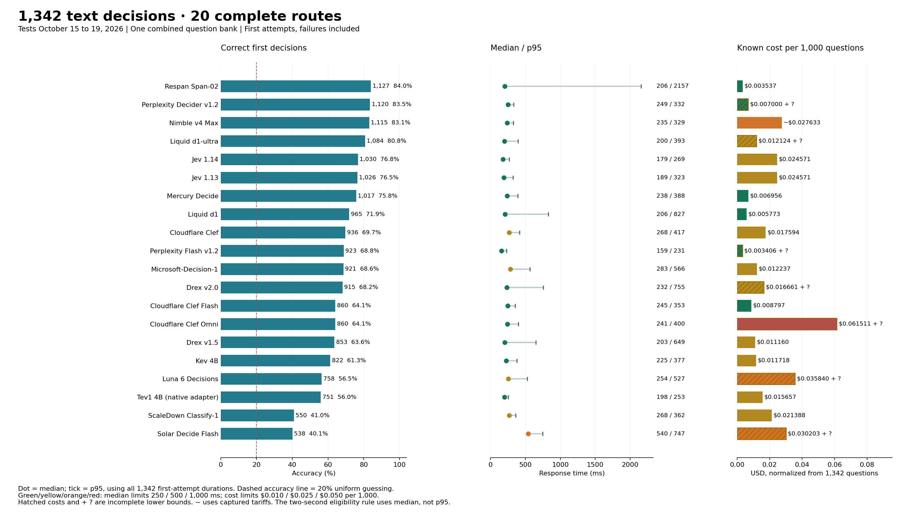
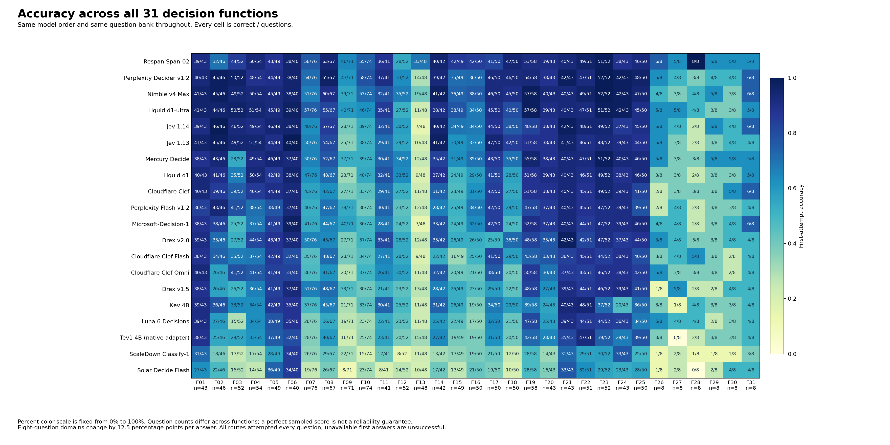
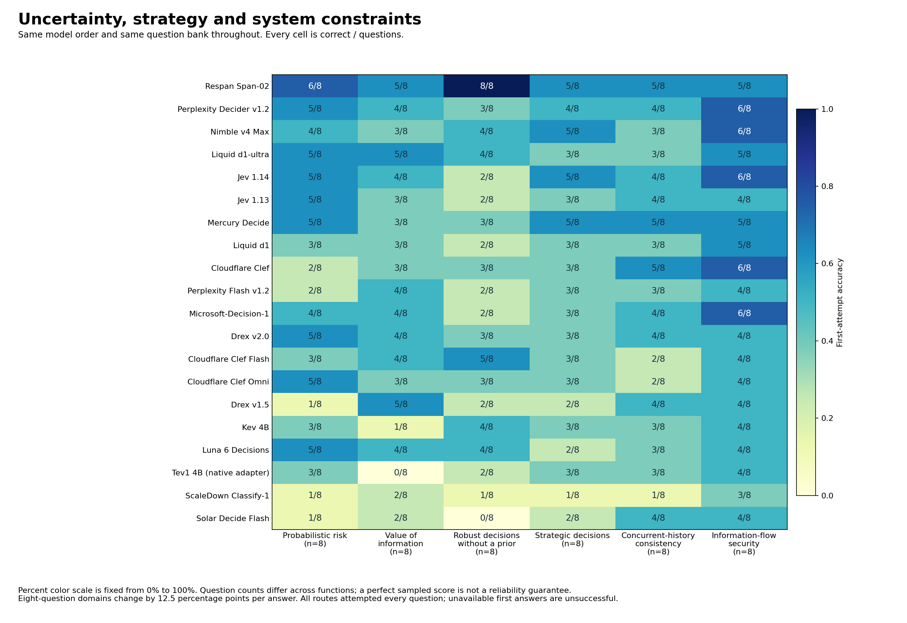

# 20 decision models on 1,342 text questions

Updated October 19, 2026. Tests October 15 to 19, 2026.

**Respan Span-02 leads with 1,127/1,342 (84.0%), followed by Perplexity Decider v1.2 at 1,120 (83.5%) and Nimble Max at 1,115 (83.1%).**

One combined bank across 31 categories, with five choices per question. [Interactive report](https://etsabary.github.io/jev-1.14-comparison-benchmark/) · [Full plain-text analysis](consolidated_2026-10-19/report.txt) · [All function scores](FUNCTIONS.md).

## Results, speed and cost

Every row covers all 1,342 first attempts. Provider failures remain unsuccessful. Median and p95 pool the individual first-attempt times, not stage medians. Costs include permitted recoveries and retain their captured tariffs. `+ ?` means unreported additional charges; `~` marks tariff-based accounting. Costs per 1,000 are normalized, not the actual number of questions tested.

| Model | Correct / 1,342 | Accuracy | Median | p95 | Cost per 1,000 | Test dates |
| --- | --- | --- | --- | --- | --- | --- |
| Respan Span-02 | 1127 | 84.0% | 206 ms 🟩 Fastest | 2157 ms | $0.00354 🟩 Lowest | 2026-10-18, 2026-10-19 |
| Perplexity Decider v1.2 | 1120 | 83.5% | 249 ms 🟩 Fastest | 332 ms | $0.00700 🟩 Lowest + ? | 2026-10-18, 2026-10-19 |
| Nimble v4 Max | 1115 | 83.1% | 235 ms 🟩 Fastest | 329 ms | ~$0.02763 🟧 Mid | 2026-10-16, 2026-10-18, 2026-10-19 |
| Liquid d1-ultra | 1084 | 80.8% | 200 ms 🟩 Fastest | 393 ms | $0.01212 🟨 Low + ? | 2026-10-18, 2026-10-19 |
| Jev 1.14 | 1030 | 76.8% | 179 ms 🟩 Fastest | 269 ms | $0.02457 🟨 Low | 2026-10-15, 2026-10-18, 2026-10-19 |
| Jev 1.13 | 1026 | 76.5% | 189 ms 🟩 Fastest | 323 ms | $0.02457 🟨 Low | 2026-10-15, 2026-10-18, 2026-10-19 |
| Mercury Decide | 1017 | 75.8% | 238 ms 🟩 Fastest | 388 ms | $0.00696 🟩 Lowest | 2026-10-18, 2026-10-19 |
| Liquid d1 | 965 | 71.9% | 206 ms 🟩 Fastest | 827 ms | $0.00577 🟩 Lowest | 2026-10-18, 2026-10-19 |
| Cloudflare Clef | 936 | 69.7% | 268 ms 🟨 Fast | 417 ms | $0.01759 🟨 Low | 2026-10-18, 2026-10-19 |
| Perplexity Decider Flash v1.2 | 923 | 68.8% | 159 ms 🟩 Fastest | 231 ms | $0.00341 🟩 Lowest + ? | 2026-10-18, 2026-10-19 |
| Microsoft-Decision-1 | 921 | 68.6% | 283 ms 🟨 Fast | 566 ms | $0.01224 🟨 Low | 2026-10-16, 2026-10-18, 2026-10-19 |
| Drex v2.0 | 915 | 68.2% | 232 ms 🟩 Fastest | 755 ms | $0.01666 🟨 Low + ? | 2026-10-18, 2026-10-19 |
| Cloudflare Clef Flash | 860 | 64.1% | 245 ms 🟩 Fastest | 353 ms | $0.00880 🟩 Lowest | 2026-10-18, 2026-10-19 |
| Cloudflare Clef Omni | 860 | 64.1% | 241 ms 🟩 Fastest | 400 ms | $0.06151 🟥 Highest + ? | 2026-10-18, 2026-10-19 |
| Drex v1.5 | 853 | 63.6% | 203 ms 🟩 Fastest | 649 ms | $0.01116 🟨 Low | 2026-10-18, 2026-10-19 |
| Kev 4B | 822 | 61.3% | 225 ms 🟩 Fastest | 377 ms | $0.01172 🟨 Low | 2026-10-18, 2026-10-19 |
| Luna 6 Decisions | 758 | 56.5% | 254 ms 🟨 Fast | 527 ms | $0.03584 🟧 Mid + ? | 2026-10-15, 2026-10-18, 2026-10-19 |
| Tev1 4B experimental (OpenRouter native adapter) | 751 | 56.0% | 198 ms 🟩 Fastest | 253 ms | $0.01566 🟨 Low | 2026-10-18, 2026-10-19 |
| ScaleDown Classify-1 | 550 | 41.0% | 268 ms 🟨 Fast | 362 ms | $0.02139 🟨 Low | 2026-10-18, 2026-10-19 |
| Solar Decide Flash | 538 | 40.1% | 540 ms 🟧 Moderate | 747 ms | $0.03020 🟧 Mid + ? | 2026-10-18, 2026-10-19 |

## Reading the speed and cost colors

The squares and labels use fixed descriptive bands, not relative ranks or statistical significance. Speed uses the full-bank first-attempt median. Cost uses known or accounted dollars per 1,000 questions, normalized from each actual 1,342-question run including permitted recoveries.

| Band | Median response time | Known/accounted cost per 1,000 |
|---|---|---|
| Green | 🟩 Fastest: ≤250 ms | 🟩 Lowest: ≤$0.010 |
| Yellow | 🟨 Fast: >250 to ≤500 ms | 🟨 Low: >$0.010 to ≤$0.025 |
| Orange | 🟧 Moderate: >500 to ≤1,000 ms | 🟧 Mid: >$0.025 to ≤$0.050 |
| Red | 🟥 Slow: >1,000 ms | 🟥 Highest: >$0.050 |
| Gray | ⬜ Unknown: unavailable | ⬜ Unknown: unavailable |

Bands use unrounded measurements; displayed numbers can round to a boundary. `+ ?` means additional charges were not reported. In those cells, the cost band describes only the known lower bound, not a complete cost or a guaranteed price advantage. The website also underlines these incomplete costs in amber. Text labels remain visible without color.

## What this measures

One decision from supplied information, with five choices. No requested thinking budget, tools, explanation or iterative repair. This is System 1-style decision performance, not a comparison of unrestricted reasoning, writing or agentic work. The ranking uses every first attempt; provider failures count as unsuccessful delivered decisions and are not called wrong reasoning answers.

## Span leads the combined bank

Span scored 1,127/1,342 (84.0%), Perplexity 1,120 (83.5%) and Nimble Max 1,115 (83.1%). The gaps are 7 and 12 answers. They are too small to establish a general intelligence ordering. Equal weighting of the 31 category percentages also puts Span first: 82.4%, versus Perplexity’s 79.4% and Nimble’s 79.0%. The main score remains question-weighted, so large categories contribute more questions.

## Typical speed and tail speed tell different stories

Span’s median was 206 ms, with a 2.16-second p95. Perplexity’s median was 249 ms and p95 332 ms; Nimble’s were 235 and 329 ms. Span combines a short typical response with a much longer response-time tail. Its recorded cost is $0.00354 per 1,000 questions, versus $0.00700 plus one unreported attempt cost for Perplexity and approximately $0.02763 for Nimble. Span has the lowest cost among routes with complete cost reporting. All pooled medians are below two seconds. The exclusion policy uses median, not p95.

## Sequential state updates and truth counting remain discriminating

Sequential procedures require applying ordered edits to the current state, such as reversing a row, swapping positions and moving an item. Span scored 33/48, Nimble 19/48, Perplexity 14/48 and Jev 1.14 7/48. For exact truth counting, which asks how many claims are true under the supplied facts, the same routes scored 46/71, 39/71, 43/71 and 28/71. Strong performance here still includes many wrong answers.

## The overall leader is not strongest in every function

Forward conditionals ask what follows when facts activate chains of rules. Jev 1.14 scored 46/46, Perplexity and Nimble each 45/46, and Span 32/46. On truth-teller consistency, where whole statements must match each speaker’s type, Perplexity scored 58/74, Span 55/74 and Nimble 53/74. On one-to-one assignments, Perplexity scored 65/67 and Span 63/67; on belief tracking, Jev 1.13 scored 47/50 and Span 41/50. Belief tracking distinguishes what observers know from what actually happened.

## Uncertainty and system constraints change the functional picture

Across the six uncertainty, strategy and system categories, Span scored 34/48, Perplexity 26/48, Nimble 25/48 and Jev 1.14 26/48. Span’s largest visible advantage is robust decision-making without a prior: 8/8, versus Perplexity 3/8, Nimble 4/8 and Jev 1.14 2/8. These require a worst-case action or policy, not an invented average. In information-flow security, Perplexity, Nimble and Jev 1.14 each scored 6/8, versus Span’s 5/8. Each category has eight questions. One answer changes its score by 12.5 percentage points; these are diagnostic profiles, not reliability guarantees.

## Jev, Luna and a lower-cost native alternative

Jev 1.14 scored 1,030/1,342 (76.8%), Jev 1.13 1,026 (76.5%), and Luna Decisions 758 (56.5%). The Jev versions differ by 4 correct decisions overall. Assignments favor 1.14, 57/67 versus 54/67; causal intervention favors 1.13, 42/50 versus 38/50. The update is not a uniform improvement across functions. Mercury Decide scored 1,017 (75.8%), with a 238 ms median and $0.00696 per 1,000 at the captured prices. It scored 34/52 on swaps and 55/58 on priority rules, but 28/52 on necessary conditions, versus Jev 1.14’s 48/52. This is the native Mercury Decide route, not regular Mercury 2.5. Regular LLMs lack the complete expanded coverage and are not ranked here.

## Questions and statistics

All **1,342 questions**, facts and five choices retain their tested order. The JSONL also preserves exact model-independent native input packets and hashes. No answer keys, item-level correctness, certificates, verifier responses or private author metadata are published.

- Questions: [CSV](consolidated_2026-10-19/questions_1342.csv), [JSONL](consolidated_2026-10-19/questions_1342.jsonl), [readable text](consolidated_2026-10-19/questions_1342.txt).
- Statistics: [model CSV](consolidated_2026-10-19/model_statistics.csv), [function CSV](consolidated_2026-10-19/family_statistics.csv), [aggregate JSON](consolidated_2026-10-19/statistics.json), [plot data](consolidated_2026-10-19/plot_data.json).
- [Request failures and output compliance](OUTPUT_COMPLIANCE.md), [release manifest](consolidated_2026-10-19/manifest.json), [sanitized audit receipt](consolidated_2026-10-19/audit_receipt.json).

## Method and construction note

There are 1,342 questions and five choices per question. The uniform random-guess baseline is 20%. The questions include dependent variants and uneven category sizes; they are not 1,342 independent observations.

The full comparison is 20 routes × 1,342 questions = 26,840 first attempts. Actual selected HTTP attempts total 26,983, including 143 permitted recoveries. Only transport failures or actual HTTP 408/429/5xx permit one recovery. Recovered responses do not replace first attempts in the ranking or timing distribution.

Median and p95 are recomputed from all 1,342 individual first-attempt durations per route. Each attempt uses a fresh HTTPS connection and a monotonic timer from connection through the complete body. Queue time, retry waiting and recovery durations are excluded from these quantiles. p95 is the interpolated 95th percentile, not the mean of the slowest 5%.

The tests retain their captured dates, routes and loads; combining their raw measurements is not a synchronized rerun. No new calls were made for this consolidation. Returned dated identities and pins match across the selected banks; missing identities on failed calls are not silently inferred.

Nimble uses Bespoke directly; the other routes use OpenRouter with pinned providers and no fallback. Tev1 is a decision-specialized generative model using a native adapter, not a claimed nongenerative architecture.

Costs include selected primary and permitted recovery attempts, normalized as cost ÷ 1,342 × 1,000. They are recorded charges or input usage times captured tariffs, not current-price quotes or independently reconciled invoices. Nimble retains 1,134 older $0.09/million-input records and 208 records at the captured $0.04 tariff. Missing costs remain unknown; no zero is substituted.

Known cost across the cohort is $0.480883745, with 218 attempt costs unreported. Verification subscription usage is outside this native-inference accounting.

The two retired ambiguous procedure prompts are absent. Their verified replacements are included exactly once. Provider failures and invalid outputs are unsuccessful delivered decisions, but only valid wrong choices are called wrong answers. Latency on a failed request may measure time to rejection.

This remains a developing benchmark. Thirty-seven author-development cases are included in this exploratory overview and retain their permanent exclusion from a future held-out scored release. The JSON preserves that policy; no new release acceptance is implied.

All 206 expansion questions have current-revision blind Sol xhigh and different-model Opus or Argon checks. Exact computational evidence supplements model review. The original bank received a targeted difficult-item audit, not independent external verification of every original question.

Construction history: the corrected 1,136-question bank, 200 verified expansion questions and six additional truth-teller questions are now pooled into one view. The six domains each contain two foundation questions and six more demanding candidates. The charts do not split scores by construction stage.

Sixteen regular-LLM configurations have only the earlier 1,136-question coverage. They remain in that reference report and are not assigned an expanded score, extrapolated, or ranked here. Solar Decide remains excluded for latency; the distinct Solar Decide Flash route remains included. No existing published row was removed.

The full question bank is downloadable without answers, grouped by category in CSV, JSONL and plain text. JSONL preserves the exact model-independent native input packets and hashes. Corrected prompts appear once; retired ambiguous prompts are absent. No answer keys, certificates, verifier responses, private author metadata or credentials are included.

The public bundle contains the consolidated graphics, aggregate statistics and all answer-free question inputs. The separate image benchmark is unchanged. No new inference was performed for this consolidation.

The 37 author-development cases remain permanently excluded from a future held-out scored release. This public developmental overview does not claim a held-out score. Publication checks validate exported consistency and privacy; the sanitized audit receipt records a separate private raw-evidence check. The public aggregates alone cannot reproduce answer-key scoring or raw-latency quantiles.

## Earlier LLM comparison and image benchmark

The [36-model, 1,136-question reference](REFERENCE_1136.md) remains available with its measurements, analysis, raw evidence and unchanged release seals. Sixteen regular LLM configurations have no complete expanded coverage, so they are not assigned a 1,342-question score or mixed into this ranking. The [image benchmark](https://github.com/etsabary/visual-decision-benchmark) is unchanged.

## Offline publication checks

Run `python3 validate_consolidated_release.py` and `python3 -m unittest test_consolidated_publication test_corrected_release`. These make no model calls. `publish_consolidated_report.py` rebuilds the presentation from the imported key-free bundle. Earlier report builders describe superseded releases and must not overwrite the current presentation.
