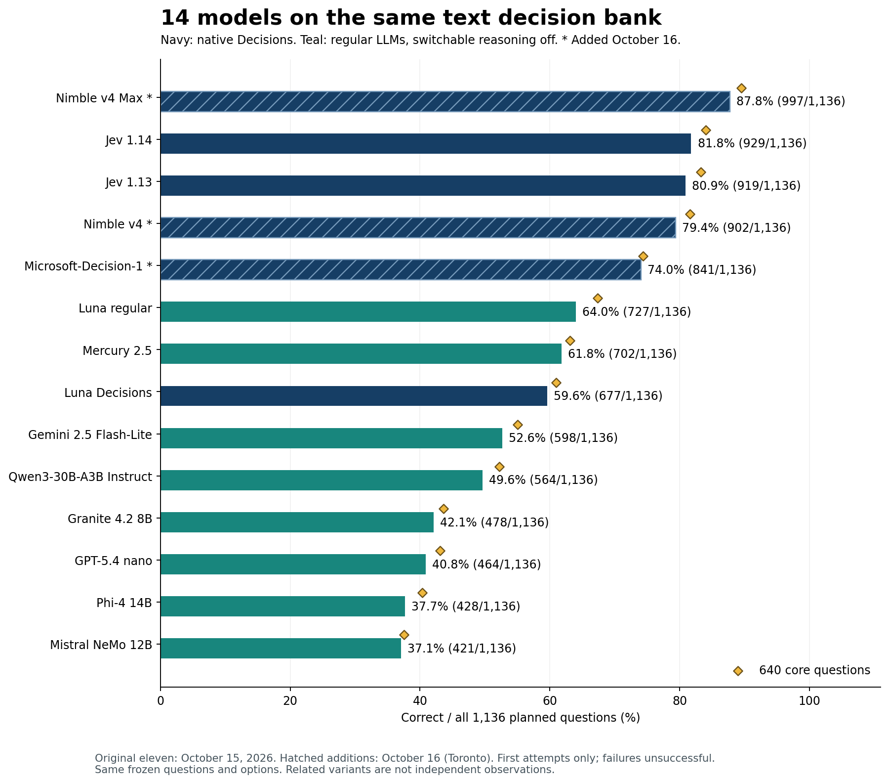
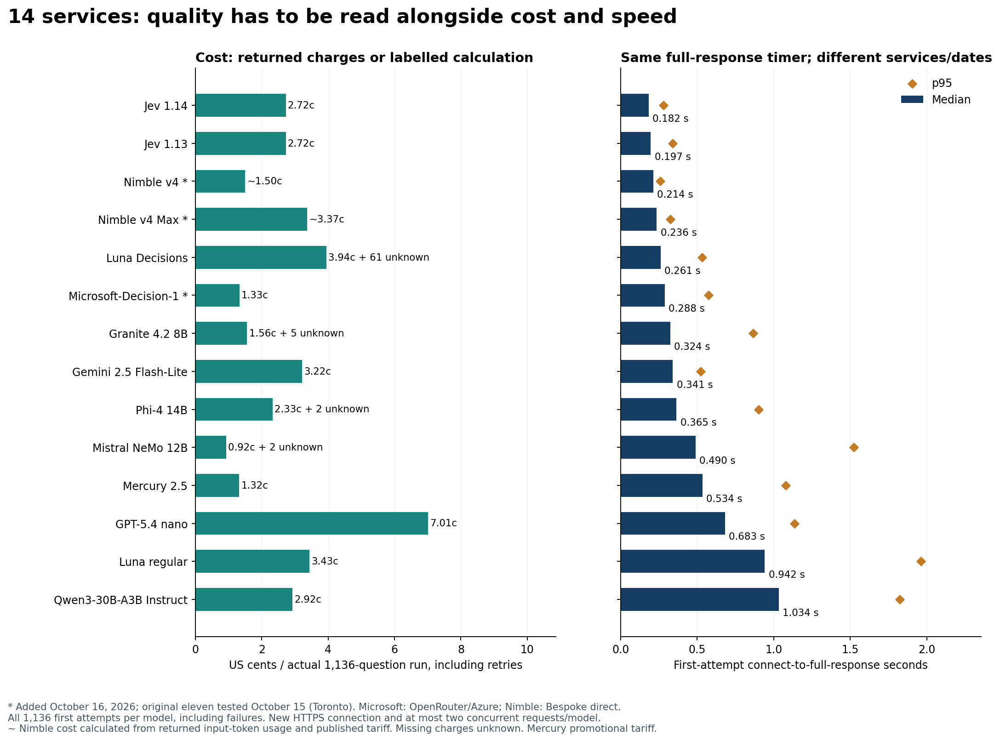
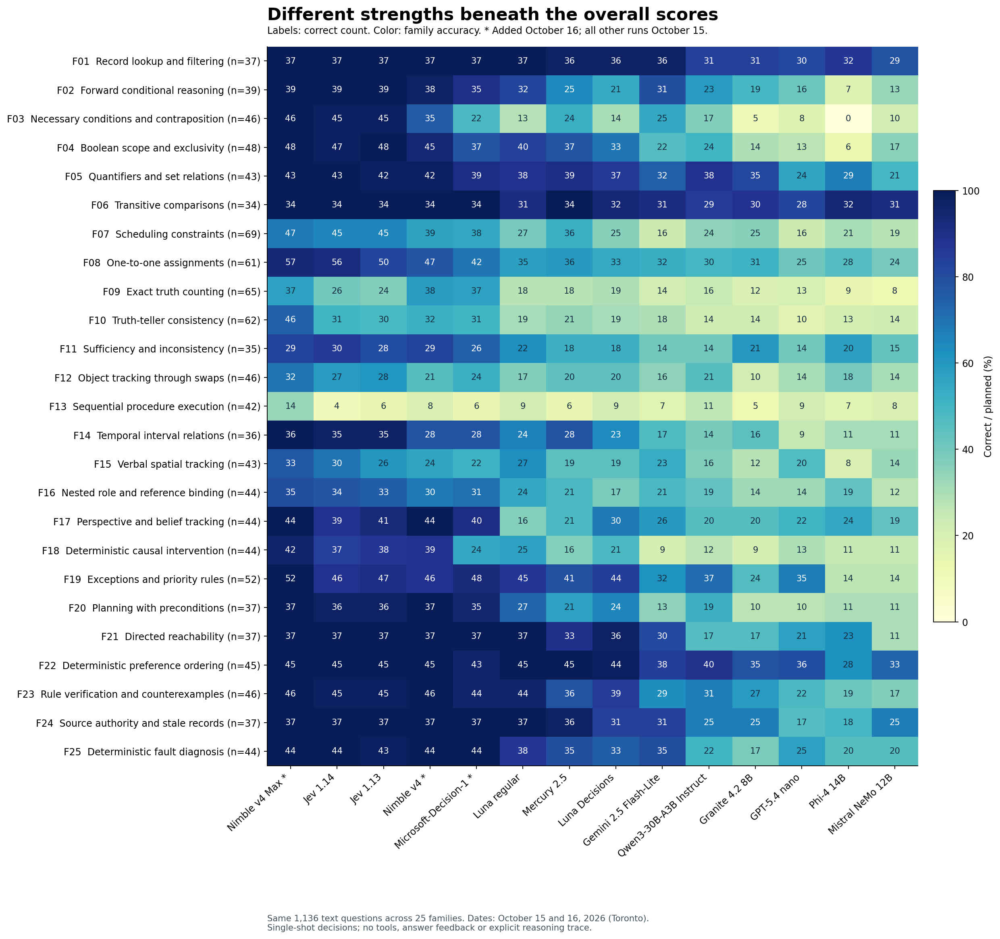

# 14 models on the same 1,136 text decisions

I have been intrigued by Jev because it does something different from the LLMs I usually use: it returns a typed decision with probabilities rather than a paragraph. That made it harder to place. Could it make better quick decisions than Luna, one of my favorite models? I wanted a comparison that would make its strengths and limits visible.

On these tests, the answer was clearly yes. Jev was substantially stronger than both Luna services overall. That is a finding about **System 1-style decisions**: a single answer from supplied information, without an explicit thinking budget, tools or an agentic feedback loop. Those decisions matter when a system needs to route many requests quickly and cheaply. This is not a comparison of unrestricted reasoning, writing or agentic ability.

**Nimble v4 Max now leads the expanded comparison at 997/1,136 (87.8%)**. Jev 1.14 scored **929 (81.8%)**, Jev 1.13 **919 (80.9%)**, Nimble v4 **902 (79.4%)**, Microsoft-Decision-1 **841 (74.0%)**. Regular Luna scored **727 (64.0%)**, Mercury 2.5 **702 (61.8%)**, and Luna Decisions **677 (59.6%)**. The new native decision services strengthen the inexpensive alternatives to regular LLMs, while exposing different limits by function.

The overall comparison contains **14 services × 1,136 questions = 15,904 scored model-question cases**. **Added October 16, 2026:** Microsoft-Decision-1, Nimble v4, Nimble v4 Max. These results are included in the main ranking, function tables and graphics, not isolated as a separate pilot. The original eleven services were tested on October 15 and their saved results are unchanged. Microsoft uses OpenRouter/Azure; Nimble uses Bespoke's direct API where tested. Different dates, routes and provider load limit speed comparisons, even with the same client timer.

The bank contains 640 core questions and 496 related variants, contrasts and candidate checks across 25 families. Related items are not independent observations. Every model received the same underlying instructions, facts, question and five answer options in the same order. Native Decisions and ordinary chat serialize that content differently.

The [function and load-level tables](FUNCTIONS.md) explain every family. The separate [image benchmark](https://github.com/etsabary/visual-decision-benchmark) is not pooled with the text scores.



## Results across the full bank

Every row uses the **first attempt**. Errors, refusals, invalid output and truncation are unsuccessful; wrong valid choices remain separate. The median and p95 use **all 1,136 timed first attempts per model**, including failures. p95 is the response time at or below which roughly 95% of requests completed.

| Model | Correct / 1,136 | Accuracy | Core correct | Wrong valid | Unanswered | Full-bank median | p95 | Test date |
|---|---:|---:|---:|---:|---:|---:|---:|---:|
| Nimble v4 Max | 997 | 87.8% | 573/640 | 139 | 0 | 236 ms | 324 ms | 2026-10-16 |
| Jev 1.14 | 929 | 81.8% | 538/640 | 207 | 0 | 182 ms | 280 ms | 2026-10-15 |
| Jev 1.13 | 919 | 80.9% | 533/640 | 217 | 0 | 197 ms | 340 ms | 2026-10-15 |
| Nimble v4 | 902 | 79.4% | 522/640 | 234 | 0 | 214 ms | 260 ms | 2026-10-16 |
| Microsoft-Decision-1 | 841 | 74.0% | 476/640 | 295 | 0 | 288 ms | 574 ms | 2026-10-16 |
| Luna 6 regular | 727 | 64.0% | 431/640 | 408 | 1 | 942 ms | 1961 ms | 2026-10-15 |
| Mercury 2.5 | 702 | 61.8% | 404/640 | 432 | 2 | 534 ms | 1077 ms | 2026-10-15 |
| Luna 6 Decisions | 677 | 59.6% | 390/640 | 426 | 33 | 261 ms | 533 ms | 2026-10-15 |
| Gemini 2.5 Flash-Lite | 598 | 52.6% | 352/640 | 524 | 14 | 341 ms | 523 ms | 2026-10-15 |
| Qwen3-30B-A3B Instruct 2507 | 564 | 49.6% | 334/640 | 572 | 0 | 1034 ms | 1823 ms | 2026-10-15 |
| Granite 4.2 8B | 478 | 42.1% | 279/640 | 612 | 46 | 324 ms | 866 ms | 2026-10-15 |
| GPT-5.4 nano | 464 | 40.8% | 276/640 | 672 | 0 | 683 ms | 1136 ms | 2026-10-15 |
| Phi-4 14B | 428 | 37.7% | 258/640 | 379 | 329 | 365 ms | 901 ms | 2026-10-15 |
| Mistral NeMo 12B | 421 | 37.1% | 240/640 | 701 | 14 | 490 ms | 1523 ms | 2026-10-15 |

All timers run from connection start through the complete response body. The same timing boundary and two concurrent requests per model are used across the October 15 and October 16 runs. Different dates, routes and provider load can still affect the comparison. Failure counts and usable-response timings remain available in the [overall aggregate evidence](overall_2026-10-16/summary.json).

## Cost of the full runs

Costs cover **1,136 questions per model**, including recovery attempts. The per-1,000 column normalizes the same run cost: run cost ÷ 1,136 × 1,000. It is not an additional run. Earlier pilots and superseded runs are excluded from these totals. Nimble returns token usage without a dollar charge, so its cost is calculated from that usage and the captured published tariff, rather than labelled API-reported billing. Free sign-up credit does not change the tariff value of the work.

| Model | Cost for 1,136 | Normalized cost per 1,000 | Attempts missing cost | Cost basis |
|---|---:|---:|---:|---:|
| Nimble v4 Max | $0.03365973 | $0.02963004 | 0 | Token usage × tariff |
| Jev 1.14 | $0.02723011 | $0.02397017 | 0 | API-reported |
| Jev 1.13 | $0.02723011 | $0.02397017 | 0 | API-reported |
| Nimble v4 | $0.01495988 | $0.01316891 | 0 | Token usage × tariff |
| Microsoft-Decision-1 | $0.01327712 | $0.01168761 | 0 | API-reported |
| Luna 6 regular | $0.03431990 | $0.03021118 | 0 | API-reported |
| Mercury 2.5 | $0.01321493 | $0.01163286 | 0 | API-reported |
| Luna 6 Decisions | $0.03941610 | $0.03469727 | 61 | API-reported |
| Gemini 2.5 Flash-Lite | $0.03219570 | $0.02834129 | 0 | API-reported |
| Qwen3-30B-A3B Instruct 2507 | $0.02922378 | $0.02572516 | 0 | API-reported |
| Granite 4.2 8B | $0.01555172 | $0.01368989 | 5 | API-reported |
| GPT-5.4 nano | $0.07005030 | $0.06166400 | 0 | API-reported |
| Phi-4 14B | $0.02329726 | $0.02050815 | 2 | API-reported |
| Mistral NeMo 12B | $0.00923528 | $0.00812965 | 2 | API-reported |

The selected 14 runs account for **$0.382861929 combined**. 70 attempts have unknown charges. API-returned charges and calculations from input-token usage and a published tariff are distinguished; neither is a statement of an independently reconciled invoice. Mercury's captured tariff had an 80% promotional discount. Its cost advantage is specific to that price.



## Nimble v4 Max changes the overall leader

**Added October 16, 2026.** Nimble v4 Max scored **997/1,136 (87.8%)**, ahead of Jev 1.14's 929/1,136 (81.8%). Its advantage is 68 correct answers, or 6.0 percentage points. The core-only comparison has the same direction: 573/640 (89.5%) versus 538/640 (84.1%). The new result changes the overall conclusion: Jev remains substantially stronger than both Luna services on these questions, but no longer leads this expanded text comparison.

Max improved on Jev 1.14 in 16 families, tied it in eight and scored one question lower on sufficiency and inconsistency (29/35 versus 30/35). It was correct on 98 questions Jev 1.14 missed, while Jev was correct on 30 that Max missed. That is a substantial overall gain without making either service a universal replacement for the other.

The clearest gains are truth-teller consistency (46/62 versus 31/62), exact truth counting (37/65 versus 26/65), and sequential procedures (14/42 versus 4/42). Truth-teller consistency means finding an account in which people's claims about who is truthful fit together. Exact truth counting asks how many supplied statements hold under the same facts. Sequential procedures require updating a state after each prescribed operation. Max improves those functions, but 37/65 on counting and 14/42 on procedures remain poor bases for unattended decisions. Its 47/69 scheduling and 32/46 swap-tracking scores also leave substantial weaknesses.

Max answered every sampled question correctly in 15 families, including necessary conditions, Boolean scope, temporal intervals, belief tracking, exceptions and priority rules. Those are observations on this generated bank, not reliability guarantees. At a returned confidence cutoff of 0.9 it retained 742 questions, all correct in this run (65.3% coverage). The cutoff was examined on the same bank and has not been validated on a new workload.

Its median complete response was **236 ms**, compared with 182 ms for Jev 1.14, and its calculated tariff cost was **$0.03365973** for the full bank, compared with Jev's reported $0.02723011. Max buys higher observed accuracy at somewhat greater cost and latency. Nimble used Bespoke directly, while Jev used OpenRouter, on different days; these timings describe the tested services, not an isolated architecture comparison.

## Nimble v4 offers a different price and quality trade-off

The smaller Nimble v4 scored **902/1,136 (79.4%)**, 27 questions below Jev 1.14 and 175 above regular Luna. Its calculated tariff cost was **$0.01495988**, about 45% below Jev 1.14's reported cost. Its median was **214 ms**, with a 260 ms p95. It did not improve on Jev's overall score or median latency, but its lower cost makes it a useful alternative on tasks where its particular strengths fit.

Nimble v4 scored 44/44 on belief tracking, 37/37 on planning with preconditions and 46/46 on rule verification, compared with Jev 1.14's 39/44, 36/37 and 45/46. It also reached 38/65 on exact truth counting, slightly above Max and well above Jev, although still far from dependable. Its weaker areas include swap tracking (21/46), sequential procedures (8/42), scheduling (39/69) and spatial tracking (24/43). The lower total is not a formatting penalty: all 1,136 first answers were usable typed choices.

## Microsoft improves the low-cost comparison

Microsoft-Decision-1 scored **841/1,136 (74.0%)**, with all first answers usable, a **288 ms** median and a 574 ms p95. Its **$0.013277124 API-reported cost** is almost the same as Mercury's $0.01321493 promotional run cost, while it answered 139 more questions correctly. It also had a shorter observed median than Mercury's 534 ms. Both used OpenRouter, but their dates and backends differ.

Microsoft was perfect on the sampled lookup, transitive-comparison, reachability, source-authority and fault-diagnosis questions. It was also strong on belief tracking (40/44) and exceptions (48/52). Exact truth counting was 37/65, ahead of Jev 1.14's 26/65, but necessary conditions and contraposition were only 22/46, swap tracking 24/46 and sequential procedures 6/42. It is a stronger inexpensive text-decision result than the regular LLMs in this bank, not the strongest model overall.

## What the additions change

All three new services completed 1,136 first attempts without a transport failure, invalid choice or recovery request. Their 3,408 new cases bring the overall comparison to **14 services and 15,904 scored model-question cases**. None of the original eleven runs was repeated or replaced. Sixteen questions remain unanswered correctly by any of the fourteen services, down from 29 in the eleven-model comparison; the original key is unchanged.

Microsoft reports a dollar charge in each response. Nimble reports input-token usage but no dollar charge, so its displayed costs are usage multiplied by the captured published prices: $0.04 per million input tokens for v4 and $0.09 for Max, with free output. These are tariff calculations, not independently reconciled invoices. Similar per-token prices do not imply identical per-question costs because services count different prompt overheads and tokens.

## Regular Luna and Luna Decisions differ in ways the total score conceals

Regular Luna answered **727/1,136** correctly, compared with **677/1,136** for Luna Decisions. Its core score was 431/640, compared with 390/640. They agreed on 683 of the 1102 questions both answered (62.0%). Similar aggregate scores do not mean they made the same decisions.

The speed trade-off matters. The full-bank median was **261 ms for Luna Decisions**, compared with 942 ms for regular Luna and 534 ms for Mercury. All three were tested on October 15 with the same response-body timing method, although Decisions was measured in a later session and uses a different request interface. Regular Luna also cost less in reported charges: $0.03431990 versus $0.03941610 for Decisions, whose 61 failed attempts omitted charges. Mercury scored 25 more questions correctly than Decisions, with roughly twice its median response time in this short-output test, but about one-third of its known reported cost.

The direction of the difference depends on the function. Regular Luna versus Luna Decisions scored 32/39 versus 21/39 on forward implications, 40/48 versus 33/48 on Boolean scope, 44/46 versus 39/46 on rule verification, 37/37 versus 31/37 on source authority. On belief tracking, Luna Decisions scored 30/44 versus regular Luna's 16/44; on supplied-candidate checks, 33/80 versus 17/80. These services expose different identities and request interfaces, so differences cannot be attributed to the interface alone.

## Mercury remains a useful regular LLM cost comparison

Mercury came within 25 correct answers of regular Luna while costing $0.01321493 for the actual 1,136-question run, compared with Luna's $0.03431990. Its median complete response was 0.534 seconds, compared with 0.942 seconds for Luna. Mercury's current 80% advertised tariff discount is part of this result; the cost advantage should be checked again after that discount changes. This short-output test does not validate a general throughput or architecture claim.

Mercury answered every sampled transitive-comparison question (34/34) and preference-ordering question (45/45), and nearly every lookup and source-authority question (36/37 in each family). It was much less dependable on exact truth counting (18/65), repeated object swaps (20/46), causal intervention (16/44), and sequential procedures (6/42). Its 61.8% total is a useful budget comparison, not a basis for accepting arbitrary decisions without checking.

## The smaller open-weight candidates expose a substantial quality cost

Qwen3-30B-A3B Instruct produced a valid numeric answer on all 1,136 questions, but only 564 were correct (49.6%). It did relatively well on preference ordering (40/45), set relations (38/43), transitive comparisons (29/34), and lookup (31/37). Scheduling (24/69), causal intervention (12/44), exact truth counting (16/65), and truth-teller consistency (14/62) remained weak. It did not outperform Mercury on aggregate accuracy, known cost or median response time in this run.

Granite 4.2 8B was fast and inexpensive, with a 0.324-second median and $0.01555172 in reported cost, but scored 478/1,136 (42.1%). Transitive comparisons (30/34), lookup (31/37), and set relations (35/43) were its better areas. Contraposition (5/46), sequential procedures (5/42), exact truth counting (12/65), and object swaps (10/46) were poor. Its post-hoc leading-ID score is almost unchanged at 479/1,136, so formatting alone does not account for the low total. Five error attempts omitted cost.

Phi-4's strict score was 428/1,136 (37.7%), but 327 first responses failed the requested output format. Many began with an answer ID and then added explanation, sometimes reaching the 16-token cap. A uniform, post-hoc leading-ID parser raises its score to 536/1,136 (47.2%). The strict result therefore mixes decision errors with failure to honor the short-output contract. The sensitivity check uses saved responses, adds no calls, and is not an evaluation with a larger output budget or reasoning enabled. Phi-4 remained below Mercury and regular Luna even under that more permissive reading.

Mistral NeMo was the cheapest regular-LLM run at $0.009235281 reported, with two error attempts missing cost, but answered only 421/1,136 correctly (37.1%). Its stronger areas were transitive comparisons (31/34), lookup (29/37), and preference ordering (33/45). Exact truth counting (8/65), procedural execution (8/42), contraposition (10/46), and truth-teller consistency (14/62) were weak. Its leading-ID score does not improve the total.

## The two earlier budget LLMs are evaluated on the full bank

Gemini 2.5 Flash-Lite scored 598/1,136 (52.6%), with a 0.341-second median and a reported cost of $0.03219570. It was strong on lookup (36/37), transitive comparisons (31/34), and preference ordering (38/45), but weak on causal intervention (9/44), scheduling (16/69), exact counting (14/65), and sequential procedures (7/42). It was faster than Mercury on this setup, while Mercury was more accurate and cheaper at its discounted tariff.

GPT-5.4 nano scored 464/1,136 (40.8%). All answers satisfied the numeric-ID format, so there is no formatting explanation for its low total. It cost $0.07005030, the highest amount among the eight regular-LLM full runs, with a 0.683-second median. Its better areas were transitive comparisons (28/34), lookup (30/37), preference ordering (36/45), and exceptions (35/52). Contraposition (8/46), truth-teller consistency (10/62), scheduling (16/69), and exact truth counting (13/65) were weak. On this workload it offers no observed accuracy, median-latency or cost advantage over Mercury.

## The common hard cases remain hard

No model is dependable on sequential procedure execution: the best strict result is 14/42. The best exact truth-counting result is 38/65. Object tracking through repeated swaps and truth-teller consistency also remain substantial weaknesses. A typed answer, a short response or a low price does not remove the need to check exact state transitions and counts.

Jev 1.14 scored 56/61 on assignments, 39/44 on belief tracking, and 36/37 on planning with preconditions. It answered every sampled question correctly in 8 families: record lookup and filtering, forward conditional reasoning, quantifiers and set relations, transitive comparisons, directed reachability, deterministic preference ordering, source authority and stale records, deterministic fault diagnosis. Its 45/69 scheduling result and 4/42 procedural result show why its bounded-deduction strengths should not be described as general reliability.

There are 16 questions that none of the 14 models answered correctly under the strict primary rules. Their IDs remain private for a possible later key and wording audit. This count does not establish that their reference answers are wrong; the original key is unchanged.

## Where Jev 1.14 improved over 1.13

The overall text difference is **+10 correct answers**, from 80.9% to 81.8%. The clearest gains remain assignments and spatial tracking, but the new run no longer shows a scheduling gain.

| Function | Jev 1.13 | Jev 1.14 | Change in correct answers |
|---|---:|---:|---:|
| One-to-one assignments | 50/61 | 56/61 | +6 |
| Verbal spatial tracking | 26/43 | 30/43 | +4 |
| Scheduling | 45/69 | 45/69 | +0 |
| Exact truth counting | 24/65 | 26/65 | +2 |
| Sequential procedures | 6/42 | 4/42 | -2 |
| Object tracking through swaps | 28/46 | 27/46 | -1 |
| Belief tracking | 41/44 | 39/44 | -2 |


Across individual questions, 1.14 corrected 44 cases that 1.13 did not answer correctly, and lost 34 cases that 1.13 answered correctly. Improvement is not uniform. Exceptions and priority rules: 47/52 versus 46/52; temporal intervals: 35/36 versus 35/36. On changed-evidence pairs, the counts with both answers correct were 20/25 and 20/25. A version upgrade should therefore be checked against the tasks an application actually uses.

A one-to-one assignment means giving each person, object or time slot a unique partner while respecting clues. For example: three people need different desks; one cannot use the window desk and another must sit left of the third; which complete assignment satisfies every rule? Spatial tracking means updating a direction or position through described movements, such as following successive turns and then identifying where someone is facing. These illustrations explain the categories; they are not additional scored questions.

## Image decisions add another dimension

The separate [image benchmark](https://github.com/etsabary/visual-decision-benchmark) used 200 questions per configuration, tested on October 15, 2026. Its scores are unchanged. Mercury was not tested on images. On October 16, Microsoft explicitly rejected the native image request. Both Nimble versions accepted its image-shaped JSON and returned choices, but their [API contract](https://docs.bespokelabs.ai/api-reference/systemone) explicitly says that a JSON state is read as JSON text. Each probe billed 26,253 input tokens; accepting the encoded image data as text is not evidence of pixel processing. No native-image score is assigned to these three API routes, and the 200-question image bank was not run through a text substitute. The [capability record and probe costs](overall_2026-10-16/image_capabilities.json) and [sanitized responses](overall_2026-10-16/image_compatibility_probes.jsonl) retain the evidence. This concerns the tested APIs, not every possible future endpoint or capability of their underlying base models.

| Image configuration | Correct / 200 | Accuracy | Median full reply | Known actual 200-question cost |
|---|---:|---:|---:|---:|
| Jev 1.14 | 141 | 70.5% | 307 ms | $0.02397688* |
| Luna Decisions | 121 | 60.5% | 383 ms | $0.02254620* |
| Luna regular | 117 | 58.5% | 2354 ms | $0.02958170 |
| GPT-5.4 nano | 70 | 35.0% | 1605 ms | $0.05052450 |
| Gemini 2.5 Flash-Lite | 75 | 37.5% | 873 ms | $0.00864040* |


An asterisk marks missing error charges. These are actual 200-question costs; the image repo’s per-1,000 chart remains a separately labelled normalization.

The image results show where the overall winner loses. Jev scored 9/10 on conditional counting, spatial relationships and flowcharts. Conditional counting means counting only objects meeting a rule, such as red shapes inside a marked region. A flowchart question asks a model to follow pictured branches for a supplied input and select the resulting outcome.

Luna Decisions was stronger on **rotation and reflection**, at 8/10 versus Jev's 3/10: recognizing which option is the rotated or mirrored version of a pictured shape. Regular Luna was stronger on **visual rule application**, at 6/10 versus Jev's 3/10: applying a pictured transformation or legend to choose the correct result. Both Luna services scored 7/10 on sequential visual state tracking, compared with Jev's 6/10. Each image family has only ten questions, so these are useful leads for further testing rather than broad reliability estimates.

The text bank also shows why totals do not describe every function: Qwen answered 11/42 procedural questions correctly, versus Jev 1.14's 4/42. Neither result is dependable.

The release's text gain should be distinguished from its broader features. In the [October 14 release announcement](https://typesafe.ai/blog/jev-1-14), TypeSafe describes incremental model improvements and expects the largest gain in multilingual support. We tested only English. The release also enabled experimental image input, a bounding-box output type and longer context. TypeSafe says 1.13 was already multimodal, and image access was enabled for it too; bounding-box output was specific to 1.14. Our image bank establishes behavior on the tested 1.14 OpenRouter route, not a measured vision improvement over 1.13. Bounding boxes, long-context quality and multilingual gains remain outside these tests.

## Accuracy across the 25 functions

Cell labels show correct counts; color shows accuracy within each family. The [function tables](FUNCTIONS.md) and [family CSV](overall_2026-10-16/family_comparison.csv) retain all denominators, including the new models.



## Matched diagnostic tests

Rotation and evidence-change scores use planned panel denominators, so missing answers cannot improve them. Semantic consistency is shown only among complete rotation panels; a consistent choice can still be wrong. Candidate-check scores include all 80 planned checks.

| Model | All rotations correct | Consistent / complete panels | Both evidence answers correct | Candidate checks correct | All five checks correct |
|---|---:|---:|---:|---:|---:|
| Nimble v4 Max | 20/25 | 22/25 | 21/25 | 60/80 | 7/16 |
| Jev 1.14 | 21/25 | 23/25 | 20/25 | 42/80 | 0/16 |
| Jev 1.13 | 22/25 | 24/25 | 20/25 | 37/80 | 1/16 |
| Nimble v4 | 20/25 | 22/25 | 17/25 | 42/80 | 2/16 |
| Microsoft-Decision-1 | 19/25 | 22/25 | 19/25 | 49/80 | 2/16 |
| Luna 6 regular | 16/25 | 17/25 | 11/25 | 17/80 | 0/16 |
| Mercury 2.5 | 14/25 | 14/24 | 13/25 | 28/80 | 0/16 |
| Luna 6 Decisions | 13/25 | 14/20 | 13/25 | 33/80 | 0/16 |
| Gemini 2.5 Flash-Lite | 12/25 | 12/25 | 9/25 | 24/80 | 0/16 |
| Qwen3-30B-A3B Instruct 2507 | 11/25 | 11/25 | 9/25 | 21/80 | 0/16 |
| Granite 4.2 8B | 7/25 | 7/23 | 7/25 | 25/80 | 0/16 |
| GPT-5.4 nano | 6/25 | 7/25 | 7/25 | 17/80 | 0/16 |
| Phi-4 14B | 5/25 | 6/9 | 7/25 | 9/80 | 0/16 |
| Mistral NeMo 12B | 5/25 | 5/24 | 5/25 | 19/80 | 0/16 |

## Output format and recovery

The leading-ID column is a **post-hoc sensitivity check**, applied uniformly to the eight saved LLM runs. It reads a numeric answer ID at the start even if an explanation follows or later output is truncated. It adds no calls and does not replace the strict primary score. A larger output budget or reasoning-enabled evaluation would be a different experiment.

| Model | Strict correct | Leading-ID correct | Invalid first output | First transport/HTTP failures | Recovery attempts | Eventual correct |
|---|---:|---:|---:|---:|---:|---:|
| Luna 6 regular | 727 | 727 | 1 | 0 | 0 | 727 |
| Mercury 2.5 | 702 | 703 | 2 | 0 | 0 | 702 |
| Gemini 2.5 Flash-Lite | 598 | 599 | 14 | 0 | 0 | 598 |
| Qwen3-30B-A3B Instruct 2507 | 564 | 564 | 0 | 0 | 0 | 564 |
| Granite 4.2 8B | 478 | 479 | 42 | 4 | 4 | 478 |
| GPT-5.4 nano | 464 | 464 | 0 | 0 | 0 | 464 |
| Phi-4 14B | 428 | 536 | 327 | 2 | 2 | 429 |
| Mistral NeMo 12B | 421 | 421 | 12 | 2 | 2 | 421 |

The native services return typed choices rather than generated answer IDs. A usable choice is scored even when its probability distribution has a rounding or normalization warning. Provider failures are unsuccessful first attempts, not demonstrated logical mistakes. The eventual scores below include the permitted recovery attempt and do not replace the main results.

| Decisions service | Usable first choices | First transport/HTTP failures | Probability warnings | Recovery attempts | Eventual correct |
|---|---:|---:|---:|---:|---:|
| Jev 1.13 | 1136 | 0 | 9 | 0 | 919 |
| Jev 1.14 | 1136 | 0 | 16 | 0 | 929 |
| Luna 6 Decisions | 1103 | 33 | 0 | 33 | 680 |
| Microsoft-Decision-1 | 1136 | 0 | 0 | 0 | 841 |
| Nimble v4 | 1136 | 0 | 0 | 0 | 902 |
| Nimble v4 Max | 1136 | 0 | 0 | 0 | 997 |

## Confidence and coverage

Native Decisions services returned confidence and option probabilities. Their confidence values need not share a scale: Nimble defines confidence as concentration of the answer distribution, not the probability of being correct. Regular LLMs were asked only for an answer ID, so an equivalent confidence-filter comparison is unavailable. These thresholds use the selected native responses and remain exploratory because they were examined on the same bank.

| Confidence cutoff | Jev 1.13 | Jev 1.14 | Luna 6 Decisions | Microsoft-Decision-1 | Nimble v4 | Nimble v4 Max |
|---|---:|---:|---:|---:|---:|---:|
| ≥0.8 | 690/703 (61.9% coverage) | 717/726 (63.9% coverage) | 215/218 (19.2% coverage) | 637/692 (60.9% coverage) | 539/540 (47.5% coverage) | 814/815 (71.7% coverage) |
| ≥0.9 | 619/622 (54.8% coverage) | 654/658 (57.9% coverage) | 143/143 (12.6% coverage) | 502/518 (45.6% coverage) | 428/429 (37.8% coverage) | 742/742 (65.3% coverage) |
| ≥0.95 | 552/553 (48.7% coverage) | 603/604 (53.2% coverage) | 90/90 (7.9% coverage) | 383/383 (33.7% coverage) | 320/320 (28.2% coverage) | 672/672 (59.2% coverage) |

An observed error-free retained subset does not guarantee zero future error. Confidence should be validated on the caller's own tasks before it controls an automation decision.

## What changed in the rerun

The fresh three-model run replaced both scores and timings in the current comparison. The previous results remain archived, rather than being combined with new response times. The table separates gains and losses across individual questions; a small net change can conceal changes in both directions.

| Service | Previous correct / 1,136 | Fresh correct / 1,136 | Previously unsuccessful now correct | Previously correct now unsuccessful |
|---|---:|---:|---:|---:|
| Jev 1.13 | 910 | 919 | 23 | 14 |
| Jev 1.14 | 932 | 929 | 14 | 17 |
| Luna 6 Decisions | 687 | 677 | 44 | 54 |

The ranking is unchanged, but Jev 1.14's margin over 1.13 narrowed from 22 to 10 correct answers (about 0.9 percentage points in the fresh run). The version improvement is therefore smaller than the first comparison suggested. Assignments and spatial tracking still improve; scheduling is now tied, while sequential procedure execution is worse.

Luna Decisions fell from 687 to 677 correct, with 33 first-attempt HTTP failures versus 23 unanswered cases in the previous selected results. Both views contain 426 wrong valid choices, but individual answers changed in both directions. Earlier retry rules also differed, so the lower total is not an isolated measurement of model intelligence. Five of the 33 failed first attempts recovered on the permitted retry; the eventual score was 680/1,136. The main comparison keeps the stricter 677/1,136 first-attempt result, as it does for the eight regular LLMs.

These repeats measure observed service variation as well as possible model behavior. The original Jev 1.13 run used several routes, and earlier runs had different retry rules. A changed answer alone does not establish a change in model weights.

## Measurement conditions and model identities

| Session | Toronto start | Toronto finish |
|---|---:|---:|
| Eight regular LLMs | 2026-10-15 12:02:00 | 2026-10-15 12:20:06 |
| Original three Decisions services | 2026-10-15 13:12:02 | 2026-10-15 13:18:31 |
| Microsoft-Decision-1 | 2026-10-16 13:44:04 | 2026-10-16 13:48:14 |
| Nimble v4 | 2026-10-16 13:48:52 | 2026-10-16 13:51:42 |
| Nimble v4 Max | 2026-10-16 13:49:02 | 2026-10-16 13:52:04 |

All sessions used a new HTTPS connection for every attempt, a monotonic connection-to-full-body timer, and at most two concurrent requests per model in each two-question wave. Local preparation, queueing and retry waits were outside the response timer. The eight-LLM session allowed 16 requests globally; the three-model refresh allowed six. The October 16 runner allowed two per model, and both Nimble models together stayed within the documented four-request free-credit concurrency limit. The [addition transport](added_decisions.py) retains the same timer operations as the [October 15 transport](decision_refresh.py), with configurable host and endpoint path.

Ordinary LLMs used `/api/v1/chat/completions`, a 16-token cap, a numeric-ID-only instruction, and switchable reasoning disabled. OpenRouter native services used `/api/alpha/decisions` with backend selection and fallback disabled. Nimble used Bespoke's `/v1/systemone` directly, with the same original state, instructions and five answer options. No reasoning trace or agentic iteration was requested. Backend hardware, routes, quantization and service interfaces differ. These are end-to-end service measurements, not isolated inference-speed measurements.

| Service | Returned identities and counts | Backend tag | Toronto dates |
|---|---:|---:|---:|
| Nimble v4 Max | `nimble-v4-max` (1136) | bespoke-direct | 2026-10-16 |
| Jev 1.14 | `typesafe/jev-1.14-20261014` (1136) | typesafe | 2026-10-15 |
| Jev 1.13 | `typesafe/jev-1.13-20260917` (1136) | typesafe | 2026-10-15 |
| Nimble v4 | `nimble-v4` (1136) | bespoke-direct | 2026-10-16 |
| Microsoft-Decision-1 | `microsoft/microsoft-decision-1-20261009` (1136) | azure | 2026-10-16 |
| Luna 6 regular | `openai/gpt-6-luna` (1136) | openai | 2026-10-15 |
| Mercury 2.5 | `inception/mercury-2.5` (1136) | inception | 2026-10-15 |
| Luna 6 Decisions | `openai/gpt-6-luna-decisions-20261006` (1103); `unreported (error)` (33) | openai | 2026-10-15 |
| Gemini 2.5 Flash-Lite | `google/gemini-2.5-flash-lite` (1136) | google-ai-studio | 2026-10-15 |
| Qwen3-30B-A3B Instruct 2507 | `qwen/qwen3-30b-a3b-instruct-2507` (1136) | siliconflow/fp8 | 2026-10-15 |
| Granite 4.2 8B | `ibm-granite/granite-4.2-8b` (1132); `unreported (error)` (4) | deepinfra/bf16 | 2026-10-15 |
| GPT-5.4 nano | `openai/gpt-5.4-nano` (1136) | openai | 2026-10-15 |
| Phi-4 14B | `microsoft/phi-4` (1134); `unreported (error)` (2) | deepinfra/bf16 | 2026-10-15 |
| Mistral NeMo 12B | `mistralai/mistral-nemo` (1134); `unreported (error)` (2) | deepinfra/fp8 | 2026-10-15 |

The refresh required the listed dated Jev and Luna Decisions checkpoints on every successful response. Microsoft likewise returned the required October 9 identity. Nimble was requested by its explicit v4 and v4 Max names, not `nimble-latest`; its API documentation says the response repeats the requested name, so this is not independent checkpoint attestation. Ordinary LLMs generally returned aliases, not dated checkpoints. Captured endpoint metadata is retained for [the eight LLMs](expansion_2026-10-15/model_metadata.json), [the original three native services](decision_refresh_2026-10-15/model_metadata.json) and [the October 16 additions](additions_2026-10-16).

## Evidence reproduction and limits

The [questions](data/questions_1136.csv), [overall summary](overall_2026-10-16/summary.json), [October 16 addition ledgers and protocols](additions_2026-10-16), [unchanged eleven-model summary](matched_2026-10-15/summary.json), [October 15 native attempt ledger](decision_refresh_2026-10-15/attempts.jsonl), and [unchanged eight-LLM evidence](expansion_2026-10-15) preserve the comparison. Account metadata and credentials are excluded. Recorded model outputs are public; the answer key and individual correctness records remain private.

All new primary scores use first attempts; retries are limited to one recovery for transport failures or HTTP 408, 429 and 5xx responses. Valid wrong answers and format failures are never retried. Cost includes eligible recoveries; missing charges remain unknown, not zero. Nimble documents HTTP errors as uncharged, while transport timeouts with no response remain unknown.

The bank mixes 25 generated task families and dependent variants. It is not a standardized intelligence or deployment-safety test. The fixed key is unchanged, and this rerun does not add an independent audit of every printed question. Later key corrections should be versioned and applied to every saved response.

```bash
# Offline checks. No credentials, answer key or paid API calls.
python3 validate.py
python3 text_models.py
python3 matched_analysis.py
python3 overall_analysis.py
python3 -m unittest -v test_analysis.py test_text_models.py test_decision_refresh.py test_added_decisions.py test_overall.py test_publication.py test_matched.py

# Reproduce scores using the external original key.
python3 matched_analysis.py --answer-key /path/to/answer_key.csv
python3 overall_analysis.py --answer-key /path/to/answer_key.csv

# Rebuild current figures, README and Pages.
python3 -m pip install -r requirements-reports.txt
python3 plot_overall.py
python3 build_report.py
python3 freeze_expansion_checksums.py
```

The [original three-model report](THREE_MODEL_REFERENCE.md), its [frozen evidence](data), and the [earlier eleven-model publication](https://github.com/etsabary/jev-1.14-comparison-benchmark/tree/b9c7b1f3abb0e1728c7b4f8585d027b3c3a82921) remain available. The earlier eight-LLM summary stays unchanged in its own directory. The [original Jev benchmark](https://github.com/etsabary/jev-deterministic-benchmark) and [two-model extension](https://github.com/etsabary/luna-decisions-benchmark/tree/0f10c51/extension_136) also remain reference points.
