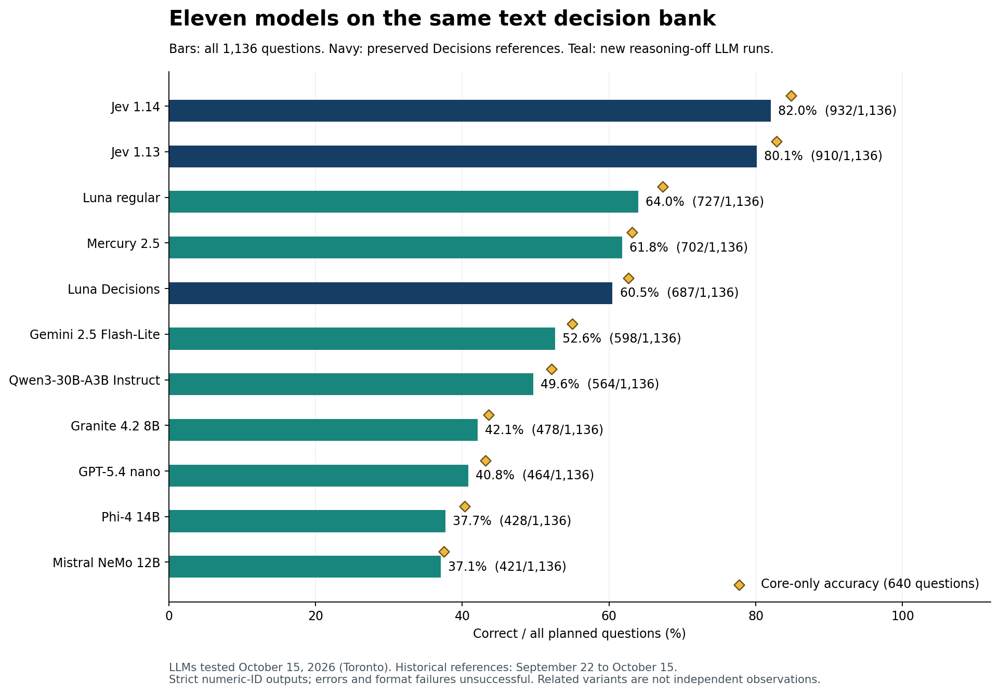
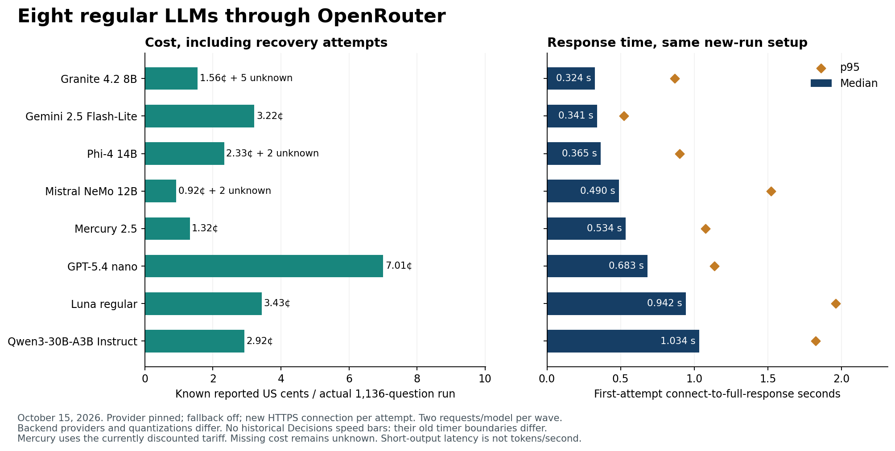
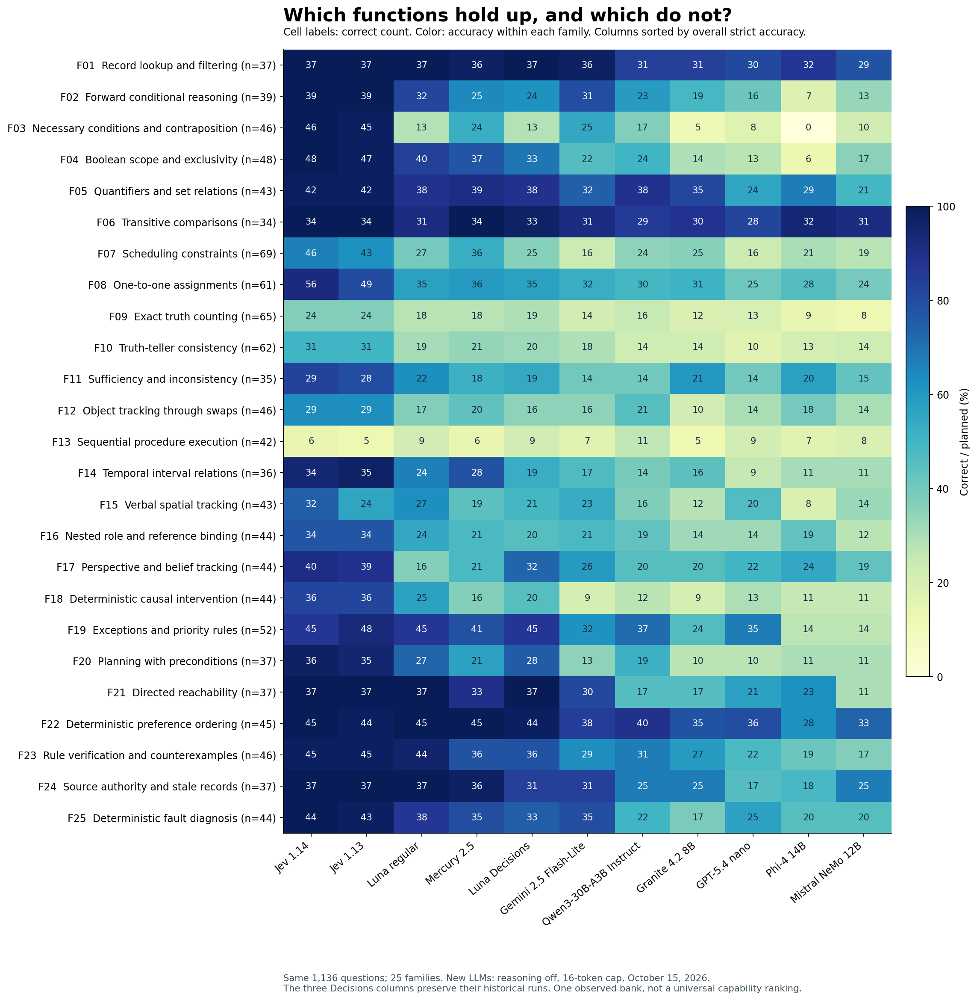
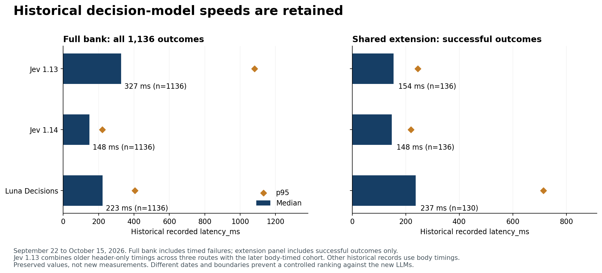

# Eleven models on the same 1,136 text decisions

I have been intrigued by Jev because it does something different from the LLMs I usually use: it returns a typed decision with probabilities rather than a paragraph. That made it harder to place. Could it make better quick decisions than Luna, one of my favorite models? I wanted a comparison that would make its strengths and limits visible.

On these tests, the answer was clearly yes. Jev was substantially stronger than both Luna services overall. That is a finding about **System 1-style decisions**: a single answer from supplied information, without an explicit thinking budget, tools or an agentic feedback loop. Those decisions matter when a system needs to route many requests quickly and cheaply. This is not a comparison of unrestricted reasoning, writing or agentic ability.

Jev 1.14 remains the strongest overall result on this bank, with **932/1,136 correct (82.0%)**, followed by Jev 1.13 with **910 (80.1%)**. Among eight regular LLMs tested with switchable reasoning disabled, **GPT-6 Luna scored 727 (64.0%)** and **Mercury 2.5 scored 702 (61.8%)**. Mercury came close to regular Luna at lower reported cost and shorter median response time under its test-day promotional tariff.

This comparison covers **11 model services × 1,136 questions = 12,496 scored model-question cases**. It preserves three historical native Decisions results and adds eight coordinated regular-LLM runs from October 15, 2026. The new LLMs used OpenRouter, pinned backend providers, a 16-token output cap and a numeric-answer-ID-only instruction. These are short-answer decision results, not unrestricted reasoning scores.

The bank contains 640 core questions and 496 related variants, contrasts and candidate checks across 25 families. Related items are not independent observations. All models received the same underlying instructions, facts, question and five answer options in the same order; native Decisions and ordinary chat serialize that content differently.

The [original three-model report](THREE_MODEL_REFERENCE.md), [frozen original evidence](data), [eleven-model summary](expansion_2026-10-15/summary.json), and [function and load-level tables](FUNCTIONS.md) remain available. The [image benchmark](https://github.com/etsabary/visual-decision-benchmark) is separate.



## Results across the full bank

Historical rows preserve their original recorded outcomes and retry rules. New LLM rows use the first attempt as primary. Errors, refusals, non-ID output and truncation are unsuccessful; wrong valid choices remain separate.

The headline median and p95 use **all 1,136 saved outcomes for each model**, including timed failures. They give a ballpark view of the recorded services. Historical timing boundaries, dates and routes differ from the new run, so this is not a controlled eleven-way speed ranking.

| Model | Correct / 1,136 | Accuracy | Core correct | Wrong valid | Unanswered | Full-bank median | p95 |
|---|---:|---:|---:|---:|---:|---:|---:|
| Jev 1.14 | 932 | 82.0% | 543/640 | 202 | 2 | 148 ms historical | 220 ms |
| Jev 1.13 | 910 | 80.1% | 530/640 | 226 | 0 | 327 ms historical | 1081 ms |
| Luna 6 regular | 727 | 64.0% | 431/640 | 408 | 1 | 942 ms | 1961 ms |
| Mercury 2.5 | 702 | 61.8% | 404/640 | 432 | 2 | 534 ms | 1077 ms |
| Luna 6 Decisions | 687 | 60.5% | 401/640 | 426 | 23 | 223 ms historical | 404 ms |
| Gemini 2.5 Flash-Lite | 598 | 52.6% | 352/640 | 524 | 14 | 341 ms | 523 ms |
| Qwen3-30B-A3B Instruct 2507 | 564 | 49.6% | 334/640 | 572 | 0 | 1034 ms | 1823 ms |
| Granite 4.2 8B | 478 | 42.1% | 279/640 | 612 | 46 | 324 ms | 866 ms |
| GPT-5.4 nano | 464 | 40.8% | 276/640 | 672 | 0 | 683 ms | 1136 ms |
| Phi-4 14B | 428 | 37.7% | 258/640 | 379 | 329 | 365 ms | 901 ms |
| Mistral NeMo 12B | 421 | 37.1% | 240/640 | 701 | 14 | 490 ms | 1523 ms |

## Actual cost of the eight new full runs

Costs cover **1,136 questions per model**, including recovery attempts. The per-1,000 column is a normalization of the same bill: reported run cost ÷ 1,136 × 1,000. It is not an additional run. The earlier 75-call pilot is separate.

| Model | Known cost for 1,136 | Normalized cost per 1,000 | Attempts missing cost |
|---|---:|---:|---:|
| Luna 6 regular | $0.03431990 | $0.03021118 | 0 |
| Mercury 2.5 | $0.01321493 | $0.01163286 | 0 |
| Gemini 2.5 Flash-Lite | $0.03219570 | $0.02834129 | 0 |
| Qwen3-30B-A3B Instruct 2507 | $0.02922378 | $0.02572516 | 0 |
| Granite 4.2 8B | $0.01555172 | $0.01368989 | 5 |
| GPT-5.4 nano | $0.07005030 | $0.06166400 | 0 |
| Phi-4 14B | $0.02329726 | $0.02050815 | 2 |
| Mistral NeMo 12B | $0.00923528 | $0.00812965 | 2 |

The eight new runs reported **$0.227088871 combined**. Nine error attempts omitted charges, so this is a known reported amount, not exact billing. Mercury's captured tariff had an 80% promotional discount. Its cost advantage is specific to that price. Backend hardware and quantization differ even though OpenRouter is the shared front door.

Jev 1.14's historical attempt ledger reported **$0.027183072**, with two errors omitting cost. Jev 1.13 has cost fields only for its 136 extension records ($0.003161340), not a full-bank bill. Luna Decisions' selected historical result records total $0.0395666 across 1,113 cost-reporting records; failed/retried attempts are not a complete accounting ledger here. These figures are retained with their coverage rather than presented as equivalent full-run bills.



## Regular Luna and Luna Decisions differ in ways the total score conceals


Regular Luna answered 40 more questions correctly than the historical Luna Decisions run, 727 versus 687. Its core score was also higher, 431/640 versus 401/640. They agreed on 691 of the 1,112 questions both answered, or 62.1%. Similar aggregate scores do not mean they made the same decisions.

The speed trade-off matters. The saved full-bank median was about 223 ms for Luna Decisions, compared with 942 ms for regular Luna and 534 ms for Mercury. Those are useful ballpark values, not a controlled speed comparison: the Decisions run came from earlier dates and a different request interface.


The direction of the difference depends on the function. Regular Luna did better on forward implications (32/39 versus 24/39), Boolean scope (40/48 versus 33/48), rule verification and counterexamples (44/46 versus 36/46), and source authority (37/37 versus 31/37). Luna Decisions did better on belief tracking (32/44 versus 16/44), supplied-candidate checks (32/80 versus 17/80), and correctly answering both questions after an evidence change (13/25 versus 11/25). The two services were tested on different dates and returned different identity information. These differences cannot be attributed to the decision interface alone.


## Mercury is the most interesting new cost alternative


Mercury came within 25 correct answers of regular Luna while costing $0.01321493 for the actual 1,136-question run, compared with Luna's $0.03431990. Its median complete response was 0.534 seconds, compared with 0.942 seconds for Luna. Mercury's current 80% advertised tariff discount is part of this result; the cost advantage should be checked again after that discount changes. This one short-output test does not validate a general throughput or architecture claim.


Mercury answered every sampled transitive-comparison question (34/34) and preference-ordering question (45/45), and nearly every lookup and source-authority question (36/37 in each family). It was much less dependable on exact truth counting (18/65), repeated object swaps (20/46), causal intervention (16/44), and sequential procedures (6/42). Its 61.8% total is a useful budget comparison, not a basis for accepting arbitrary decisions without checking.


## The smaller open-weight candidates expose a substantial quality cost


Qwen3-30B-A3B Instruct produced a valid numeric answer on all 1,136 questions, but only 564 were correct (49.6%). It did relatively well on preference ordering (40/45), set relations (38/43), transitive comparisons (29/34), and lookup (31/37). Scheduling (24/69), causal intervention (12/44), exact truth counting (16/65), and truth-teller consistency (14/62) remained weak. It did not outperform Mercury on aggregate accuracy, known cost or median response time in this run.


Granite 4.2 8B was fast and inexpensive, with a 0.324-second median and $0.01555172 in reported cost, but scored 478/1,136 (42.1%). Transitive comparisons (30/34), lookup (31/37), and set relations (35/43) were its better areas. Contraposition (5/46), sequential procedures (5/42), exact truth counting (12/65), and object swaps (10/46) were poor. Its post-hoc leading-ID score is almost unchanged at 479/1,136, so formatting alone does not account for the low total. Five error attempts omitted cost.


Phi-4's strict score was 428/1,136 (37.7%), but 327 first responses failed the requested output format. Many began with an answer ID and then added explanation, sometimes reaching the 16-token cap. A uniform, post-hoc leading-ID parser raises its score to 536/1,136 (47.2%). This matters: the strict result mixes decision errors with failure to honor the short-output contract. The sensitivity check uses the saved responses, adds no calls, and is not an evaluation with a larger output budget or reasoning enabled. Phi-4 remained below Mercury and regular Luna even under that more permissive reading.


Mistral NeMo was the cheapest new run at $0.009235281 reported, with two error attempts missing cost, but answered only 421/1,136 correctly (37.1%). Its stronger areas were transitive comparisons (31/34), lookup (29/37), and preference ordering (33/45). Exact truth counting (8/65), procedural execution (8/42), contraposition (10/46), and truth-teller consistency (14/62) were weak. Its leading-ID score does not improve the total.


## The two earlier budget LLMs are now evaluated on the full bank


Gemini 2.5 Flash-Lite scored 598/1,136 (52.6%), with a 0.341-second median and a reported cost of $0.03219570. It was strong on lookup (36/37), transitive comparisons (31/34), and preference ordering (38/45), but weak on causal intervention (9/44), scheduling (16/69), exact counting (14/65), and sequential procedures (7/42). It was faster than Mercury on this setup, while Mercury was more accurate and cheaper at its discounted tariff.


GPT-5.4 nano scored 464/1,136 (40.8%). All answers satisfied the numeric-ID format, so there is no formatting explanation for its low total. It cost $0.07005030, the highest amount among the eight new full runs, with a 0.683-second median. Its better areas were transitive comparisons (28/34), lookup (30/37), preference ordering (36/45), and exceptions (35/52). Contraposition (8/46), truth-teller consistency (10/62), scheduling (16/69), and exact truth counting (13/65) were weak. On this particular workload it offers no observed accuracy, median-latency or cost advantage over Mercury.


## The common hard cases remain hard


No model is dependable on sequential procedure execution: the best strict result is Qwen's 11/42 (26.2%). The best exact truth-counting result remains 24/65 (36.9%), shared by the two Jev versions. Object tracking through repeated swaps and truth-teller consistency also remain substantial weaknesses. A typed answer, a short response or a low price does not remove the need to check exact state transitions and counts.


Jev 1.14's broad advantage is clearest on bounded deductions and explicit constraints. It answered all sampled lookup, forward implication, contraposition, Boolean-scope, transitive-comparison, reachability, preference-ordering, source-authority and fault-diagnosis questions correctly. It also retained stronger performance on assignments (56/61), belief tracking (40/44), and planning with preconditions (36/37). Its 46/69 scheduling result and 6/42 procedural result show why those strengths should not be described as general reliability.


There are 26 questions that none of the eleven models answered correctly under the strict primary rules. Their IDs are saved privately for a possible later key and wording audit. That count is not evidence that their reference answers are wrong. This expansion uses the existing key unchanged and does not claim a new independent audit of it.


## What can and cannot be concluded


The eight new LLMs were tested on October 15, 2026, from 12:02 to 12:20 Toronto time. Every request went through OpenRouter, with a named backend pinned, fallback disabled, a fresh HTTPS connection, and at most two concurrent requests per model within each two-question wave. Provider hardware, quantization, default sampling and hidden checkpoint behavior are not controlled. The three historical decision-model records preserve their original dates and methods; their latency and total costs are not mixed into a new controlled speed ranking.


The new runs made 9,096 HTTP/transport attempts for 9,088 scored first requests. Eight transient first-attempt failures received one retry; seven recovered to a usable response and one remained unanswered. Across all attempts there were six HTTP 429s, one HTTP 503 and two local DNS-resolution failures. Local DNS failures should not be described as model reasoning failures. All 9,087 attempts with returned usage reported zero reasoning tokens, and no reasoning field contained a trace. Ordinary visible explanation still occurred in some responses. Reported cost totals $0.227088871; nine error attempts supplied no cost, which remains unknown rather than zero. The earlier 75-call pilot is retained separately and is not included in these full-run costs.


The first-attempt strict score is the registered primary view. Invalid format and truncation are unsuccessful in that view, rather than asserted to be wrong logical choices. Recovery and leading-ID sensitivity are reported separately. No confidence probabilities were requested from the regular LLMs, so they cannot be given the same confidence-filter analysis as the native Decisions models. The 640 core items and 496 related variants are shown separately because the full bank does not contain 1,136 independent observations.

## Where Jev 1.14 improved over 1.13

The overall text gain is modest: **22 additional correct answers, from 80.1% to 82.0%**. Some individual functions improved much more. **One-to-one assignments rose from 49/61 to 56/61**, and **verbal spatial tracking from 24/43 to 32/43**. Scheduling rose from 43/69 to 46/69, still leaving 23 errors. Exact truth counting stayed at 24/65, and sequential procedure execution moved only from 5/42 to 6/42.

The improvement was not uniform. Exceptions and priority rules fell from 48/52 to 45/52, temporal interval relations from 35/36 to 34/36, and correctly answered changed-evidence pairs from 20/25 to 19/25. Across individual questions, 1.14 corrected 56 previously unsuccessful cases and lost 34 previously correct cases; two losses were provider errors rather than wrong valid choices. This is another reason to validate an upgrade against the tasks an application actually uses.

A one-to-one assignment means giving each person, object or time slot a unique partner while respecting clues. An illustrative question is: three people need different desks; one cannot use the window desk and another must sit left of the third; which complete assignment satisfies every rule? Spatial tracking means updating a direction or position through described movements, such as following successive turns and then identifying where someone is facing. These examples explain the categories; they are not additional scored questions. The [task examples](FUNCTIONS.md) explain the remaining functions.

## Image decisions add another dimension

The separate [image benchmark](https://github.com/etsabary/visual-decision-benchmark) used 200 questions per configuration, tested on October 15, 2026. Its scores are not combined with the 1,136-question text bank. Mercury was not tested on images.

| Image configuration | Correct / 200 | Accuracy | Median full reply | Known actual 200-question cost |
|---|---:|---:|---:|---:|
| Jev 1.14 | 141 | 70.5% | 307 ms | $0.02397688* |
| Luna Decisions | 121 | 60.5% | 383 ms | $0.02254620* |
| Luna regular | 117 | 58.5% | 2354 ms | $0.02958170 |
| GPT-5.4 nano | 70 | 35.0% | 1605 ms | $0.05052450 |
| Gemini 2.5 Flash-Lite | 75 | 37.5% | 873 ms | $0.00864040* |


An asterisk marks missing error charges. Image costs here are actual 200-question amounts; the image repo’s per-1,000 chart remains a separately labelled normalization.

The image results make the value of image input concrete, while also showing where the overall winner loses. Jev scored 9/10 on conditional counting, spatial relationships and flowcharts. Conditional counting means counting only objects meeting a rule, such as red shapes inside a marked region. A flowchart question asks a model to follow the pictured branches for a supplied input and select the resulting outcome.

Luna Decisions was substantially stronger on **rotation and reflection**, at 8/10 versus Jev's 3/10: recognizing which option is the rotated or mirrored version of a pictured shape. Regular Luna was stronger on **visual rule application**, at 6/10 versus Jev's 3/10: applying a pictured transformation or legend to choose the correct next result. Both Luna services scored 7/10 on sequential visual state tracking, compared with Jev's 6/10. The text bank also has a smaller counterexample to Jev's overall lead: Qwen answered 11/42 procedural questions correctly versus Jev 1.14's 6/42, although neither result is dependable.

The release's modest text gain should be distinguished from its broader features. In the [October 14 release announcement](https://typesafe.ai/blog/jev-1-14), TypeSafe describes incremental model improvements and expects the largest gain in multilingual support. We did not test languages other than English. The release also enabled experimental image input, a bounding-box output type and longer context. Image access was enabled for 1.13 too; bounding-box output was specific to 1.14. Our image bank establishes useful behavior on the tested 1.14 OpenRouter route, not a measured vision improvement over 1.13. Bounding boxes, long-context quality and multilingual gains remain outside these tests. TypeSafe labels these added features experimental rather than production guarantees.

TypeSafe says 1.13 was already multimodal. Enabling image access to that existing model should therefore not be counted as a 1.14 model improvement. A matched 1.13 image run would be needed to measure the version-to-version vision gain.

## Accuracy across the 25 functions

The heatmap labels show correct counts; color shows the fraction correct within each family. The [full function and load tables](FUNCTIONS.md) and [family CSV](expansion_2026-10-15/family_comparison.csv) retain all denominators and results.



## Matched diagnostic tests

Rotation and evidence-change scores use planned panel denominators, so missing answers cannot improve them. Semantic consistency is shown only among complete rotation panels; a consistent choice can still be wrong. Candidate-check scores include all 80 planned checks.

| Model | All rotations correct | Consistent / complete panels | Both evidence answers correct | Candidate checks correct | All five checks correct |
|---|---:|---:|---:|---:|---:|
| Jev 1.14 | 21/25 | 23/25 | 19/25 | 41/80 | 1/16 |
| Jev 1.13 | 21/25 | 22/25 | 20/25 | 36/80 | 1/16 |
| Luna 6 regular | 16/25 | 17/25 | 11/25 | 17/80 | 0/16 |
| Mercury 2.5 | 14/25 | 14/24 | 13/25 | 28/80 | 0/16 |
| Luna 6 Decisions | 14/25 | 15/21 | 13/25 | 32/80 | 0/16 |
| Gemini 2.5 Flash-Lite | 12/25 | 12/25 | 9/25 | 24/80 | 0/16 |
| Qwen3-30B-A3B Instruct 2507 | 11/25 | 11/25 | 9/25 | 21/80 | 0/16 |
| Granite 4.2 8B | 7/25 | 7/23 | 7/25 | 25/80 | 0/16 |
| GPT-5.4 nano | 6/25 | 7/25 | 7/25 | 17/80 | 0/16 |
| Phi-4 14B | 5/25 | 6/9 | 7/25 | 9/80 | 0/16 |
| Mistral NeMo 12B | 5/25 | 5/24 | 5/25 | 19/80 | 0/16 |

## Output format and recovery

The leading-ID column is an explicitly **post-hoc sensitivity check**, applied uniformly to all eight saved LLM runs. It reads a numeric answer ID at the start even if an explanation follows or later output is truncated. It adds no calls and does not replace the strict primary score. A larger output budget or reasoning-enabled evaluation would be a different experiment.

| Model | Strict correct | Leading-ID correct | Invalid first output | First transport/HTTP failures | Recovery attempts | Eventual correct |
|---|---:|---:|---:|---:|---:|---:|
| Luna 6 regular | 727 | 727 | 1 | 0 | 0 | 727 |
| Mercury 2.5 | 702 | 703 | 2 | 0 | 0 | 702 |
| Gemini 2.5 Flash-Lite | 598 | 599 | 14 | 0 | 0 | 598 |
| Qwen3-30B-A3B Instruct 2507 | 564 | 564 | 0 | 0 | 0 | 564 |
| Granite 4.2 8B | 478 | 479 | 42 | 4 | 4 | 478 |
| GPT-5.4 nano | 464 | 464 | 0 | 0 | 0 | 464 |
| Phi-4 14B | 428 | 536 | 327 | 2 | 2 | 429 |
| Mistral NeMo 12B | 421 | 421 | 12 | 2 | 2 | 421 |

## Historical confidence and coverage

Native Decisions models returned confidence and option probabilities. Regular LLMs were asked only for an answer ID, so an equivalent confidence-filter comparison is not available. The historical thresholds are exploratory because they were examined on the same bank.

| Confidence cutoff | Jev 1.13 | Jev 1.14 | Luna Decisions |
|---|---:|---:|---:|
| ≥0.8 | 682/696 (98.0%; 61.3% coverage) | 724/735 (98.5%; 64.7% coverage) | 220/223 (98.7%; 19.6% coverage) |
| ≥0.9 | 607/611 (99.3%; 53.8% coverage) | 654/657 (99.5%; 57.8% coverage) | 142/142 (100.0%; 12.5% coverage) |
| ≥0.95 | 543/544 (99.8%; 47.9% coverage) | 602/603 (99.8%; 53.1% coverage) | 96/96 (100.0%; 8.5% coverage) |

At ≥0.95, Jev 1.14 retained 603 questions with one error, while Luna Decisions retained 96 with no observed errors. An observed error-free subset is not a guarantee of zero future error. No LLM confidence or calibration is inferred from a short answer.

## Supporting historical speed cohorts

The main table uses each full 1,136-record bank. These older cohort views remain available to explain why familiar historical medians differ. The original Jev 1.13 1,000-question cohort measured response headers across TypeSafe direct, Experiential and OpenRouter. Its later extension measured the response body. Combining those cohorts gives a mixed-boundary median, not a new measurement. Jev 1.14 and Luna Decisions use saved response-body timings.

| Model | Supporting historical cohort | Timed outcomes | Median | p95 |
|---|---:|---:|---:|---:|
| Jev 1.13 | Original 1,000-question cohort | 1000 | 338.1 ms | 1243.2 ms |
| Jev 1.13 | Original OpenRouter-only subset | 332 | 262.0 ms | 462.0 ms |
| Jev 1.13 | All successful bank outcomes | 1136 | 327.4 ms | 1081.2 ms |
| Jev 1.13 | Shared 136-question extension | 136 | 154.4 ms | 245.5 ms |
| Jev 1.14 | All successful bank outcomes | 1134 | 148.0 ms | 220.4 ms |
| Jev 1.14 | Shared 136-question extension | 136 | 148.1 ms | 219.5 ms |
| Luna 6 Decisions | Original 1,000-question cohort | 983 | 221.5 ms | 319.3 ms |
| Luna 6 Decisions | All successful bank outcomes | 1113 | 222.7 ms | 401.4 ms |
| Luna 6 Decisions | Shared 136-question extension | 130 | 237.3 ms | 714.5 ms |

Jev 1.13 was tested September 22 and October 14, 2026; Jev 1.14 on October 14 and 15; Luna Decisions on October 10 and 14. Dates are Toronto local dates. Luna's extension has 130 successful timings because six questions remained unanswered. The chart's left panel uses all 1,136 outcomes, matching the main table; its right panel shows successful extension records only.



## Model identities routes and dates

| Service | Returned identities and counts | Backend tag | Toronto dates |
|---|---:|---:|---:|
| Jev 1.14 | `typesafe/jev-1.14-20261014` (1134); `unreported (error)` (2) | historical routes retained | 2026-10-14, 2026-10-15 |
| Jev 1.13 | `typesafe/jev-1.13-20260917` (468); `jev-1.13.0` (412); `jev-latest` (256) | historical routes retained | 2026-09-22, 2026-10-14 |
| Luna 6 regular | `openai/gpt-6-luna` (1136) | openai | 2026-10-15 |
| Mercury 2.5 | `inception/mercury-2.5` (1136) | inception | 2026-10-15 |
| Luna 6 Decisions | `openai/gpt-6-luna-decisions-20261006` (1113); `unreported (error)` (23) | historical routes retained | 2026-10-10, 2026-10-14 |
| Gemini 2.5 Flash-Lite | `google/gemini-2.5-flash-lite` (1136) | google-ai-studio | 2026-10-15 |
| Qwen3-30B-A3B Instruct 2507 | `qwen/qwen3-30b-a3b-instruct-2507` (1136) | siliconflow/fp8 | 2026-10-15 |
| Granite 4.2 8B | `ibm-granite/granite-4.2-8b` (1132); `unreported (error)` (4) | deepinfra/bf16 | 2026-10-15 |
| GPT-5.4 nano | `openai/gpt-5.4-nano` (1136) | openai | 2026-10-15 |
| Phi-4 14B | `microsoft/phi-4` (1134); `unreported (error)` (2) | deepinfra/bf16 | 2026-10-15 |
| Mistral NeMo 12B | `mistralai/mistral-nemo` (1134); `unreported (error)` (2) | deepinfra/fp8 | 2026-10-15 |

New regular LLMs generally returned aliases, not dated checkpoints. The captured [model metadata](expansion_2026-10-15/model_metadata.json) includes endpoint names and advertised snapshot hints; those are not proof of the hidden weights used for each call. An unchanged alias cannot establish an unchanged hidden checkpoint. Historical `jev-latest` records belong to the September 22 Jev 1.13 run, not a new call to that alias.

## Evidence reproduction and limits

The [questions](data/questions_1136.csv), [new request plan](expansion_2026-10-15/request_plan.jsonl), [sanitized attempts](expansion_2026-10-15/attempts.jsonl), [dispatch ledger](expansion_2026-10-15/dispatches.jsonl), [terminal outcomes](expansion_2026-10-15/results.jsonl), [frozen protocol](expansion_2026-10-15/run_manifest.json), [source audit](expansion_2026-10-15/source_audit.json) and [release checksums](expansion_2026-10-15/release_checksums.json) preserve the comparison. Provider account IDs and BYOK account flags were removed. Recorded model outputs are public; the answer key and individual correctness records remain private.

`text_models.py` reconstructs all 9,088 new payloads and validates saved responses, costs and timing arithmetic without a network connection or key. It is a portable offline verifier, not the original live executor. `score_expansion.py` reproduces all eleven accuracy scores and matched diagnostics using the external original key. Public aggregate consistency checks cannot independently establish that every reference answer is true. Shared wording or generator defects remain possible; later key corrections should be versioned and applied to every saved model response.

```bash
# Standard library only. No credentials, answer key or paid API calls.
python3 validate.py
python3 text_models.py
python3 -m unittest -v test_analysis.py test_text_models.py test_publication.py

# Reproduce accuracy with the external original key; no per-item output.
python3 score_expansion.py --answer-key /path/to/answer_key.csv

# Rebuild expanded graphics, README and Pages.
python3 -m pip install -r requirements-reports.txt
python3 plot_expansion.py
python3 build_report.py
python3 freeze_expansion_checksums.py
```

The original comparison remains in [THREE_MODEL_REFERENCE.md](THREE_MODEL_REFERENCE.md) and [commit c302581](https://github.com/etsabary/jev-1.14-comparison-benchmark/tree/c30258100569fd0b81c8db89020733f74b87e484). Its data, analysis and original figures are unchanged. `analyze.py`, `plot_results.py` and `build_reference_report.py` remain the three-model tools; the expansion has separate evidence and offline verification. The [original Jev benchmark](https://github.com/etsabary/jev-deterministic-benchmark) and [two-model extension](https://github.com/etsabary/luna-decisions-benchmark/tree/0f10c51/extension_136) remain historical references.
