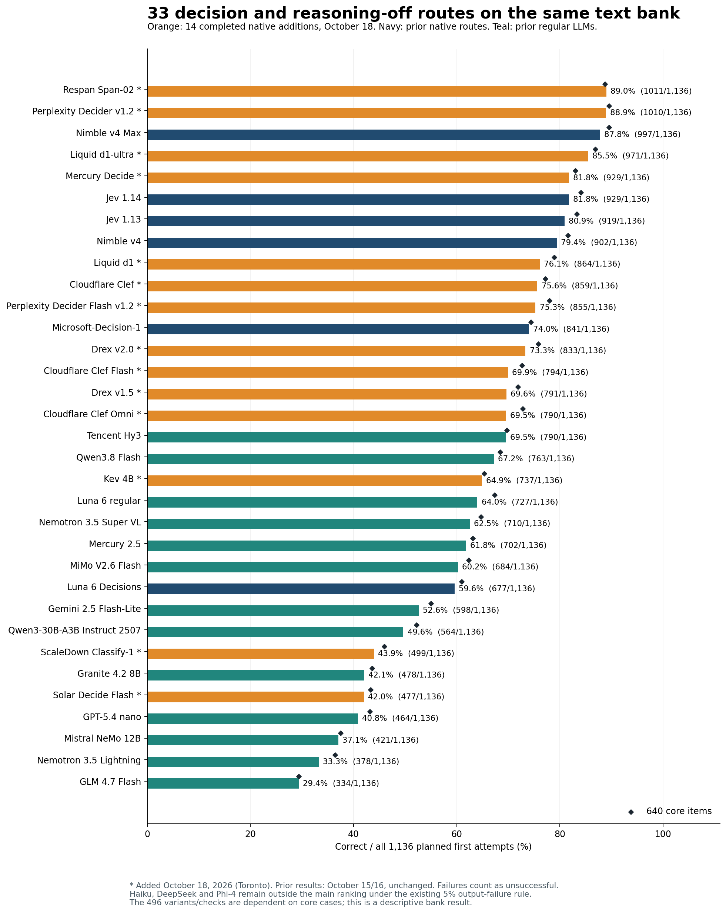
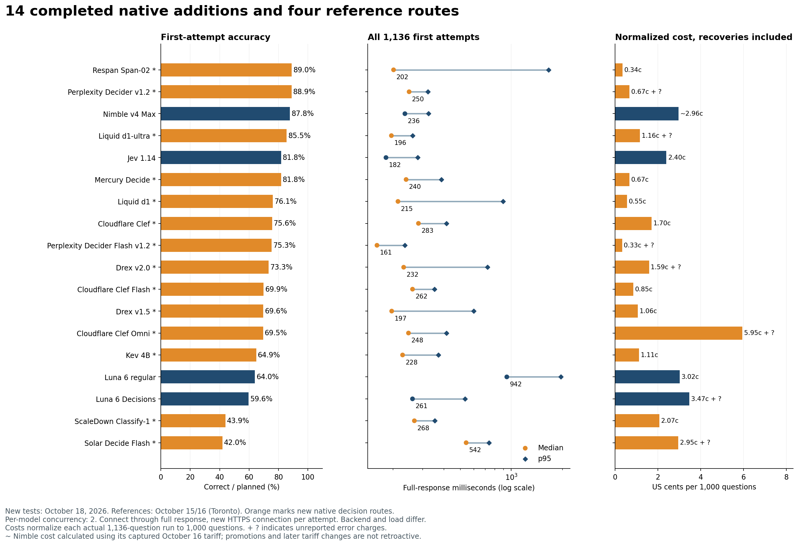
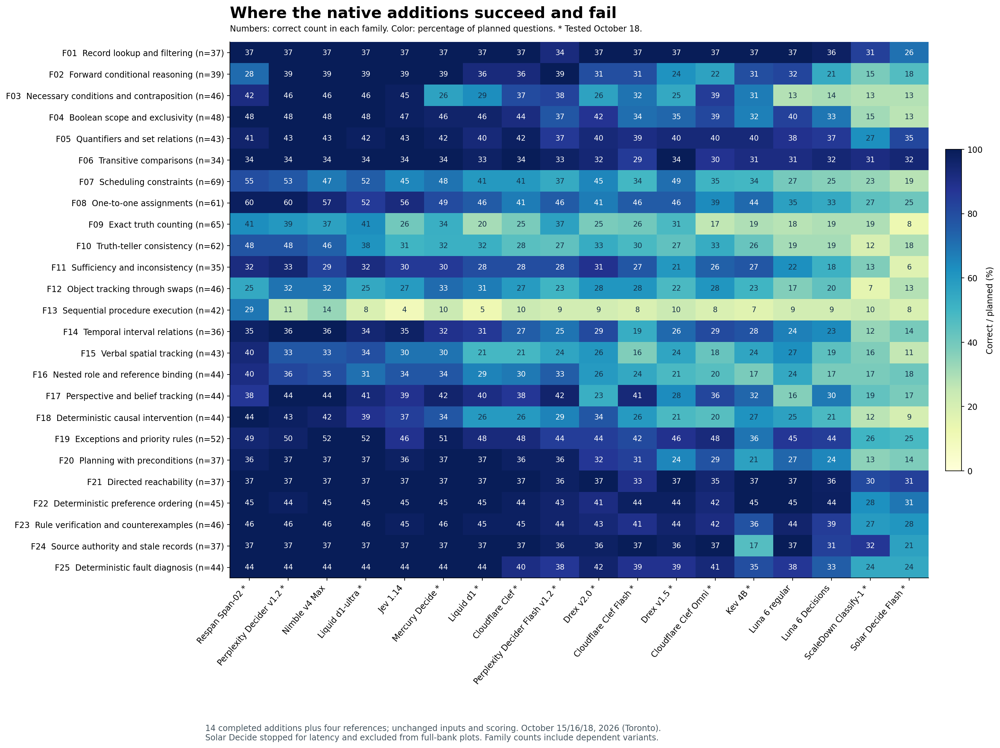

# Native decision models on the full text bank

I tested 15 new native decision routes on October 18, 2026. Fourteen completed the same 1,136 English text questions used for Jev, Nimble and Luna; I stopped Solar Decide because its latency was impractical for fast decisions. The complete runs add 15,904 scored model-question cases. The combined record now contains 36 complete model runs; 33 qualify for the main comparison under the existing output-compliance rule. All 22 earlier results and their original costs and timings are unchanged.

This is a local review before choosing the next regular-LLM runs. The published GitHub pages have not been replaced. The image bank has not been run on these additions.

## Span-02 and Perplexity Decider exceed the previous full-bank leader

Respan Span-02 scored **1,011/1,136 (89.0%)**, and Perplexity Decider v1.2 scored **1,010/1,136 (88.9%)**. Nimble Max's previous result was 997/1,136 (87.8%). These are gains of 14 and 13 correct answers. The new results improve the full-bank total, but the core-only comparison is different: Perplexity and Nimble Max both scored 573/640 (89.5%); Span-02 scored 568/640 (88.8%). Span's higher total comes from the related variants and checks, rather than a higher score on the underlying core questions.

The one-answer difference between Span and Perplexity is not a useful basis for declaring one generally smarter. Span was correct on 71 questions that Perplexity missed, while Perplexity was correct on 70 that Span missed. One Perplexity first attempt failed at the transport level; its permitted recovery was correct and brought its eventual score to 1,011. The primary ranking retains 1,010. The family profiles, cost and response-time tails explain more than the one-answer ordering.

Span's median was **202 ms**, with **$0.00384482** reported for the full bank, or **$0.00338 per 1,000 questions**. Every first answer was usable. Perplexity's median was **250 ms**, with **$0.00763898** reported for its run and one unreported transport charge. Perplexity had the more predictable slow tail: **323 ms p95**, compared with Span's **1,661 ms**. A fast median does not mean every request is fast.

## Span improves procedures but loses some simpler rules

Span scored **29/42 on sequential procedures**, compared with Nimble Max's 14/42, Perplexity's 11/42 and Jev 1.14's 4/42. These questions require updating a state after each operation, such as swapping two registers, testing the updated value and then overwriting another register. Span also improved scheduling to 55/69, one-to-one assignments to 60/61, and verbal spatial tracking to 40/43. One-to-one assignments require giving every person or item a unique partner while respecting interacting clues. Spatial tracking requires maintaining position and heading through described turns and moves.

The procedure gain is substantial on this bank, but 29/42 still leaves 13 wrong answers. Exact truth counting was only 41/65, and repeated swaps were 25/46. Span also scored **28/39 on forward conditional rules**, where both Perplexity and Nimble Max scored 39/39. Belief tracking was 38/44, versus their 44/44. These are concrete reasons to test the caller's own rule types rather than choose a route solely by its overall score.

Perplexity was stronger on those direct implications, necessary conditions, temporal intervals and belief tracking. It also reached 60/61 on one-to-one assignments, 53/69 on scheduling and 33/35 on sufficiency and inconsistency. Its **11/42 procedure score** and **39/65 truth-counting score** leave those functions unreliable. The overall result does not support unattended execution of multi-step instructions.

## Liquid d1-ultra improves on Jev with a similar median

Liquid d1-ultra scored **971/1,136 (85.5%)**, 42 more correct answers than Jev 1.14. Its core score was 556/640 (86.9%), versus Jev's 538/640 (84.1%). Its **196 ms median** was close to Jev's 182 ms, and its **262 ms p95** was slightly below Jev's 280 ms. It reported **$0.01314377** for the full run, with one unknown transport charge, compared with Jev's $0.02723011.

d1-ultra was perfect on the sampled necessary conditions, Boolean scope, exceptions, planning, reachability, preference ordering, rule verification, source authority and fault diagnosis. Its weak areas included procedures (8/42), repeated swaps (25/46) and truth-teller consistency (38/62). The smaller d1 scored 864/1,136 (76.1%), with a 215 ms median and $0.00625894 reported cost. Both versions offer useful price and quality comparisons, but neither matched the leading full-bank scores.

## Mercury Decide matches Jev's total with a different pattern

Mercury Decide scored **929/1,136 (81.8%)**, exactly Jev 1.14's total. Its core score was slightly lower, at 531/640 versus Jev's 538/640. Its **240 ms median** was slower than Jev's 182 ms, while its **$0.00760874 reported run cost** was about 28% of Jev's captured run cost. All 1,136 first answers were usable. The captured Mercury Decide price was promotional.

The tied total conceals different strengths. Mercury scored 33/46 on repeated swaps, 42/44 on belief tracking and 51/52 on priority rules, versus Jev's 27/46, 39/44 and 46/52. Necessary conditions were much weaker at 26/46 versus Jev's 45/46. Procedures were only 10/42. It is a plausible lower-cost route for some of the tested functions, not an interchangeable copy of Jev.

Mercury Decide is also distinct from the previously tested regular Mercury 2.5, which scored 702/1,136 (61.8%) with a 534 ms median and $0.01321493 reported cost. The native decision route performed substantially better on this contract. These are different hosted configurations tested on different dates, rather than an experiment isolating the effect of a decision head.

## Native decision output does not by itself establish high accuracy

Clef scored 859/1,136 (75.6%), Clef Flash 794 (69.9%) and Clef Omni 790 (69.5%). Their medians were all below 300 ms. Omni's $0.06753705 reported text-run cost was the highest among the completed new native routes, without a text-accuracy gain over the cheaper Clef routes. Its listed non-text capabilities were not tested here.

Drex v2.0 scored 833/1,136 (73.3%), with a 232 ms median. It encountered 31 first-attempt provider rate limits. The earlier v1.5 scored 791 (69.6%), with a 197 ms median and no failed first response. Kev 4B scored 737 (64.9%), near regular Luna's 727, but with a much shorter median: 228 ms versus 942 ms. Kev's core result was lower than Luna's, at 418/640 versus 431/640. These are hosted-route measurements, not local-hardware speed estimates.

Classify-1 scored **499/1,136 (43.9%)**, and Solar Decide Flash scored **477 (42.0%)**. Their low scores mostly reflect wrong valid choices, not explanatory output. The stopped, slower Solar Decide route is a separate configuration and has only a partial diagnostic below. These results show why direct decision output, model size and a low per-token tariff are insufficient selection criteria.

Perplexity Flash scored 855/1,136 (75.3%), including 50 first-attempt token-rate-limit failures. Among its 1,086 usable first answers, 855 were correct (78.7%). Its 161 ms median includes the failed requests. The higher conditional percentage is diagnostic only; it does not replace the full-denominator score.



## Results on the unchanged question bank

Every row uses the first attempt on all 1,136 questions. A failed request is unsuccessful, but is distinguished from a wrong valid answer in the reliability table. The core column uses the 640 underlying questions. The other 496 cases are related rotations, contrasts and candidate checks, so the overall denominator is not 1,136 independent observations.

* marks a new October 18 run. All dates are in Toronto in 2026. Costs per 1,000 are normalized from each actual 1,136-question run, including permitted recoveries. `+ ?` indicates unreported charges; `~` indicates a usage-times-tariff calculation rather than a returned dollar charge.

| Model | Correct | Accuracy | Core correct | Median ms | p95 ms | Cost per 1,000 | Test date |
| --- | --- | --- | --- | --- | --- | --- | --- |
| Respan Span-02 * | 1011/1,136 | 89.0% | 568/640 | 202 | 1661 | $0.00338 | 10-18 |
| Perplexity Decider v1.2 * | 1010/1,136 | 88.9% | 573/640 | 250 | 323 | $0.00672 + ? | 10-18 |
| Nimble v4 Max | 997/1,136 | 87.8% | 573/640 | 236 | 324 | ~$0.02963 | 10-16 |
| Liquid d1-ultra * | 971/1,136 | 85.5% | 556/640 | 196 | 261 | $0.01157 + ? | 10-18 |
| Jev 1.14 | 929/1,136 | 81.8% | 538/640 | 182 | 280 | $0.02397 | 10-15 |
| Mercury Decide * | 929/1,136 | 81.8% | 531/640 | 240 | 387 | $0.00670 | 10-18 |
| Jev 1.13 | 919/1,136 | 80.9% | 533/640 | 197 | 340 | $0.02397 | 10-15 |
| Nimble v4 | 902/1,136 | 79.4% | 522/640 | 214 | 260 | ~$0.01317 | 10-16 |
| Liquid d1 * | 864/1,136 | 76.1% | 505/640 | 215 | 894 | $0.00551 | 10-18 |
| Cloudflare Clef * | 859/1,136 | 75.6% | 494/640 | 283 | 415 | $0.01704 | 10-18 |
| Perplexity Decider Flash v1.2 * | 855/1,136 | 75.3% | 499/640 | 161 | 236 | $0.00327 + ? | 10-18 |
| Microsoft-Decision-1 | 841/1,136 | 74.0% | 476/640 | 288 | 574 | $0.01169 | 10-16 |
| Drex v2.0 * | 833/1,136 | 73.3% | 485/640 | 232 | 724 | $0.01588 + ? | 10-18 |
| Cloudflare Clef Flash * | 794/1,136 | 69.9% | 465/640 | 262 | 353 | $0.00852 | 10-18 |
| Drex v1.5 * | 791/1,136 | 69.6% | 460/640 | 197 | 601 | $0.01061 | 10-18 |
| Tencent Hy3 | 790/1,136 | 69.5% | 446/640 | 1423 | 1926 | $0.02442 + ? | 10-16 |
| Cloudflare Clef Omni * | 790/1,136 | 69.5% | 466/640 | 248 | 415 | $0.05945 + ? | 10-18 |
| Qwen3.8 Flash | 763/1,136 | 67.2% | 438/640 | 862 | 5717 | $0.04404 + ? | 10-16 |
| Kev 4B * | 737/1,136 | 64.9% | 418/640 | 228 | 371 | $0.01114 | 10-18 |
| Luna 6 regular | 727/1,136 | 64.0% | 431/640 | 942 | 1961 | $0.03021 | 10-15 |
| Nemotron 3.5 Super VL | 710/1,136 | 62.5% | 414/640 | 465 | 835 | $0.02977 + ? | 10-16 |
| Mercury 2.5 | 702/1,136 | 61.8% | 404/640 | 534 | 1077 | $0.01163 | 10-15 |
| MiMo V2.6 Flash | 684/1,136 | 60.2% | 399/640 | 1429 | 6032 | $0.03796 + ? | 10-16 |
| Luna 6 Decisions | 677/1,136 | 59.6% | 390/640 | 261 | 533 | $0.03470 + ? | 10-15 |
| Gemini 2.5 Flash-Lite | 598/1,136 | 52.6% | 352/640 | 341 | 523 | $0.02834 | 10-15 |
| Qwen3-30B-A3B Instruct 2507 | 564/1,136 | 49.6% | 334/640 | 1034 | 1823 | $0.02573 | 10-15 |
| ScaleDown Classify-1 * | 499/1,136 | 43.9% | 294/640 | 268 | 354 | $0.02066 | 10-18 |
| Granite 4.2 8B | 478/1,136 | 42.1% | 279/640 | 324 | 866 | $0.01369 + ? | 10-15 |
| Solar Decide Flash * | 477/1,136 | 42.0% | 277/640 | 542 | 738 | $0.02952 + ? | 10-18 |
| GPT-5.4 nano | 464/1,136 | 40.8% | 276/640 | 683 | 1136 | $0.06166 | 10-15 |
| Mistral NeMo 12B | 421/1,136 | 37.1% | 240/640 | 490 | 1523 | $0.00813 + ? | 10-15 |
| Nemotron 3.5 Lightning | 378/1,136 | 33.3% | 233/640 | 280 | 533 | $0.02046 + ? | 10-16 |
| GLM 4.7 Flash | 334/1,136 | 29.4% | 188/640 | 560 | 17056 | $0.01766 + ? | 10-16 |

Haiku 5.5, DeepSeek V4.1 Flash and Phi-4 remain outside this main table under the existing post-hoc cutoff of at least 5% model-output failures. Their original runs remain in the [output diagnostics](OUTPUT_COMPLIANCE.md). Provider failures do not count toward that format cutoff, and none is removed from an eligible model's score.

## Cost and route reliability of the additions

The 14 new full runs reported **$0.23853563** in known charges, with **118 attempts whose charges were not returned**. The 15 compatibility calls are separate and cost **$0.00018676** in reported charges. Missing charges are not treated as zero, and these totals have not been reconciled against an invoice.

| New model | Usable first | Output failures | Provider or transport failures | Recovery calls | Eventual correct | Actual 1,136 run cost | Unknown charges |
| --- | --- | --- | --- | --- | --- | --- | --- |
| Respan Span-02 | 1136 | 0 | 0 | 0 | 1011 | $0.00384482 | 0 |
| Perplexity Decider v1.2 | 1135 | 0 | 1 | 1 | 1011 | $0.00763898 | 1 |
| Liquid d1-ultra | 1135 | 0 | 1 | 1 | 972 | $0.01314377 | 1 |
| Mercury Decide | 1136 | 0 | 0 | 0 | 929 | $0.00760874 | 0 |
| Liquid d1 | 1136 | 0 | 0 | 0 | 864 | $0.00625894 | 0 |
| Cloudflare Clef | 1136 | 0 | 0 | 0 | 859 | $0.01935818 | 0 |
| Perplexity Decider Flash v1.2 | 1086 | 0 | 50 | 50 | 871 | $0.00371710 | 80 |
| Drex v2.0 | 1105 | 0 | 31 | 31 | 848 | $0.01803630 | 34 |
| Cloudflare Clef Flash | 1136 | 0 | 0 | 0 | 794 | $0.00967909 | 0 |
| Drex v1.5 | 1136 | 0 | 0 | 0 | 791 | $0.01205172 | 0 |
| Cloudflare Clef Omni | 1135 | 0 | 1 | 1 | 791 | $0.06753705 | 1 |
| Kev 4B | 1136 | 0 | 0 | 0 | 737 | $0.01265431 | 0 |
| ScaleDown Classify-1 | 1136 | 0 | 0 | 0 | 499 | $0.02346888 | 0 |
| Solar Decide Flash | 1135 | 0 | 1 | 1 | 478 | $0.03353775 | 1 |

The eventual column includes at most one recovery for a transport failure or HTTP 408, 429 or 5xx. Wrong valid answers, malformed answers and HTTP-200 provider-error envelopes are not retried. The primary ranking never substitutes an eventual answer for the first response.

### Solar Decide was stopped for latency

Solar Decide returned 311/347 correct completed answers (89.6%), with a 4.58-second median and 12.95-second p95. On exactly those 347 items, Span-02 scored 316, Perplexity Decider 310 and Nimble Max 309. These are matched partial-subset comparisons, not full-bank scores. The route was accurate on this subset but too slow for the intended latency-sensitive use.

Its 347 recorded responses reported $0.01015205. One of the 348 dispatched requests had no recorded response when the process was stopped; its outcome and charge remain unknown. The [stop receipt and partial ledger](../results/runs/native_additions_2026-10-18/solar_decide_partial) preserve that request without replay. Solar Decide is outside every full-bank table and chart.

Nimble Max's table cost retains the October 16 tariff of $0.09 per million input tokens. Its [current documented tariff](https://docs.bespokelabs.ai/nimble/pricing.md), checked October 18, is $0.04. Applying that tariff to its saved 373,997 input tokens gives $0.01495988 for the full bank, or $0.013169 per 1,000 questions. That is a price-only calculation, not a new benchmark run. The deprecated `nimble-v4` name now points to Max, so the two historical Nimble rows do not imply two distinct current services.



## Functions and dependent diagnostic panels

The [family CSV](../results/releases/overall_expanded_2026-10-18/family_comparison.csv) preserves correct counts and denominators for all 25 functions and 33 included models. The [task examples](task_examples.md) explain what each function means without adding scored questions.



Rotation panels put the same semantic options in different positions. A model can be semantically consistent and consistently wrong, so all-correct panels are separate. Contrast panels change evidence and require the right decision on both versions. Candidate checks ask whether a proposed answer meets the original rules. Planned panel denominators retain missing answers.

| New model | All rotations correct | Semantically consistent complete panels | Both contrast answers correct | Candidate checks correct |
| --- | --- | --- | --- | --- |
| Respan Span-02 | 22/25 | 23/25 | 21/25 | 70/80 |
| Perplexity Decider v1.2 | 22/25 | 23/25 | 21/25 | 65/80 |
| Liquid d1-ultra | 22/25 | 24/25 | 18/25 | 54/80 |
| Mercury Decide | 19/25 | 23/25 | 18/25 | 51/80 |
| Liquid d1 | 18/25 | 19/25 | 19/25 | 33/80 |
| Cloudflare Clef | 19/25 | 20/25 | 20/25 | 32/80 |
| Perplexity Decider Flash v1.2 | 15/25 | 17/20 | 18/25 | 41/80 |
| Drex v2.0 | 18/25 | 19/23 | 16/25 | 35/80 |
| Cloudflare Clef Flash | 19/25 | 21/25 | 16/25 | 30/80 |
| Drex v1.5 | 17/25 | 21/25 | 16/25 | 40/80 |
| Cloudflare Clef Omni | 20/25 | 24/25 | 17/25 | 28/80 |
| Kev 4B | 15/25 | 18/25 | 13/25 | 35/80 |
| ScaleDown Classify-1 | 8/25 | 8/25 | 7/25 | 20/80 |
| Solar Decide Flash | 8/25 | 9/25 | 9/25 | 19/80 |

Probability-distribution warnings do not discard usable choices, matching the original scoring policy. New warnings: Cloudflare Clef: 490; Cloudflare Clef Flash: 474; Solar Decide Flash: 245; Drex v2.0: 459; Drex v1.5: 470; Kev 4B: 455. Clef's recorded warning examples arise from rounded probabilities summing to 0.9999 or 1.0001 rather than exactly one. The raw responses preserve the distributions. Returned confidence values are not calibrated on a common cross-model scale; threshold results in the aggregate data are exploratory on this same bank.

## Measurement conditions and model names

All 15 new routes use OpenRouter's `/api/alpha/decisions` endpoint. They receive the unchanged native state, original instructions and question, and the original five criteria in the same order. There are two concurrent requests per model, with a barrier after each pair, and at most five active native models. Each attempt opens a fresh HTTPS connection. The monotonic timer starts before connecting and ends after reading the complete response. Local queueing and retry waits are outside that response timer. The table below lists the 14 completed routes; the stopped route's snapshot is in its partial ledger.

Median and p95 include all 1,136 timed first attempts per model, including failures. p95 is the response time at or below which roughly 95% of those requests completed. The earlier routes use the same timing boundary and per-model concurrency, but were tested on October 15/16 with different aggregate load and services. These measurements describe end-to-end routes, not isolated model inference.

Every provider is pinned and fallback is disabled. The two PrimeIntellect Clef routes were chosen at their captured lower tariffs, not silently switched to the more expensive Cloudflare or DeepInfra routes. Returned names are checked against captured endpoint metadata; names alone do not independently attest fixed weights. Clef and Clef Flash return undated model names.

| New model | Pinned provider tag | Returned model name | Captured input price per million |
| --- | --- | --- | --- |
| Liquid d1-ultra | liquid | liquid/d1-ultra-20261015 | $0.042 |
| Liquid d1 | liquid | liquid/d1-20260930 | $0.02 |
| Perplexity Decider v1.2 | perplexity | perplexity/pplx-decider-v1.2-20261016 | $0.02 |
| Perplexity Decider Flash v1.2 | perplexity | perplexity/pplx-decider-flash-v1.2-20261016 | $0.01 |
| Respan Span-02 | respan | respan/span-02-20261015 | $0.01 |
| Cloudflare Clef | primeintellect | cloudflare/clef | $0.042 |
| Cloudflare Clef Flash | primeintellect | cloudflare/clef-flash | $0.021 |
| Cloudflare Clef Omni | cloudflare | cloudflare/clef-omni-20261009 | $0.15 |
| Mercury Decide | inception | inception/mercury-decide-20260930 | $0.02 |
| Solar Decide Flash | upstage | upstage/solar-decide-flash-20261008 | $0.05 |
| Drex v2.0 | deepinfra/us | nace-ai/drex-v2.0-20261009 | $0.06 |
| Drex v1.5 | deepinfra/us | nace-ai/drex-v1.5-20261009 | $0.04 |
| ScaleDown Classify-1 | scaledown | scaledown/classify-1-20260928 | $0.04 |
| Kev 4B | phala | jaredpalmer/kev-4b-20260924 | $0.042 |

The captured endpoint snapshots retain promotions and listed modalities. Only text was tested. Image acceptance and visual decision quality require separate verification. [Tev1's documented interface](https://huggingface.co/togethercomputer/Tev1-4B-experimental) uses a standard language-model head and generates an option letter through chat completions; it is reserved for the later generative-model comparison, rather than classified as one of these 15 native routes.

## Saved evidence and reproduction

The [combined summary](../results/releases/overall_expanded_2026-10-18/summary.json), [new sanitized attempt ledgers](../results/runs/native_additions_2026-10-18), [unchanged 22-model summary](../results/releases/overall_expanded_2026-10-16/summary.json) and [question bank](../data/questions_1136.csv) preserve the comparison. The answer key, account metadata, credentials and individual correctness records are not exported. Scoring happens offline after each model's full run, using the original key's frozen hash; the live executor never reads the key.

Offline integrity and protocol checks require no API credentials:

```sh
python3 native_expansion_analysis.py
python3 -m unittest test_native_field_2026_10_18 test_native_expansion_analysis
```

With the original private key supplied externally, all 36 complete aggregate scores, family scores, panel results and the stopped route's partial score can be reproduced without sending requests:

```sh
python3 native_expansion_analysis.py --answer-key /path/to/answer_key_PRIVATE.csv
```

The bank measures single-shot choice decisions from supplied facts, without an explicit thinking budget, tools or answer feedback. It does not measure unrestricted reasoning, writing, multilingual performance or agentic iteration.
