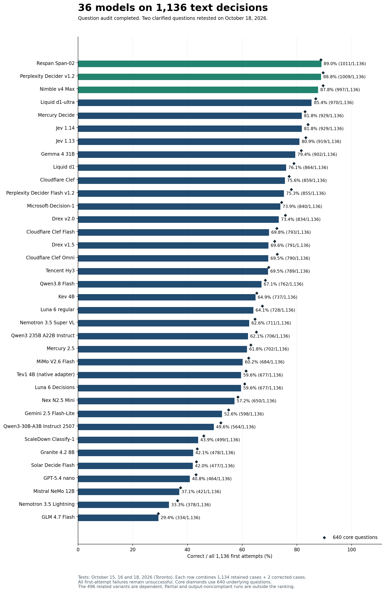
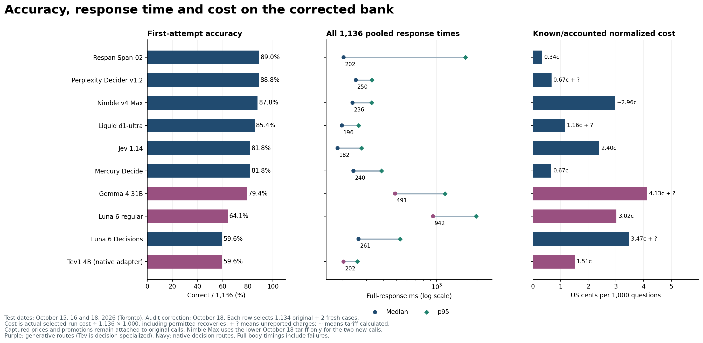
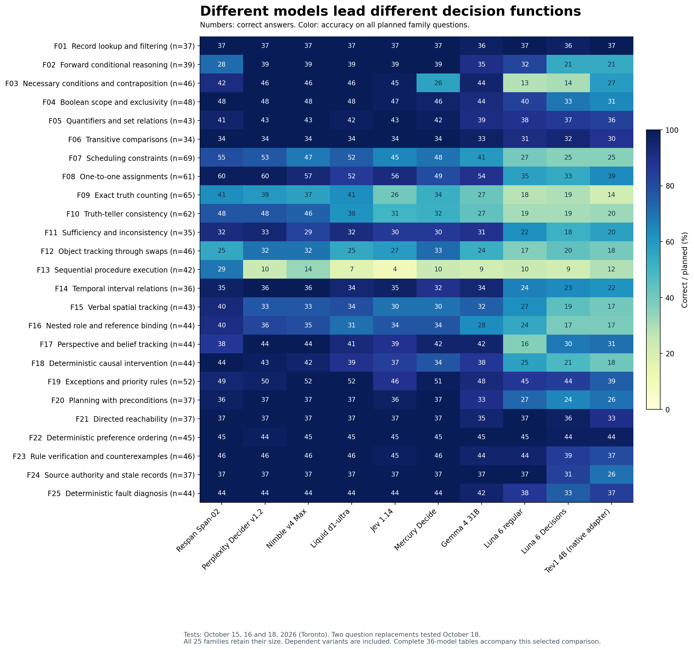

> Earlier 1,136-question reference, not the current 1,342-question ranking. [Current report](../README.md).

# 36 models on the same 1136 text decisions

I started this benchmark because Jev interested me, but I could not place its intelligence relative to the LLMs I use. Could a service that returns a typed decision rather than a paragraph make better quick decisions than Luna? On this bank, Jev was substantially stronger. Expanding the comparison has since found models that exceed Jev, and a regular LLM that comes close.

**Respan Span-02 scored 1,011/1,136 (89.0%), Perplexity Decider v1.2 scored 1,009 (88.8%), and Nimble Max scored 997 (87.8%).** Jev 1.14 scored 929 (81.8%), Jev 1.13 scored 919 (80.9%), regular Luna scored 728 (64.1%) and Luna Decisions scored 677 (59.6%). **Gemma 4 31B is the strongest regular LLM tested under this short-output contract: 902/1,136 (79.4%).**

These are **System 1-style decisions**: one answer from supplied information, without an explicit thinking budget, tools or an agentic feedback loop. They matter for systems routing many requests under time and cost constraints. This does not compare unrestricted reasoning, writing or agentic ability.

**Updated October 18, 2026, after the question audit.** The active comparison contains **36 complete configurations × 1,136 questions = 40,896 model-question cases**. Two ambiguous procedure questions have been replaced by clarified versions and tested across all 36 available configurations. Every model retains its other 1,134 responses. The leading order is unchanged. The original Nimble v4 is unavailable as a distinct checkpoint, so its 1,134 retained cases remain a partial diagnostic outside the full-bank ranking. Three earlier output-noncompliant runs, five stopped LLM samples, the stopped Solar Decide sample and two failed interface probes also remain outside the ranking.

The [active question bank](../results/releases/corrected_2026-10-18/questions_1136.csv) contains **640 core questions plus 496 related variants, contrasts and candidate checks across 25 families**. Each question has five options, giving a 20% uniform-random baseline. Related items are not independent observations. The [function tables and examples](REFERENCE_1136_FUNCTIONS.md) explain the abilities. The [image benchmark](https://github.com/etsabary/visual-decision-benchmark) remains separate. The harder future benchmark is a separate project.



## Full bank results with cost and speed scales

Every score uses the first attempt on all 1,136 active questions. Failed requests, refusals, invalid output and truncations remain unsuccessful. Median and p95 pool **all 1,136 timed first attempts**, including failures: 1,134 retained measurements plus the two new measurements. Medians are not averaged. This correction is not a fresh full-bank speed rerun. p95 is the response time at or below which roughly 95% of requests completed.

Costs per 1,000 normalize the selected 1,136-question evidence, including permitted recoveries: selected cost ÷ 1,136 × 1,000. **`+ ?` means additional charges are unknown**, so its cost band describes the known lower bound. `~` marks usage multiplied by a captured tariff rather than an API-returned dollar amount. Original charges retain their captured prices; the new Nimble Max calls use the October 18 tariff. Dates are Toronto dates. * identifies a configuration first added on October 18.

| Model | Correct / 1,136 | Accuracy | Core correct | Median | p95 | Cost per 1,000 | Test dates |
|---|---:|---:|---:|---:|---:|---:|---:|
| Respan Span-02 * | 1011 | 89.0% | 568/640 | 202 ms 🟩 Fastest | 1644 ms | $0.00338 🟩 Lowest | 2026-10-18 |
| Perplexity Decider v1.2 * | 1009 | 88.8% | 573/640 | 250 ms 🟩 Fastest | 328 ms | $0.00672 🟩 Lowest + ? | 2026-10-18 |
| Nimble v4 Max | 997 | 87.8% | 573/640 | 236 ms 🟩 Fastest | 328 ms | ~$0.02961 🟧 Mid | 2026-10-16, 2026-10-18 |
| Liquid d1-ultra * | 970 | 85.4% | 556/640 | 196 ms 🟩 Fastest | 261 ms | $0.01157 🟨 Low + ? | 2026-10-18 |
| Jev 1.14 | 929 | 81.8% | 538/640 | 182 ms 🟩 Fastest | 275 ms | $0.02397 🟨 Low | 2026-10-15, 2026-10-18 |
| Mercury Decide * | 929 | 81.8% | 531/640 | 240 ms 🟩 Fastest | 387 ms | $0.00670 🟩 Lowest | 2026-10-18 |
| Jev 1.13 | 919 | 80.9% | 533/640 | 196 ms 🟩 Fastest | 340 ms | $0.02397 🟨 Low | 2026-10-15, 2026-10-18 |
| Gemma 4 31B * | 902 | 79.4% | 522/640 | 491 ms 🟨 Fast | 1154 ms | $0.04131 🟧 Mid + ? | 2026-10-18 |
| Liquid d1 * | 864 | 76.1% | 505/640 | 214 ms 🟩 Fastest | 894 ms | $0.00551 🟩 Lowest | 2026-10-18 |
| Cloudflare Clef * | 859 | 75.6% | 494/640 | 284 ms 🟨 Fast | 417 ms | $0.01704 🟨 Low | 2026-10-18 |
| Perplexity Decider Flash v1.2 * | 855 | 75.3% | 499/640 | 161 ms 🟩 Fastest | 236 ms | $0.00327 🟩 Lowest + ? | 2026-10-18 |
| Microsoft-Decision-1 | 840 | 73.9% | 476/640 | 289 ms 🟨 Fast | 591 ms | $0.01169 🟨 Low | 2026-10-16, 2026-10-18 |
| Drex v2.0 * | 834 | 73.4% | 485/640 | 233 ms 🟩 Fastest | 724 ms | $0.01588 🟨 Low + ? | 2026-10-18 |
| Cloudflare Clef Flash * | 793 | 69.8% | 465/640 | 262 ms 🟨 Fast | 358 ms | $0.00852 🟩 Lowest | 2026-10-18 |
| Drex v1.5 * | 791 | 69.6% | 460/640 | 197 ms 🟩 Fastest | 607 ms | $0.01061 🟨 Low | 2026-10-18 |
| Cloudflare Clef Omni * | 790 | 69.5% | 466/640 | 248 ms 🟩 Fastest | 415 ms | $0.05945 🟥 Highest + ? | 2026-10-18 |
| Tencent Hy3 | 789 | 69.5% | 446/640 | 1423 ms 🟥 Slow | 1928 ms | $0.02443 🟨 Low + ? | 2026-10-16, 2026-10-18 |
| Qwen3.8 Flash | 762 | 67.1% | 438/640 | 862 ms 🟧 Moderate | 5717 ms | $0.04404 🟧 Mid + ? | 2026-10-16, 2026-10-18 |
| Kev 4B * | 737 | 64.9% | 418/640 | 229 ms 🟩 Fastest | 374 ms | $0.01114 🟨 Low | 2026-10-18 |
| Luna 6 regular | 728 | 64.1% | 431/640 | 942 ms 🟧 Moderate | 1971 ms | $0.03021 🟧 Mid | 2026-10-15, 2026-10-18 |
| Nemotron 3.5 Super VL | 711 | 62.6% | 414/640 | 465 ms 🟨 Fast | 835 ms | $0.02979 🟧 Mid + ? | 2026-10-16, 2026-10-18 |
| Qwen3 235B A22B Instruct 2507 * | 706 | 62.1% | 417/640 | 556 ms 🟧 Moderate | 1667 ms | $0.02653 🟧 Mid | 2026-10-18 |
| Mercury 2.5 | 702 | 61.8% | 404/640 | 534 ms 🟧 Moderate | 1077 ms | $0.01163 🟨 Low | 2026-10-15, 2026-10-18 |
| MiMo V2.6 Flash | 684 | 60.2% | 399/640 | 1428 ms 🟥 Slow | 6032 ms | $0.03796 🟧 Mid + ? | 2026-10-16, 2026-10-18 |
| Luna 6 Decisions | 677 | 59.6% | 390/640 | 261 ms 🟨 Fast | 535 ms | $0.03470 🟧 Mid + ? | 2026-10-15, 2026-10-18 |
| Tev1 4B experimental (OpenRouter native adapter) * | 677 | 59.6% | 393/640 | 202 ms 🟩 Fastest | 256 ms | $0.01510 🟨 Low | 2026-10-18 |
| Nex N2.5 Mini * | 650 | 57.2% | 374/640 | 500 ms 🟧 Moderate | 1221 ms | $0.00770 🟩 Lowest | 2026-10-18 |
| Gemini 2.5 Flash-Lite | 598 | 52.6% | 352/640 | 341 ms 🟨 Fast | 523 ms | $0.02834 🟧 Mid | 2026-10-15, 2026-10-18 |
| Qwen3-30B-A3B Instruct 2507 | 564 | 49.6% | 334/640 | 1034 ms 🟥 Slow | 1823 ms | $0.02573 🟧 Mid | 2026-10-15, 2026-10-18 |
| ScaleDown Classify-1 * | 499 | 43.9% | 294/640 | 268 ms 🟨 Fast | 354 ms | $0.02066 🟨 Low | 2026-10-18 |
| Granite 4.2 8B | 478 | 42.1% | 279/640 | 324 ms 🟨 Fast | 871 ms | $0.01370 🟨 Low + ? | 2026-10-15, 2026-10-18 |
| Solar Decide Flash * | 477 | 42.0% | 277/640 | 542 ms 🟧 Moderate | 742 ms | $0.02952 🟧 Mid + ? | 2026-10-18 |
| GPT-5.4 nano | 464 | 40.8% | 276/640 | 683 ms 🟧 Moderate | 1136 ms | $0.06167 🟥 Highest | 2026-10-15, 2026-10-18 |
| Mistral NeMo 12B | 421 | 37.1% | 240/640 | 490 ms 🟨 Fast | 1523 ms | $0.00813 🟩 Lowest + ? | 2026-10-15, 2026-10-18 |
| Nemotron 3.5 Lightning | 378 | 33.3% | 233/640 | 280 ms 🟨 Fast | 533 ms | $0.02046 🟨 Low + ? | 2026-10-16, 2026-10-18 |
| GLM 4.7 Flash | 334 | 29.4% | 188/640 | 560 ms 🟧 Moderate | 17056 ms | $0.01766 🟨 Low + ? | 2026-10-16, 2026-10-18 |


## Reading the speed and cost colors

The squares and labels use fixed descriptive bands, not relative ranks or statistical significance. Speed uses the full-bank first-attempt median. Cost uses known or accounted dollars per 1,000 questions, normalized from each actual 1,136-question run including permitted recoveries.

| Band | Median response time | Known/accounted cost per 1,000 |
|---|---|---|
| Green | 🟩 Fastest: ≤250 ms | 🟩 Lowest: ≤$0.010 |
| Yellow | 🟨 Fast: >250 to ≤500 ms | 🟨 Low: >$0.010 to ≤$0.025 |
| Orange | 🟧 Moderate: >500 to ≤1,000 ms | 🟧 Mid: >$0.025 to ≤$0.050 |
| Red | 🟥 Slow: >1,000 ms | 🟥 Highest: >$0.050 |
| Gray | ⬜ Unknown: unavailable | ⬜ Unknown: unavailable |

Bands use unrounded measurements; displayed numbers can round to a boundary. `+ ?` means additional charges were not reported. In those cells, the cost band describes only the known lower bound, not a complete cost or a guaranteed price advantage. The website also underlines these incomplete costs in amber. Text labels remain visible without color.

The active complete configurations account for **$0.88414152** in known charges or tariff calculations, with **352 attempt charges still unknown**. These are selected-evidence costs, not independently reconciled invoices. Removed original-question attempts, partial runs and compatibility probes are outside these totals. The [correction receipt](../results/releases/corrected_2026-10-18/correction_receipt.json) accounts for removed calls separately.

For **GLM 4.7 Flash**, only the two replacement calls moved from inactive Cloudflare to **Venice**, using the same dated model. For **Nemotron 3.5 Super VL**, those two calls moved from inactive Crusoe to **Together**, again using the same dated model. Each retains 1,134 original-provider results. These are explicitly mixed-provider rows, not 1,136 new calls on the replacement provider. The [route records](../results/releases/corrected_2026-10-18/routes.json) identify both changes.

Nimble Max's retained 1,134 responses use its October 16 tariff of $0.09 per million input tokens. The two fresh calls use the [October 18 tariff of $0.04](https://docs.bespokelabs.ai/nimble/pricing.md). Its active cost therefore combines captured prices rather than repricing the earlier run. The deprecated `nimble-v4` alias now redirects to Max and cannot supply the missing original-v4 measurements.

## Span leads the full bank while Perplexity and Nimble lead the core subset

Span scored **1,011/1,136**, Perplexity **1,009** and Nimble Max **997**. Perplexity and Nimble both scored **573/640 (89.5%)** on the core questions; Span scored **568/640 (88.8%)**. Span's higher total comes from the related variants and checks.

The two-answer gap between Span and Perplexity is too small to establish a general intelligence ordering. Span was correct on 72 questions Perplexity missed; Perplexity was correct on 70 Span missed. One Perplexity first attempt failed at the transport level. Its permitted recovery was correct, bringing its eventual score to 1,010; the primary table retains 1,009.

Span's median was **202 ms**, with **$0.00384490** reported for the selected full bank, or **$0.00338 per 1,000 questions**. Every first answer was usable. Perplexity's median was **250 ms**, with **$0.00763914** reported and one unknown charge. Its **328 ms p95** was much shorter than Span's **1644 ms**. Span combined high accuracy, a short typical response and the lower reported cost; Perplexity had a more consistent response-time tail.

The function profile explains more than the aggregate gap. A sequential procedure can ask you to reverse five cards, swap two positions, move a card, and identify the final occupant of a position. Span scored **29/42**, versus Perplexity's **10/42**, Nimble's **14/42** and Jev 1.14's **4/42**. Span also led these references on scheduling, **55/69**, versus Perplexity's 53, Nimble's 47 and Jev's 45. These are substantial improvements over Jev in maintaining and updating a state, with many errors remaining.

Exact truth counting asks which candidate makes precisely a specified number of statements true. Span scored **41/65**, Perplexity **39/65**, Nimble **37/65** and Jev **26/65**. This family is improving among the strongest tested routes, while the best score still misses 24 of 65 items.

Span was weaker on forward conditionals, **28/39**, where Perplexity, Nimble and both Jev versions scored 39/39. These ask what follows when facts activate a chain of rules. On belief tracking, which asks what a person knows given what they witnessed, Span scored **38/44**, versus Perplexity and Nimble at **44/44**. Its swap tracking was **25/46**, below Perplexity and Nimble's 32. The overall leader is not the strongest route for every function.

## Jev remains stronger than both Luna configurations

Jev 1.14 scored **929/1,136 (81.8%)**, versus regular Luna's **728 (64.1%)** and Luna Decisions' **677 (59.6%)**. Its **182 ms median** was among the shortest tested. Regular Luna answered 51 more questions correctly than Luna Decisions, while taking a longer median, **942 versus 261 ms**.

Jev 1.14 improved by ten correct answers over Jev 1.13, **929 versus 919**. One-to-one assignments rose from **50/61 to 56/61**. Such a question might assign five people to five rooms while satisfying several exclusions and one-use constraints. This is a meaningful family improvement within a modest overall gain. Procedures were **4/42 versus 6/42**, and swaps **27/46 versus 28/46**. The new version did not improve every function. Language and image feature claims are not established by these English text scores; actual image decisions have their own benchmark.

Mercury Decide tied Jev 1.14 at **929**, with a **240 ms median** and **$0.00760908** reported cost, or **$0.00670 per 1,000** at the captured promotion. It scored **33/46** on swaps, **42/44** on belief tracking and **51/52** on priority rules, versus Jev's 27, 39 and 46. Necessary conditions were weaker at **26/46**, versus Jev's **45/46**. Procedures were **10/42**. These profiles support choosing routes by the decisions a system actually needs to make.

Regular Mercury 2.5 is a separate configuration: **702/1,136 (61.8%)**, a **534 ms median** and **$0.01321471** reported cost. The native route performed substantially better under this contract. Different hosted configurations and dates do not isolate the architectural cause of that difference.

## Gemma narrows the regular LLM gap

Gemma 4 31B scored **902/1,136 (79.4%)**, 27 answers behind Jev 1.14 and 174 above regular Luna. Its core result was **522/640 (81.6%)**, versus Jev's 538 and Luna's 431. Its **491 ms median** was shorter than regular Luna's 942 ms, but longer than Jev's 182 ms. Known selected cost was **$0.04693288**, plus 40 unreported attempt charges.

Gemma had **47 model-output failures (4.1%)** and **28 first-attempt provider failures**. All 75 unusable first attempts remain unsuccessful. Recovery raised its eventual score to 915; the primary table retains 902. Its output-failure rate remains below the agreed 5% exclusion threshold.

Gemma scored **44/46** on necessary conditions, **54/61** on assignments, **42/44** on belief tracking, **48/52** on priority rules and **38/44** on causal interventions. It exceeded Jev on the latter three sampled families. A causal intervention changes a variable by instruction and asks which downstream effects follow. Its harder families included scheduling **41/69**, exact truth counting **27/65**, truth-teller consistency **27/62**, swaps **24/46** and procedures **9/42**.

Qwen3 235B A22B Instruct 2507 scored **706/1,136 (62.1%)**, with all first answers usable, a **556 ms median** and **$0.03013330** reported cost. Its score is only four above regular Mercury 2.5 despite a higher captured cost. Qwen scored 37/37 on lookup and source authority, 44/45 on preference ordering and 42/46 on counterexamples, but only 14/39 on forward conditionals, 10/65 on truth counting and 8/42 on procedures.

Nex N2.5 Mini scored **650/1,136 (57.2%)**, with all first answers usable, a **500 ms median** and **$0.00874708** reported cost. It was the cheapest completed new regular LLM. Span's native route was cheaper and more accurate overall in the captured runs.

Tev1 4B experimental now ties Luna Decisions at **677/1,136 (59.6%)**, with all first answers usable, a **202 ms median**, **256 ms p95** and **$0.01714936** reported cost. It is a [decision-specialized generative model](https://huggingface.co/togethercomputer/Tev1-4B-experimental) served through OpenRouter's native adapter, not a claimed non-generative architecture. Its chat interface was rejected; that probe is separate from its full native-adapter result.



## Direct decision output does not guarantee accurate decisions

Liquid d1-ultra scored **970/1,136 (85.4%)**, with a **196 ms median** and **261 ms p95**. The cheaper Liquid d1 scored **864 (76.1%)**. Clef scored **859**, Clef Flash **793** and Clef Omni **790**. Omni's higher captured text cost did not produce a gain over the cheaper Clef routes. Its non-text capabilities were not tested here.

Drex v2.0 scored **834**, versus v1.5's **791**. v2.0 encountered 31 first-attempt HTTP 429 provider failures. Kev 4B scored **737**, near regular Luna's 728 with a shorter median, **229 versus 942 ms**. Its core score, 418/640, was below Luna's 431.

Classify-1 scored **499/1,136 (43.9%)** and Solar Decide Flash **477 (42.0%)**. These low scores mostly reflect wrong valid choices. Perplexity Flash scored **855 (75.3%)**, including 50 first-attempt token-rate-limit failures. Accuracy among only usable responses is diagnostic; the full-denominator score measures delivered decisions.

## The audit and the two replacements

The audit selected **182 difficult questions** that at most 30% of the 37 previously included configurations answered correctly. Each received two independent blind verifications through the Village bridges, using Opus 5.5, Argon and GPT 6.1 Sol (extra-high effort). **181 had two independent verifiers supporting the supplied answer.** One procedure question had ambiguous wording: “after every operation” could ask for the intermediate states, while its options and supplied answer described the final state. A full-bank wording search found one additional instance outside the difficult-item queue.

Both now ask for the position **after all operations have been completed**. Their facts, operations and options are unchanged. Fresh independent Opus and Argon checks, plus exact step-by-step simulation, confirmed each clarified question has one valid supplied answer. The two original prompts and their results are absent from the active bank, accuracy totals, timing pools and selected costs. This targeted audit does not establish independent verification of every one of the 1,136 questions.

There were **72 fresh first attempts: two corrected questions × 36 available configurations**, with no recovery needed. Twenty-five configurations kept their total; seven lost one correct answer and four gained one. Fresh responses can vary, so those changes do not isolate the effect of the wording. The two corrected items are dependent variants, so all 640-question core scores are unchanged. The leading order is unchanged. Span's margin over Perplexity increased from one answer to two; Tev now ties Luna Decisions. The [aggregate correction deltas](../results/releases/corrected_2026-10-18/summary.json) document the changes without publishing the private answer key.

## Output compliance and unfinished routes

Complete runs with at least 5% model-output failures remain outside the main comparison. Earlier Haiku, DeepSeek and Phi-4 runs are previous-version diagnostics, not corrected full-bank results. Provider failures are counted separately from explanations, refusals and malformed model output.

The newer LLM screen paused a model after 100 questions, and at subsequent cumulative 100-question checks, for accuracy below 50%, model-output failures at least 5%, or median response time above 2,000 ms. These are practical outcome-based selection rules for useful additions, not a representative survey. The uneven prefixes include related variants. The five stopped samples retain their actual denominators in the [output diagnostics](REFERENCE_1136_OUTPUT_COMPLIANCE.md); no partial score is extrapolated to the full bank. This stopping rule is not retroactively used to delete older completed low-scoring configurations.

The separate Solar Decide route returned **311/347 correct completed responses**, with a **4.58-second median and 12.95-second p95**, and was stopped for latency. One additional dispatch has no recorded response or known charge. It receives no full-bank score and was not replayed. Original Nimble v4 now has **902/1,134 retained correct answers**, with two replacement questions untested because the original checkpoint is unavailable. It also receives no full-bank rank.



The [36-model family CSV](../results/releases/corrected_2026-10-18/family_comparison.csv) and [complete function tables](REFERENCE_1136_FUNCTIONS.md) show where individual routes are stronger. Perfect scores on a sampled family are not reliability guarantees. Dependent variants expose sensitivity and inconsistency without creating extra independent scenarios.

## Measurement conditions and evidence

Ordinary LLMs receive the same question facts, instructions and five options in the same order, with the original numeric-only suffix, a 16-token output cap and reasoning disabled or a natively nonthinking checkpoint. Native APIs serialize the same content as state and five criteria. Tev uses the native wire format. Providers are pinned and fallback is disabled. Captured metadata records requested and returned model identities. Aliases alone do not independently attest fixed model weights.

Each model runs two requests concurrently with a barrier after each pair. Every attempt opens a fresh HTTPS connection. A monotonic timer starts before connecting and ends after the complete response body is read. Local queueing and retry waits are outside this timer. Original batches had different aggregate loads and dates. The two-question correction ran up to three models concurrently. These are end-to-end hosted-route measurements, not local-hardware speed estimates.

Only transport failures and actual HTTP 408, 429 or 5xx allow one recovery. Wrong valid choices, invalid output and HTTP-200 provider-error envelopes are not retried. Recovered answers never replace first attempts in the primary ranking. Reported absence of reasoning tokens is not an independent audit of hidden internal computation.

The [active aggregate](../results/releases/corrected_2026-10-18/summary.json), [active question bank](../results/releases/corrected_2026-10-18/questions_1136.csv), [replacement attempt evidence](../results/releases/corrected_2026-10-18/replacement_attempts.jsonl), [route records](../results/releases/corrected_2026-10-18/routes.json) and [correction receipt](../results/releases/corrected_2026-10-18/correction_receipt.json) define this version. The selected record is 1,134 retained cases plus two new cases per included configuration. Earlier captures keep their exact seals for provenance and are not the active bank. The answer key, account metadata, credentials and item-level correctness are not published. Inference executors never read the key; scoring occurs offline.

Offline validation sends no model requests:

```sh
python3 -m pip install -r scripts/requirements-reports.txt
python3 freeze_october18_release.py --check
python3 validate_corrected_release.py
python3 -m unittest discover -p 'test_*.py'
```

Python 3.10 matches the capture runtime and its frozen floating-point probability checks. [Earlier measurement captures](../results/releases/overall_llm_expanded_2026-10-18) and [output diagnostics](REFERENCE_1136_OUTPUT_COMPLIANCE.md) preserve the different denominators and settings.
