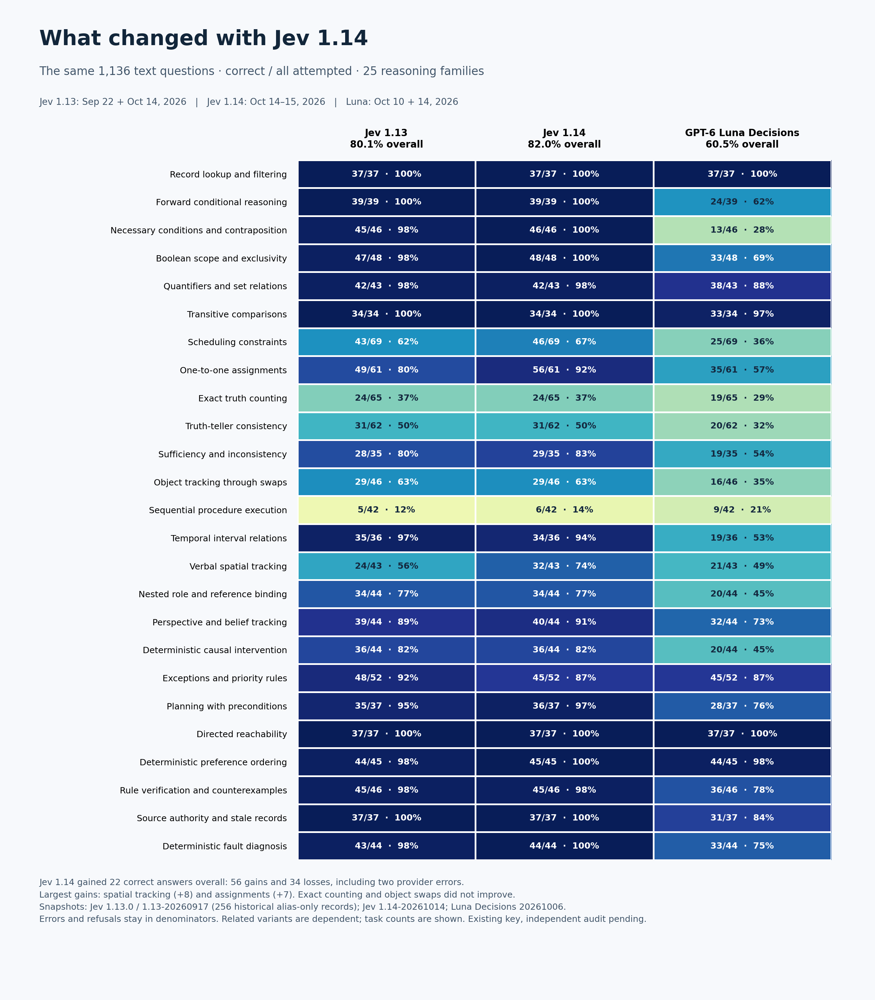
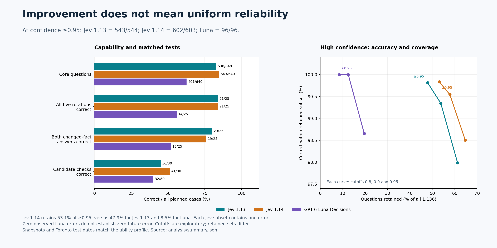

# Jev 1.14, Jev 1.13 and GPT-6 Luna Decisions

## The same 1,136 questions, with a fixed reference

Jev 1.14 scored **932/1,136 (82.0%)**, compared with **910/1,136 (80.1%)** for Jev 1.13 and **687/1,136 (60.5%)** for GPT-6 Luna Decisions. The new Jev release gained 22 correct answers overall. It improved some abilities substantially, while leaving several of the original weaknesses almost unchanged.

This is a text-only comparison using the exact same instructions, facts, questions and five answer options in the same order. The original responses remain the reference. A separate 256-item Jev 1.13 recheck is reported in the baseline repository and does not replace them.



## Results and model identities

| Measure | Jev 1.13 | Jev 1.14 | GPT-6 Luna Decisions |
|---|---:|---:|---:|
| Questions attempted | 1136 | 1136 | 1136 |
| Valid choices | 1136 | 1134 | 1113 |
| Correct | 910 | 932 | 687 |
| Wrong valid choices | 226 | 202 | 426 |
| Unanswered | 0 | 2 | 23 |
| Probability-format warnings | 13 | 8 | 0 |
| Correct / all attempted | 80.1% | 82.0% | 60.5% |
| Correct / answered | 80.1% | 82.2% | 61.7% |
| Core questions only | 530/640 (82.8%) | 543/640 (84.8%) | 401/640 (62.7%) |

The full reference contains 640 core questions and 496 related variants, contrasts and candidate checks. The combined score is useful for tracking the same bank over time; the related items are not independent observations. The core score and matched tests therefore remain separate views of performance.

| Model | Returned identity | Test dates, Toronto |
|---|---|---|
| Jev 1.13 | `jev-1.13.0` (412), `typesafe/jev-1.13-20260917` (468), historical `jev-latest` (256) | September 22 and October 14, 2026 |
| Jev 1.14 | `typesafe/jev-1.14-20261014` on all 1,134 answered requests | October 14–15, 2026 |
| GPT-6 Luna Decisions | `openai/gpt-6-luna-decisions-20261006` on all 1,113 answered requests | October 10 and 14, 2026 |

The Jev 1.14 release date is October 14. Its run crossed midnight locally. Error responses did not identify a model. The historical Jev alias belongs to the September 22 Jev 1.13 run; those response records preserve the alias rather than an exact snapshot. All new Jev calls explicitly requested their version, and the runner checked the returned snapshot. These dates and identities matter: later calls to a Luna or Jev alias may evaluate another release.

## Where Jev 1.14 improved, and where it did not

The clearest gains were in **verbal spatial tracking**, from 24/43 to 32/43, and **one-to-one assignments**, from 49/61 to 56/61. Scheduling improved from 43/69 to 46/69. Spatial tracking still failed on 11 questions, and scheduling on 23, so the gains do not make either ability dependable without task-specific checking.

Several weak areas barely moved. **Exact truth counting stayed at 24/65**, and **object tracking through swaps stayed at 29/46**. **Sequential procedure execution rose from 5/42 to 6/42**, still only 14.3%. Jev 1.14 therefore provides little evidence of a solution to the state-update and exact-count limitations found in the original benchmark.

The new version also lost ground in some areas. Exceptions and priority rules fell from 48/52 to 45/52, temporal interval relations from 35/36 to 34/36, and correctly answered changed-evidence pairs from 20/25 to 19/25. Improvement is not uniform across functions.

Across individual questions, Jev 1.14 corrected **56** previously unsuccessful cases and lost **34** previously correct cases. Two of those losses were provider errors; the remaining 32 were wrong valid choices. Both versions were correct on 876 questions, and both were unsuccessful on 170. On the 1,134 questions both answered, Jev 1.14 scored 932 and Jev 1.13 scored 908. This is one observed comparison across dates and historical routes, not an isolated measurement of model weights.

## What looks dependable, and what still needs checking

**Bounded decisions from supplied facts are the strongest use case here.** Jev 1.14 answered every sampled record-lookup, forward-implication, contraposition, Boolean-scope, transitive-comparison, preference-ordering, source-authority, reachability and fault-diagnosis question correctly. These are generated, self-contained tasks with explicit rules. The result supports further testing of classification and routing under similarly clear conditions; it does not guarantee correctness on new domains, long real-world contexts or safety-critical decisions.

**Exact counts, repeated state changes and broad candidate verification remain weak.** A caller should not assume Jev 1.14 can reliably maintain a changing state, execute a sequence of edits, count satisfied statements, or certify an arrangement simply because it returns a confident typed choice. Exact arithmetic and state transitions can be checked in code. Richer interpretations need their own domain evaluation and an uncertainty path.

**Luna has clear strengths too.** It answered all 37 lookup and all 37 reachability questions correctly, 44/45 preference questions, and 33/34 transitive comparisons. It exceeded both Jev versions on sequential procedures, with 9/42, although that is still poor absolute performance. It was substantially weaker on contraposition, with 13/46, and on object tracking, with 16/46. Its confidence filter identified a small strong subset, but its overall coverage at high confidence was much lower.

## Confidence: accuracy and coverage together



| Confidence cutoff | Jev 1.13 correct / retained | Jev 1.14 correct / retained | Luna correct / retained |
|---|---:|---:|---:|
| ≥0.8 | 682/696 (98.0%; 61.3% coverage) | 724/735 (98.5%; 64.7% coverage) | 220/223 (98.7%; 19.6% coverage) |
| ≥0.9 | 607/611 (99.3%; 53.8% coverage) | 654/657 (99.5%; 57.8% coverage) | 142/142 (100.0%; 12.5% coverage) |
| ≥0.95 | 543/544 (99.8%; 47.9% coverage) | 602/603 (99.8%; 53.1% coverage) | 96/96 (100.0%; 8.5% coverage) |

At confidence ≥0.95, Jev 1.14 retained 603 questions and made one error; Jev 1.13 retained 544 and made one error. The new release covers a larger fraction of this bank at roughly the same observed selective accuracy. Luna retained 96 with no observed errors. That smaller error-free subset does not establish a zero future error rate. Confidence is a provider-reported signal, distinct from selected-option probability. The cutoffs are exploratory because they were examined on these results; they are not validated production thresholds.

## Matched diagnostic tests

| Outcome | Jev 1.13 | Jev 1.14 | Luna Decisions |
|---|---:|---:|---:|
| All five option rotations correct | 21/25 | 21/25 | 14/25 |
| Same semantic choice across rotations | 22/25 | 23/25 | 15/21 |
| Both changed-evidence answers correct | 20/25 | 19/25 | 13/25 |
| Supplied-candidate checks correct | 36/80 | 41/80 | 32/80 |
| Original parent puzzles correct | 9/16 | 10/16 | 6/16 |
| All five candidate checks correct | 1/16 | 1/16 | 0/16 |

Luna fully answered 21/25 rotation panels, 22/25 evidence pairs and 12/16 parent-plus-check sets; both Jev versions fully answered every planned panel. Refusals remain unsuccessful in planned-case denominators. On the 21 rotation panels all three fully answered, both Jev versions got all five choices correct in 18 panels, compared with Luna's 14. On the 22 fully answered evidence pairs, the counts were 18 for Jev 1.13, 17 for Jev 1.14 and 13 for Luna. The summary also records the shared-complete candidate checks.

Supplying a candidate improved Jev's verification score from 36/80 to 41/80, compared with Luna's 32/80. The continued errors show that removing solution search does not remove all difficulty in checking or counting constraints. This observation does not establish a particular internal reasoning mechanism. A stable semantic choice across rotations can still be wrong, and changing an answer after an evidence edit is insufficient unless the new answer is correct.

## All reasoning families

| Function | n | Jev 1.13 | Jev 1.14 | Luna Decisions | Jev change, correct answers |
|---|---:|---:|---:|---:|---:|
| Record lookup and filtering | 37 | 37 (100.0%) | 37 (100.0%) | 37 (100.0%) | +0 |
| Forward conditional reasoning | 39 | 39 (100.0%) | 39 (100.0%) | 24 (61.5%) | +0 |
| Necessary conditions and contraposition | 46 | 45 (97.8%) | 46 (100.0%) | 13 (28.3%) | +1 |
| Boolean scope and exclusivity | 48 | 47 (97.9%) | 48 (100.0%) | 33 (68.8%) | +1 |
| Quantifiers and set relations | 43 | 42 (97.7%) | 42 (97.7%) | 38 (88.4%) | +0 |
| Transitive comparisons | 34 | 34 (100.0%) | 34 (100.0%) | 33 (97.1%) | +0 |
| Scheduling constraints | 69 | 43 (62.3%) | 46 (66.7%) | 25 (36.2%) | +3 |
| One-to-one assignments | 61 | 49 (80.3%) | 56 (91.8%) | 35 (57.4%) | +7 |
| Exact truth counting | 65 | 24 (36.9%) | 24 (36.9%) | 19 (29.2%) | +0 |
| Truth-teller consistency | 62 | 31 (50.0%) | 31 (50.0%) | 20 (32.3%) | +0 |
| Sufficiency and inconsistency | 35 | 28 (80.0%) | 29 (82.9%) | 19 (54.3%) | +1 |
| Object tracking through swaps | 46 | 29 (63.0%) | 29 (63.0%) | 16 (34.8%) | +0 |
| Sequential procedure execution | 42 | 5 (11.9%) | 6 (14.3%) | 9 (21.4%) | +1 |
| Temporal interval relations | 36 | 35 (97.2%) | 34 (94.4%) | 19 (52.8%) | -1 |
| Verbal spatial tracking | 43 | 24 (55.8%) | 32 (74.4%) | 21 (48.8%) | +8 |
| Nested role and reference binding | 44 | 34 (77.3%) | 34 (77.3%) | 20 (45.5%) | +0 |
| Perspective and belief tracking | 44 | 39 (88.6%) | 40 (90.9%) | 32 (72.7%) | +1 |
| Deterministic causal intervention | 44 | 36 (81.8%) | 36 (81.8%) | 20 (45.5%) | +0 |
| Exceptions and priority rules | 52 | 48 (92.3%) | 45 (86.5%) | 45 (86.5%) | -3 |
| Planning with preconditions | 37 | 35 (94.6%) | 36 (97.3%) | 28 (75.7%) | +1 |
| Directed reachability | 37 | 37 (100.0%) | 37 (100.0%) | 37 (100.0%) | +0 |
| Deterministic preference ordering | 45 | 44 (97.8%) | 45 (100.0%) | 44 (97.8%) | +1 |
| Rule verification and counterexamples | 46 | 45 (97.8%) | 45 (97.8%) | 36 (78.3%) | +0 |
| Source authority and stale records | 37 | 37 (100.0%) | 37 (100.0%) | 31 (83.8%) | +0 |
| Deterministic fault diagnosis | 44 | 43 (97.7%) | 44 (100.0%) | 33 (75.0%) | +1 |

## API outcomes and cost

Jev 1.14 made **1136 HTTP attempts**. Two returned HTTP 499 with a provider `internal_error` and “Unable to complete this request.” They were retained as unanswered and were not retried because 499 is outside the runner's frozen retry list. They are not demonstrated logical mistakes. Eight other responses contained valid choices but probability distributions failing the strict normalization check; those first choices were scored, and the probability warnings remain visible. This is the same choice/probability separation used for the earlier Jev results.

Successful responses reported **647,216 input tokens**, **58,968 output tokens**, and **$0.02718307** in cost. The two errors omitted usage, so their billed cost is unknown. Median successful response-body latency was 148 ms, with p95 220 ms. Different dates, historical timer boundaries and provider conditions prevent a controlled speed or total-cost comparison with the older runs.

## Data, reproduction and limits

The [questions](../data/questions_1136.csv), [three sets of results](../data), [attempt ledger](../data/attempts_jev114.jsonl), [model manifest](../data/jev114_run_manifest.json), [family comparison](../results/releases/analysis/family_comparison.csv), [changed choices](../results/releases/analysis/changed_choices.csv), [aggregate summary](../results/releases/analysis/summary.json) and [checksums](../data/checksums.json) are retained. Changed-choice rows expose recorded model outputs, not gold answers. The answer key remains outside Git.

This bank mixes 25 task templates, engineered load levels and dependent variants. The reference is fixed, but it is not a standardized measure of intelligence or a deployment safety test. Gold answers have computational validation; a fully independent audit of the printed questions is separate work. Shared template or wording defects can affect every model. Future key corrections should be versioned and applied to all three sets of saved responses.

The [original Jev benchmark](https://github.com/etsabary/jev-deterministic-benchmark) and [expanded two-model reference](https://github.com/etsabary/luna-decisions-benchmark/tree/0f10c51/extension_136) remain unchanged. This repository is the separate Jev 1.14 comparison. The new run evaluates the release explicitly listed as [Jev 1.14](https://openrouter.ai/typesafe/jev-1.14), using OpenRouter's native Decisions endpoint. The recorded Luna model is GPT-6 Luna Decisions, snapshot October 6, 2026. There is no multimodal testing in this report.

```bash
# No credentials, private key or API calls needed
python3 validate.py
python3 -m unittest -v test_analysis.py
python3 run_benchmark.py

# Re-score using the external original key
python3 analyze.py --answer-key /path/to/answer_key_PRIVATE.csv

# Rebuild graphics and the report
python3 -m pip install -r scripts/requirements-reports.txt
python3 plot_results.py
python3 build_report.py
```
