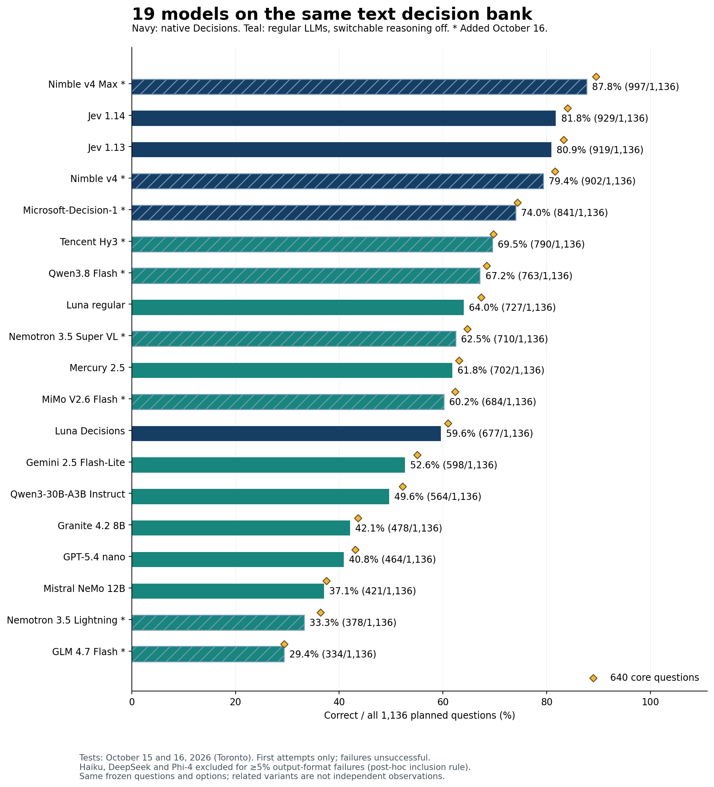
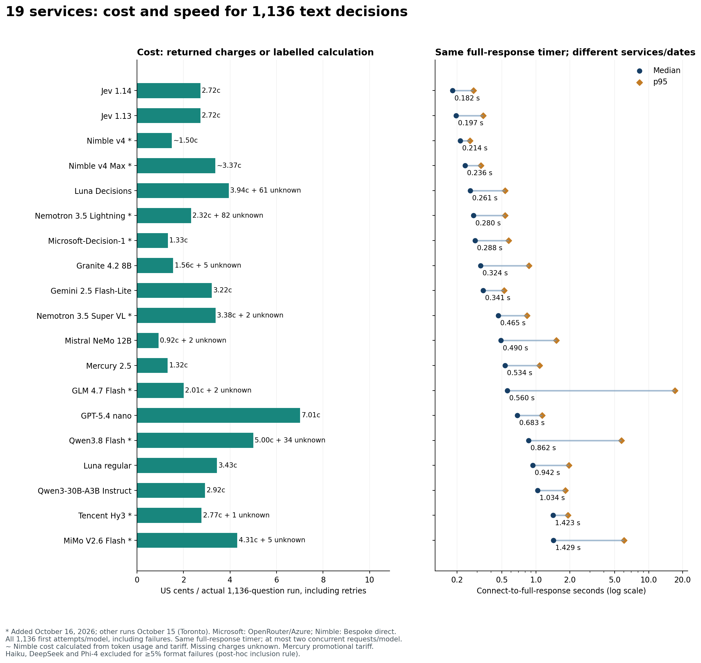
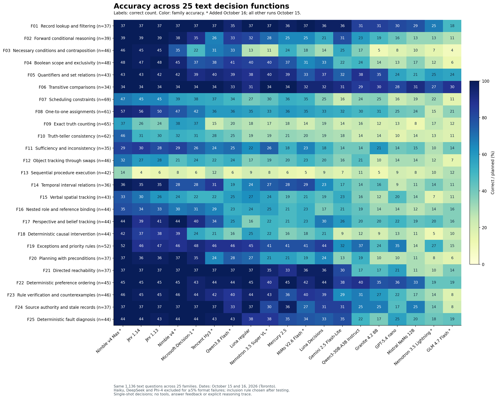

# {{MODEL_COUNT}} models on the same 1,136 text decisions

I have been intrigued by Jev because it does something different from the LLMs I usually use: it returns a typed decision with probabilities rather than a paragraph. That made it harder to place. Could it make better quick decisions than Luna, one of my favorite models? I wanted a comparison that would make its strengths and limits visible.

On these tests, the answer was clearly yes. Jev was substantially stronger than both Luna services overall. That is a finding about **System 1-style decisions**: a single answer from supplied information, without an explicit thinking budget, tools or an agentic feedback loop. Those decisions matter when a system needs to route many requests quickly and cheaply. This is not a comparison of unrestricted reasoning, writing or agentic ability.

{{LEAD_RESULTS}}

{{TEST_CONTEXT}}

The bank contains 640 core questions and 496 related variants, contrasts and candidate checks across 25 families. Related items are not independent observations. Every model received the same underlying instructions, facts, question and five answer options in the same order. Native Decisions and ordinary chat serialize that content differently.

The [function and load-level tables](FUNCTIONS.md) explain every family. The separate [image benchmark](https://github.com/etsabary/visual-decision-benchmark) is not pooled with the text scores.



## Results across the full bank

Models with at least 5% model-output failures are excluded from the main comparison. This author-requested, post-hoc reporting rule removes Haiku, DeepSeek and Phi-4 from the ranking, all function tables and charts. Their complete runs remain in the [separate diagnostics](OUTPUT_COMPLIANCE.md). Provider and transport failures do not count toward this format cutoff. Models below the cutoff retain every failed first attempt in their scores.

Every row uses the **first attempt**. Errors, refusals, invalid output and truncation are unsuccessful; wrong valid choices remain separate. The median and p95 use **all 1,136 timed first attempts per model**, including failures. p95 is the response time at or below which roughly 95% of requests completed.

{{RESULTS}}

All timers run from connection start through the complete response body. The same timing boundary and up to two concurrent requests per model are used across the October 15 and October 16 runs. Different dates, routes and provider load can still affect the comparison. Failure counts and usable-response timings remain available in the [overall aggregate evidence](../results/releases/overall_expanded_2026-10-16/summary.json).

## Cost of the full runs

Costs cover **1,136 questions per model**, including recovery attempts. The per-1,000 column normalizes the same run cost: run cost ÷ 1,136 × 1,000. It is not an additional run. Earlier pilots and superseded runs are excluded from these totals. Nimble returns token usage without a dollar charge, so its cost is calculated from that usage and the captured published tariff, rather than labelled API-reported billing. Free sign-up credit does not change the tariff value of the work.

{{COSTS}}

{{COST_CONTEXT}}



{{ADDITIONS_ANALYSIS}}

{{ANALYSIS}}

## Where Jev 1.14 improved over 1.13

{{VERSION_RESULTS}}

A one-to-one assignment means giving each person, object or time slot a unique partner while respecting clues. For example: three people need different desks; one cannot use the window desk and another must sit left of the third; which complete assignment satisfies every rule? Spatial tracking means updating a direction or position through described movements, such as following successive turns and then identifying where someone is facing. These illustrations explain the categories; they are not additional scored questions.

## Image decisions add another dimension

The separate [image benchmark](https://github.com/etsabary/visual-decision-benchmark) used 200 questions per configuration, tested on October 15, 2026. Its scores are unchanged. Mercury was not tested on images. On October 16, Microsoft explicitly rejected the native image request. Both Nimble versions accepted its image-shaped JSON and returned choices, but their [API contract](https://docs.bespokelabs.ai/api-reference/systemone) explicitly says that a JSON state is read as JSON text. Each probe billed 26,253 input tokens; accepting the encoded image data as text is not evidence of pixel processing. No native-image score is assigned to these three API routes, and the 200-question image bank was not run through a text substitute. The [capability record and probe costs](../results/releases/overall_2026-10-16/image_capabilities.json) and [sanitized responses](../results/releases/overall_2026-10-16/image_compatibility_probes.jsonl) retain the evidence. This concerns the tested APIs, not every possible future endpoint or capability of their underlying base models.

{{IMAGES}}

The image results show where the overall winner loses. Jev scored 9/10 on conditional counting, spatial relationships and flowcharts. Conditional counting means counting only objects meeting a rule, such as red shapes inside a marked region. A flowchart question asks a model to follow pictured branches for a supplied input and select the resulting outcome.

Luna Decisions was stronger on **rotation and reflection**, at 8/10 versus Jev's 3/10: recognizing which option is the rotated or mirrored version of a pictured shape. Regular Luna was stronger on **visual rule application**, at 6/10 versus Jev's 3/10: applying a pictured transformation or legend to choose the correct result. Both Luna services scored 7/10 on sequential visual state tracking, compared with Jev's 6/10. Each image family has only ten questions, so these are useful leads for further testing rather than broad reliability estimates.

{{PROCEDURE_CROSSOVER}}

The release's text gain should be distinguished from its broader features. In the [October 14 release announcement](https://typesafe.ai/blog/jev-1-14), TypeSafe describes incremental model improvements and expects the largest gain in multilingual support. We tested only English. The release also enabled experimental image input, a bounding-box output type and longer context. TypeSafe says 1.13 was already multimodal, and image access was enabled for it too; bounding-box output was specific to 1.14. Our image bank establishes behavior on the tested 1.14 OpenRouter route, not a measured vision improvement over 1.13. Bounding boxes, long-context quality and multilingual gains remain outside these tests.

## Accuracy across the 25 functions

Cell labels show correct counts; color shows accuracy within each family. The [function tables](FUNCTIONS.md) and [family CSV](../results/releases/overall_expanded_2026-10-16/family_comparison.csv) retain all denominators, including the new models.



## Matched diagnostic tests

Rotation and evidence-change scores use planned panel denominators, so missing answers cannot improve them. Semantic consistency is shown only among complete rotation panels; a consistent choice can still be wrong. Candidate-check scores include all 80 planned checks.

{{PANELS}}

## Output format and recovery

The leading-ID column is a **post-hoc sensitivity check**, applied uniformly to the saved regular-LLM runs. It reads a numeric answer ID at the start even if an explanation follows or later output is truncated. It adds no calls and does not replace the strict primary score. A larger output budget or reasoning-enabled evaluation would be a different experiment. Explanatory text without a leading answer ID is not converted into a guessed choice.

The three models above the output-failure cutoff appear only in the [diagnostics](OUTPUT_COMPLIANCE.md), not in this table. “Invalid first output” counts model-output failures; provider errors and incomplete response bodies appear in the separate failure column.

{{FORMAT}}

The native services return typed choices rather than generated answer IDs. A usable choice is scored even when its probability distribution has a rounding or normalization warning. Provider failures are unsuccessful first attempts, not demonstrated logical mistakes. The eventual scores below include the permitted recovery attempt and do not replace the main results.

{{NATIVE_OUTCOMES}}

## Confidence and coverage

Native Decisions services returned confidence and option probabilities. Their confidence values need not share a scale: Nimble defines confidence as concentration of the answer distribution, not the probability of being correct. Regular LLMs were asked only for an answer ID, so an equivalent confidence-filter comparison is unavailable. These thresholds use the selected native responses and remain exploratory because they were examined on the same bank.

{{CONFIDENCE}}

An observed error-free retained subset does not guarantee zero future error. Confidence should be validated on the caller's own tasks before it controls an automation decision.

## What changed in the rerun

The fresh three-model run replaced both scores and timings in the current comparison. The previous results remain archived, rather than being combined with new response times. The table separates gains and losses across individual questions; a small net change can conceal changes in both directions.

{{REPEAT}}

{{REPEAT_ANALYSIS}}

These repeats measure observed service variation as well as possible model behavior. The original Jev 1.13 run used several routes, and earlier runs had different retry rules. A changed answer alone does not establish a change in model weights.

## Measurement conditions and model identities

{{SESSIONS}}

All sessions used a new HTTPS connection for every attempt, a monotonic connection-to-full-body timer, and at most two concurrent requests per model in each two-question wave. Local preparation, queueing and retry waits were outside the response timer. The eight-LLM session allowed 16 requests globally; the three-model refresh allowed six. The seven October 16 regular-LLM processes ran independent waves, allowing up to 14 concurrent requests in total; GLM continued after the others had finished. The native-addition runner also allowed two per model, and both Nimble models together stayed within the documented four-request free-credit concurrency limit. The [addition transport](../scripts/added_decisions.py) retains the same timer operations as the [October 15 transport](../scripts/decision_refresh.py), with configurable host and endpoint path.

Ordinary LLMs used `/api/v1/chat/completions`, a 16-token cap, a numeric-ID-only instruction, and switchable reasoning disabled. Temperature was omitted in the original eight-LLM session and in the October 16 regular-LLM additions. This preserves that request protocol but does not establish equal provider-default sampling settings. Hidden reasoning was disabled; a model could still generate an explanation as its visible output, which was unusable under the answer-ID contract if it was not a complete numeric answer. OpenRouter native services used `/api/alpha/decisions` with backend selection and fallback disabled. Nimble used Bespoke's `/v1/systemone` directly, with the same original state, instructions and five answer options. No agentic iteration was requested. Backend hardware, routes, quantization and service interfaces differ. These are end-to-end service measurements, not isolated inference-speed measurements.

{{IDENTITIES}}

The refresh required the listed dated Jev and Luna Decisions checkpoints on every successful response. Microsoft likewise returned the required October 9 identity. Nimble was requested by its explicit v4 and v4 Max names, not `nimble-latest`; its API documentation says the response repeats the requested name, so this is not independent checkpoint attestation. Ordinary LLMs generally returned aliases, not dated checkpoints. Captured endpoint metadata is retained for [the eight LLMs](../results/releases/expansion_2026-10-15/model_metadata.json), [the original three native services](../results/runs/decision_refresh_2026-10-15/model_metadata.json), [the October 16 native additions](../results/runs/additions_2026-10-16) and [the October 16 regular LLM additions](../results/runs/llm_additions_2026-10-16).

GLM 5.3 Flash rejected the request to disable reasoning and was excluded before scoring. GLM 4.7 Flash replaced it with the author's approval. The [compatibility probes](../results/runs/llm_additions_2026-10-16/compatibility_probes.json) are separate from the 1,136-question runs and their costs.

## Evidence reproduction and limits

The [questions](../data/questions_1136.csv), [current overall summary](../results/releases/overall_expanded_2026-10-16/summary.json), [unchanged fourteen-model summary](../results/releases/overall_2026-10-16/summary.json), [regular-LLM addition ledgers](../results/runs/llm_additions_2026-10-16), [native October 16 ledgers](../results/runs/additions_2026-10-16), [unchanged eleven-model summary](../results/releases/matched_2026-10-15/summary.json), [October 15 native attempt ledger](../results/runs/decision_refresh_2026-10-15/attempts.jsonl), and [unchanged eight-LLM evidence](../results/releases/expansion_2026-10-15) preserve the comparison. Account metadata and credentials are excluded. Recorded model outputs are public; the answer key and individual correctness records remain private.

All new primary scores use first attempts; retries are limited to one recovery for transport failures or HTTP 408, 429 and 5xx responses. Valid wrong answers and format failures are never retried. Cost includes eligible recoveries; missing charges remain unknown, not zero. Nimble documents HTTP errors as uncharged, while transport timeouts with no response remain unknown.

The bank mixes 25 generated task families and dependent variants. It is not a standardized intelligence or deployment-safety test. The fixed key is unchanged, and this rerun does not add an independent audit of every printed question. Later key corrections should be versioned and applied to every saved response.

```bash
# Offline checks. No credentials, answer key or paid API calls.
python3 validate.py
python3 text_models.py
python3 matched_analysis.py
python3 overall_analysis.py
python3 text_additions.py
python3 -m unittest discover -p 'test_*.py'

# Reproduce scores using the external original key.
python3 matched_analysis.py --answer-key /path/to/answer_key.csv
python3 overall_analysis.py --answer-key /path/to/answer_key.csv
python3 text_additions.py --answer-key /path/to/answer_key.csv

# Rebuild current figures, README and Pages.
python3 -m pip install -r scripts/requirements-reports.txt
python3 plot_overall.py
python3 build_report.py
python3 freeze_expansion_checksums.py
```

The [original three-model report](THREE_MODEL_REFERENCE.md), its [frozen evidence](../data), and the [earlier eleven-model publication](https://github.com/etsabary/jev-1.14-comparison-benchmark/tree/b9c7b1f3abb0e1728c7b4f8585d027b3c3a82921) remain available. The earlier eight-LLM summary stays unchanged in its own directory. The [original Jev benchmark](https://github.com/etsabary/jev-deterministic-benchmark) and [two-model extension](https://github.com/etsabary/luna-decisions-benchmark/tree/0f10c51/extension_136) also remain reference points.
