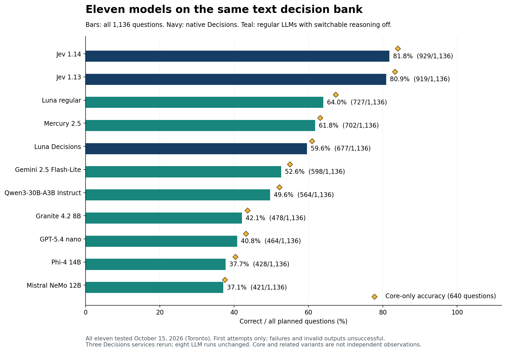
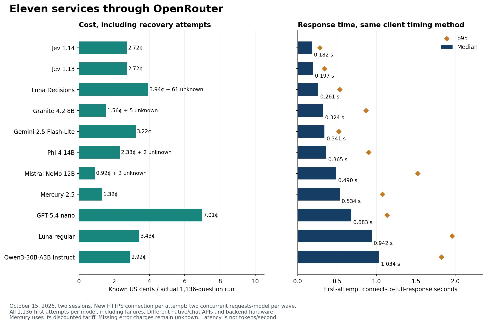
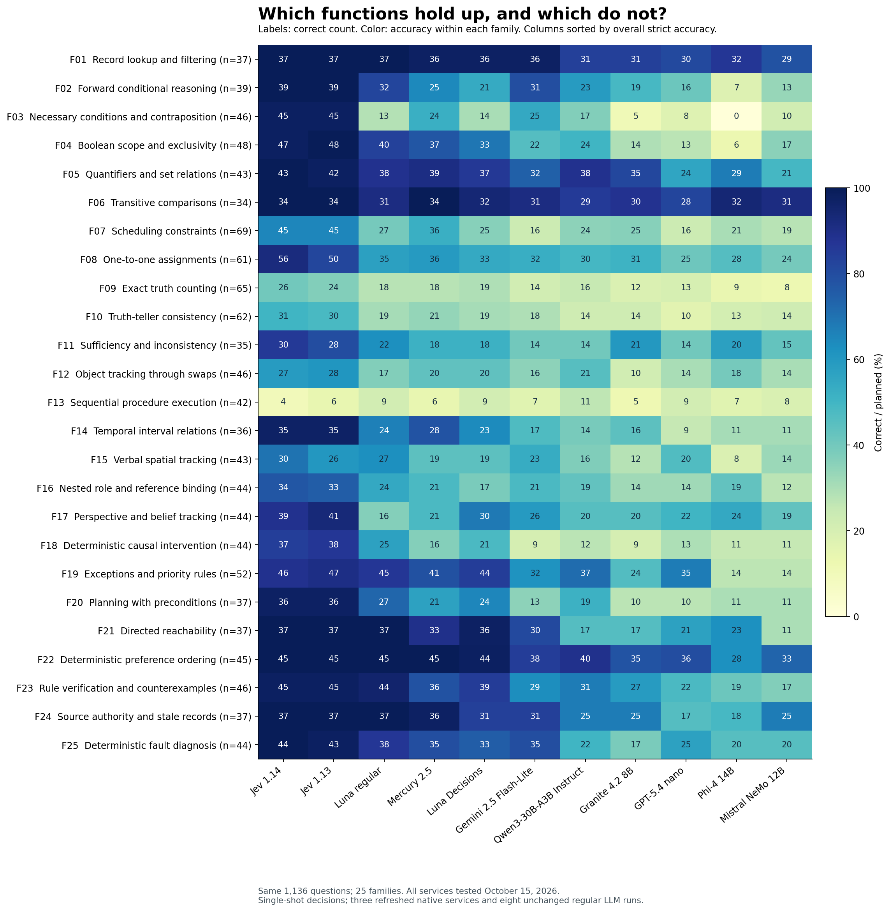

# Eleven models on the same 1,136 text decisions

I have been intrigued by Jev because it does something different from the LLMs I usually use: it returns a typed decision with probabilities rather than a paragraph. That made it harder to place. Could it make better quick decisions than Luna, one of my favorite models? I wanted a comparison that would make its strengths and limits visible.

On these tests, the answer was clearly yes. Jev was substantially stronger than both Luna services overall. That is a finding about **System 1-style decisions**: a single answer from supplied information, without an explicit thinking budget, tools or an agentic feedback loop. Those decisions matter when a system needs to route many requests quickly and cheaply. This is not a comparison of unrestricted reasoning, writing or agentic ability.

{{LEAD_RESULTS}}

All **11 model services × 1,136 questions = 12,496 scored model-question cases** were collected on **October 15, 2026**, through OpenRouter. The eight regular LLM runs are unchanged. Jev 1.13, Jev 1.14 and Luna Decisions were rerun later that day using the same HTTP timer and per-model concurrency. The main results use these fresh answers, scores, costs and speeds together.

The bank contains 640 core questions and 496 related variants, contrasts and candidate checks across 25 families. Related items are not independent observations. Every model received the same underlying instructions, facts, question and five answer options in the same order. Native Decisions and ordinary chat serialize that content differently.

The [function and load-level tables](FUNCTIONS.md) explain every family. The separate [image benchmark](https://github.com/etsabary/visual-decision-benchmark) is not pooled with the text scores.



## Results across the full bank

Every row uses the **first attempt**. Errors, refusals, invalid output and truncation are unsuccessful; wrong valid choices remain separate. The median and p95 use **all 1,136 timed first attempts per model**, including failures. p95 is the response time at or below which roughly 95% of requests completed.

{{RESULTS}}

All timers run from connection start through the complete response body. This removes the earlier mix of header-only and full-body measurements. The tests used two sessions on the same day, so changing provider load can still affect the comparison. Failure counts and usable-response timings remain available in the [aggregate evidence](matched_2026-10-15/summary.json).

## Cost of the eleven full runs

Costs cover **1,136 questions per model**, including recovery attempts. The per-1,000 column normalizes the same bill: reported run cost ÷ 1,136 × 1,000. It is not an additional run. Earlier pilots and superseded runs are excluded from these totals.

{{COSTS}}

{{COST_CONTEXT}}



{{ANALYSIS}}

## Where Jev 1.14 improved over 1.13

{{VERSION_RESULTS}}

A one-to-one assignment means giving each person, object or time slot a unique partner while respecting clues. For example: three people need different desks; one cannot use the window desk and another must sit left of the third; which complete assignment satisfies every rule? Spatial tracking means updating a direction or position through described movements, such as following successive turns and then identifying where someone is facing. These illustrations explain the categories; they are not additional scored questions.

## Image decisions add another dimension

The separate [image benchmark](https://github.com/etsabary/visual-decision-benchmark) used 200 questions per configuration, tested on October 15, 2026. Its scores are unchanged by this text rerun. Mercury was not tested on images.

{{IMAGES}}

The image results show where the overall winner loses. Jev scored 9/10 on conditional counting, spatial relationships and flowcharts. Conditional counting means counting only objects meeting a rule, such as red shapes inside a marked region. A flowchart question asks a model to follow pictured branches for a supplied input and select the resulting outcome.

Luna Decisions was stronger on **rotation and reflection**, at 8/10 versus Jev's 3/10: recognizing which option is the rotated or mirrored version of a pictured shape. Regular Luna was stronger on **visual rule application**, at 6/10 versus Jev's 3/10: applying a pictured transformation or legend to choose the correct result. Both Luna services scored 7/10 on sequential visual state tracking, compared with Jev's 6/10. Each image family has only ten questions, so these are useful leads for further testing rather than broad reliability estimates.

{{PROCEDURE_CROSSOVER}}

The release's text gain should be distinguished from its broader features. In the [October 14 release announcement](https://typesafe.ai/blog/jev-1-14), TypeSafe describes incremental model improvements and expects the largest gain in multilingual support. We tested only English. The release also enabled experimental image input, a bounding-box output type and longer context. TypeSafe says 1.13 was already multimodal, and image access was enabled for it too; bounding-box output was specific to 1.14. Our image bank establishes behavior on the tested 1.14 OpenRouter route, not a measured vision improvement over 1.13. Bounding boxes, long-context quality and multilingual gains remain outside these tests.

## Accuracy across the 25 functions

Cell labels show correct counts; color shows accuracy within each family. The [function tables](FUNCTIONS.md) and [family CSV](matched_2026-10-15/family_comparison.csv) retain all denominators.



## Matched diagnostic tests

Rotation and evidence-change scores use planned panel denominators, so missing answers cannot improve them. Semantic consistency is shown only among complete rotation panels; a consistent choice can still be wrong. Candidate-check scores include all 80 planned checks.

{{PANELS}}

## Output format and recovery

The leading-ID column is a **post-hoc sensitivity check**, applied uniformly to the eight saved LLM runs. It reads a numeric answer ID at the start even if an explanation follows or later output is truncated. It adds no calls and does not replace the strict primary score. A larger output budget or reasoning-enabled evaluation would be a different experiment.

{{FORMAT}}

The native services return typed choices rather than generated answer IDs. A usable choice is scored even when its probability distribution has a rounding or normalization warning. Provider failures are unsuccessful first attempts, not demonstrated logical mistakes. The eventual scores below include the permitted recovery attempt and do not replace the main results.

{{NATIVE_OUTCOMES}}

## Confidence and coverage

Native Decisions services returned confidence and option probabilities. Regular LLMs were asked only for an answer ID, so an equivalent confidence-filter comparison is unavailable. These thresholds use the fresh native responses and remain exploratory because they were examined on the same bank.

{{CONFIDENCE}}

An observed error-free retained subset does not guarantee zero future error. Confidence should be validated on the caller's own tasks before it controls an automation decision.

## What changed in the rerun

The fresh three-model run replaced both scores and timings in the current comparison. The previous results remain archived, rather than being combined with new response times. The table separates gains and losses across individual questions; a small net change can conceal changes in both directions.

{{REPEAT}}

{{REPEAT_ANALYSIS}}

These repeats measure observed service variation as well as possible model behavior. The original Jev 1.13 run used several routes, and earlier runs had different retry rules. A changed answer alone does not establish a change in model weights.

## Measurement conditions and model identities

{{SESSIONS}}

Both sessions used a new HTTPS connection for every attempt, a monotonic connection-to-full-body timer, and at most two concurrent requests per model in each two-question wave. Local preparation, queueing and retry waits were outside the response timer. The eight-LLM session allowed 16 requests globally; the three-model refresh allowed six. The [refresh transport](decision_refresh.py) uses the same HTTP timing function as the eight-LLM executor, with only the endpoint path changed.

Ordinary LLMs used `/api/v1/chat/completions`, a 16-token cap, a numeric-ID-only instruction, and switchable reasoning disabled. The native services used `/api/alpha/decisions` with the original typed-choice payloads. Backend providers were explicitly selected with fallback disabled. OpenRouter is the common front door, but backend hardware, quantization and service interfaces differ. These are end-to-end service measurements, not isolated inference-speed measurements.

{{IDENTITIES}}

The refresh required the listed dated Jev and Luna Decisions checkpoints on every successful response. Ordinary LLMs generally returned aliases, not dated checkpoints; an unchanged alias does not prove an unchanged hidden model. Captured endpoint metadata is retained for [the eight LLMs](expansion_2026-10-15/model_metadata.json) and [the three native services](decision_refresh_2026-10-15/model_metadata.json).

## Evidence reproduction and limits

The [questions](data/questions_1136.csv), [selected eleven-model summary](matched_2026-10-15/summary.json), [native request plan](decision_refresh_2026-10-15/request_plan.jsonl), [native attempt ledger](decision_refresh_2026-10-15/attempts.jsonl), [refresh protocol](decision_refresh_2026-10-15/run_manifest.json), and [unchanged eight-LLM evidence](expansion_2026-10-15) preserve the current comparison. Account metadata and credentials are excluded. Recorded model outputs are public; the answer key and individual correctness records remain private.

All new primary scores use first attempts; retries are limited to one recovery for transport failures or HTTP 408, 429 and 5xx responses. Valid wrong answers and format failures are never retried. Reported cost includes eligible recoveries; missing charges remain unknown, not zero.

The bank mixes 25 generated task families and dependent variants. It is not a standardized intelligence or deployment-safety test. The fixed key is unchanged, and this rerun does not add an independent audit of every printed question. Later key corrections should be versioned and applied to every saved response.

```bash
# Offline checks. No credentials, answer key or paid API calls.
python3 validate.py
python3 text_models.py
python3 matched_analysis.py
python3 -m unittest -v test_analysis.py test_text_models.py test_decision_refresh.py test_publication.py test_matched.py

# Reproduce scores using the external original key.
python3 matched_analysis.py --answer-key /path/to/answer_key.csv

# Rebuild current figures, README and Pages.
python3 -m pip install -r requirements-reports.txt
python3 plot_matched.py
python3 build_report.py
python3 freeze_expansion_checksums.py
```

The [original three-model report](THREE_MODEL_REFERENCE.md), its [frozen evidence](data), and the [earlier eleven-model publication](https://github.com/etsabary/jev-1.14-comparison-benchmark/tree/b9c7b1f3abb0e1728c7b4f8585d027b3c3a82921) remain available. The earlier eight-LLM summary stays unchanged in its own directory. The [original Jev benchmark](https://github.com/etsabary/jev-deterministic-benchmark) and [two-model extension](https://github.com/etsabary/luna-decisions-benchmark/tree/0f10c51/extension_136) also remain reference points.
